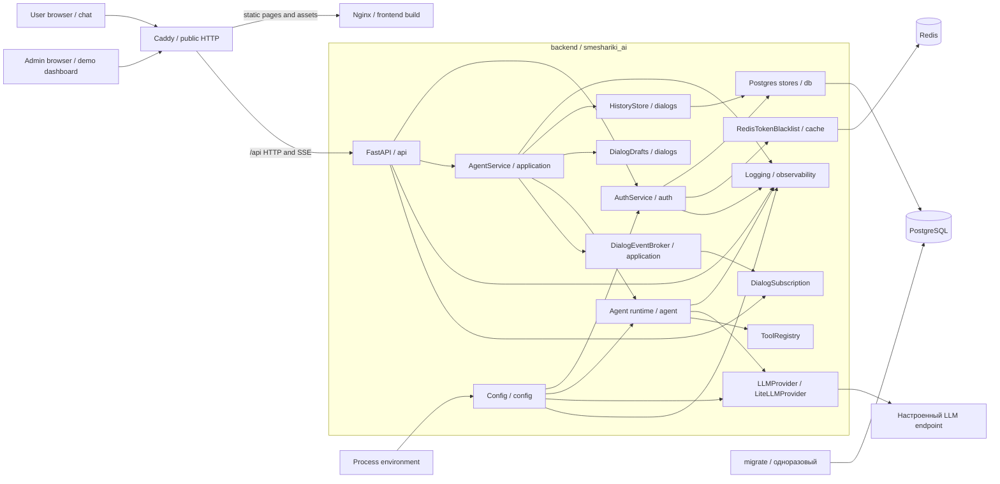

# Архитектура и контракты smeshariki-ai

Этот каталог помогает быстро найти архитектурные границы, пояснения по
фактической реализации и действующие контракты. Он не заменяет SDD-
спецификации: требования, сценарии, планы и доказательства проверки находятся
в [`specs/changes/`](../specs/changes/).

Если краткое описание расходится с последней согласованной спецификацией и её
результатом проверки, источником истины являются спецификация и
`verification.md`.

## Карта проекта

| Часть | Назначение | Где смотреть |
| --- | --- | --- |
| `frontend/` | Vanilla JavaScript чат по `/`, demo-макет панели администратора по `/admin/` и страница входа и регистрации по `/login/`: общий Vite build для Nginx и отдельный dev server | [Frontend](../frontend/) |
| `backend/` | Единое приложение с HTTP API, application-слоем и runtime агента | [Backend](../backend/) |
| `docker/` | Единый Compose запуск Caddy, Nginx/frontend, backend, PostgreSQL и Redis | [Запуск и конфигурация](../docker/README.md) |
| `docs/` | Глобальная карта и тематические страницы архитектуры и контрактов | [Текущий каталог](./README.md) |
| `specs/` | Полные SDD-спецификации, планы, результаты проверки и реестр состояний | [SDD-артефакты](../specs/) |

## Тематические страницы

- [Агент](./agent.md) — `Agent`, `LLMProvider`, инструменты, `ToolRegistry` и
  ограничения agent loop.
- [Диалоги и HTTP API](./dialogs.md) — `AgentService`, `DialogEventBroker`,
  жизненный цикл диалога (черновик и сохранение), хранение истории, список,
  чтение и удаление диалогов, очередь запросов, SSE, HTTP и наблюдаемость.
- [Конфигурация backend](./configuration.md) — корневой `Config`, загрузка
  environment и передача component-owned подконфигов.
- [Аутентификация](./auth.md) — HTTP-контракт регистрации, входа, refresh,
  выхода и текущего пользователя, JWT и refresh-токены в cookie, blacklist в
  Redis, защита от CSRF (`Sec-Fetch-Site`, `Content-Type`), отзыв семейства сессий и страница `/login/`.
- [Панель администратора](./admin.md) — статистика пользователей
  `GET /api/v1/admin/stats` с проверкой роли и демонстрационные показатели
  агента.
- [База данных](./database.md) — схема PostgreSQL (пользователи,
  refresh-сессии, диалоги и сообщения), `PostgresHistoryStore` и миграции.
- [Логирование backend](./logging.md) — форматы, общие поля, идентификаторы
  операций и метрики вызовов модели.
- [RAG](./rag.md) — границы модуля, гексагональные слои, PostgreSQL как
  единственное хранилище, путь пакетов знаний в БД, команды, изоляция и
  точки интеграции.
- [Модель знаний](./knowledge.md) — ER-модель структурированных знаний,
  идентичность, версии персонажей, варианты канона, источники, формат пакетов
  и их проверка.
- [Запуск приложения](../docker/README.md) — Docker Compose, настройки и примеры
  тестовых запросов.

## Архитектура

Backend является модульным монолитом. HTTP-слой вызывает application-сервис,
который координирует историю и независимый от транспорта runtime агента, и
сервис аутентификации, который работает с PostgreSQL и Redis через адаптеры.

Сборка конкретных зависимостей выполняется в
[`bootstrap.py`](../backend/src/smeshariki_ai/bootstrap.py). Внутренние слои не
создают LLM-провайдер, реестр инструментов, хранилище или брокер событий
самостоятельно.

## Состояния компонентов

Краткий источник текущего состояния SDD-изменений —
[`specs/status.yaml`](../specs/status.yaml). Каталог использует такое
отображение статусов:

| Статус SDD | Состояние в каталоге | Значение |
| --- | --- | --- |
| `draft` | Специфицировано | Требования ещё не завершены или не согласованы |
| `in-queue` | Запланировано | Спецификация согласована и ожидает выполнения |
| `in-progress` | Реализуется | По изменению идёт активная работа |
| `done` | Проверено | Реализация прошла verify и имеет успешный `verification.md` |

| Компонент | Назначение | Состояние | Где реализация | Где конкретика |
| --- | --- | --- | --- | --- |
| Каркас проекта | Границы frontend, модульного backend и служебных каталогов | Проверено | [`frontend/`](../frontend/), [`backend/`](../backend/) | [spec](../specs/changes/project-scaffold/spec.md), [plan](../specs/changes/project-scaffold/plan.md), [verification](../specs/changes/project-scaffold/verification.md) |
| Контейнерный запуск | Caddy как единая точка входа, Nginx/frontend и backend в одном Compose проекте; собственный `nginx.conf` с относительными редиректами и политикой кэширования | Проверено | [`docker/`](../docker/) | [spec](../specs/changes/compose-caddy-nginx-stack/spec.md), [plan](../specs/changes/compose-caddy-nginx-stack/plan.md), [verification](../specs/changes/compose-caddy-nginx-stack/verification.md), [nginx spec](../specs/changes/frontend-nginx-config/spec.md), [nginx verification](../specs/changes/frontend-nginx-config/verification.md) |
| Frontend-чат | Исходный масштаб на ноутбуках, плавное увеличение на широких экранах, мобильный режим без декоративной сцены, подсказка Кроша до нажатия на textarea или выбора типа истории, создание диалога с повтором, отправка запроса и потоковое отображение SSE-ответа | Проверено | [`frontend/src/`](../frontend/src/) | [описание](../frontend/README.md), [hint spec](../specs/changes/frontend-krosh-hint-input-dismiss/spec.md), [hint plan](../specs/changes/frontend-krosh-hint-input-dismiss/plan.md), [hint verification](../specs/changes/frontend-krosh-hint-input-dismiss/verification.md), [laptop/mobile spec](../specs/changes/frontend-laptop-baseline-mobile-chat/spec.md), [laptop/mobile verification](../specs/changes/frontend-laptop-baseline-mobile-chat/verification.md), [responsive spec](../specs/changes/frontend-responsive-layout/spec.md), [responsive verification](../specs/changes/frontend-responsive-layout/verification.md), [integration spec](../specs/changes/frontend-agent-integration/spec.md), [integration verification](../specs/changes/frontend-agent-integration/verification.md), [retry spec](../specs/changes/frontend-dialog-retry/spec.md), [retry verification](../specs/changes/frontend-dialog-retry/verification.md), [fetch spec](../specs/changes/frontend-fetch-binding/spec.md), [fetch verification](../specs/changes/frontend-fetch-binding/verification.md) |
| Admin dashboard | Панель `/admin/` для роли `admin`: статистика и список пользователей из PostgreSQL через `GET /api/v1/admin/stats`, показатели агента на помеченных demo-данных | Проверено | [`frontend/src/admin/`](../frontend/src/admin/), [`admin`](../backend/src/smeshariki_ai/admin/), [`api/admin.py`](../backend/src/smeshariki_ai/api/admin.py) | [страница компонента](./admin.md), [описание](../frontend/README.md), [stats spec](../specs/changes/admin-user-stats/spec.md), [stats verification](../specs/changes/admin-user-stats/verification.md), [spec](../specs/changes/admin-dashboard-frontend/spec.md), [plan](../specs/changes/admin-dashboard-frontend/plan.md), [verification](../specs/changes/admin-dashboard-frontend/verification.md), [navigation spec](../specs/changes/admin-active-navigation/spec.md), [navigation verification](../specs/changes/admin-active-navigation/verification.md) |
| Страница авторизации | Страница `/login/` со входом и регистрацией, клиент контракта аутентификации и общая проверка сессии с `refresh` и переходами по роли для `/`, `/admin/` и `/login/` | Проверено | [`frontend/src/login/`](../frontend/src/login/), [`auth-api.js`](../frontend/src/auth-api.js) | [страница компонента](./auth.md), [spec](../specs/changes/auth-frontend-contract/spec.md), [plan](../specs/changes/auth-frontend-contract/plan.md), [verification](../specs/changes/auth-frontend-contract/verification.md), [redesign spec](../specs/changes/login-page-redesign/spec.md), [redesign verification](../specs/changes/login-page-redesign/verification.md) |
| Аутентификация backend | Регистрация, вход, access JWT, ротация refresh-токенов, blacklist в Redis, пользователи в PostgreSQL, защита ручек диалогов, проверки `Sec-Fetch-Site` и `Content-Type`, отзыв семейства сессий, перепроверка SSE, ограничение частоты входа и регистрации (Redis), блокировка refresh между вкладками и команда `make create-admin` | Проверено | [`auth`](../backend/src/smeshariki_ai/auth/), [`api/auth.py`](../backend/src/smeshariki_ai/api/auth.py), [`db`](../backend/src/smeshariki_ai/db/), [`cache`](../backend/src/smeshariki_ai/cache/) | [страница компонента](./auth.md), [схема БД](./database.md), [spec](../specs/changes/backend-auth-jwt/spec.md), [plan](../specs/changes/backend-auth-jwt/plan.md), [verification](../specs/changes/backend-auth-jwt/verification.md), [guard spec](../specs/changes/auth-route-guard/spec.md), [guard plan](../specs/changes/auth-route-guard/plan.md), [guard verification](../specs/changes/auth-route-guard/verification.md), [hardening spec](../specs/changes/auth-hardening/spec.md), [hardening plan](../specs/changes/auth-hardening/plan.md), [hardening verification](../specs/changes/auth-hardening/verification.md), [rate limit spec](../specs/changes/auth-rate-limit/spec.md), [rate limit plan](../specs/changes/auth-rate-limit/plan.md), [rate limit verification](../specs/changes/auth-rate-limit/verification.md) |
| Agent runtime | Собственный ограниченный tool-calling loop и независимые контракты LLM и инструментов | Проверено | [`smeshariki_ai/agent`](../backend/src/smeshariki_ai/agent/) | [страница компонента](./agent.md), [spec](../specs/changes/agent-runtime/spec.md), [plan](../specs/changes/agent-runtime/plan.md), [verification](../specs/changes/agent-runtime/verification.md) |
| Инструмент `get_context` | Возвращает агенту фиксированный демонстрационный текст через `ToolRegistry` | Проверено | [`get_context.py`](../backend/src/smeshariki_ai/agent/get_context.py) | [страница компонента](./agent.md), [spec](../specs/changes/get-context-example/spec.md), [plan](../specs/changes/get-context-example/plan.md), [verification](../specs/changes/get-context-example/verification.md) |
| Архитектура RAG | Границы, слои, хранилище и модель структурированных знаний | Проверено | — | [страница RAG](./rag.md), [модель знаний](./knowledge.md), [spec](../specs/changes/rag-architecture/spec.md), [plan](../specs/changes/rag-architecture/plan.md) |
| Каталог знаний | Формат пакетов структурированных знаний, правила целостности и команды `check` и `schema` | Проверено | [`smeshariki_ai/rag`](../backend/src/smeshariki_ai/rag/) | [модель знаний](./knowledge.md), [spec](../specs/changes/knowledge-catalog/spec.md), [plan](../specs/changes/knowledge-catalog/plan.md), [verification](../specs/changes/knowledge-catalog/verification.md) |
| LiteLLM-провайдер | Асинхронный production-адаптер Chat Completions и отдельная provider-конфигурация | Проверено | [`agent/providers`](../backend/src/smeshariki_ai/agent/providers/) | [страница компонента](./agent.md), [spec](../specs/changes/litellm-provider/spec.md), [plan](../specs/changes/litellm-provider/plan.md), [verification](../specs/changes/litellm-provider/verification.md) |
| Конфигурация backend | Единая загрузка environment, корневой immutable `Config` и раздача подконфигов | Проверено | [`config.py`](../backend/src/smeshariki_ai/config.py), [`main.py`](../backend/src/smeshariki_ai/main.py), [`bootstrap.py`](../backend/src/smeshariki_ai/bootstrap.py) | [страница компонента](./configuration.md), [spec](../specs/changes/backend-config/spec.md), [plan](../specs/changes/backend-config/plan.md), [verification](../specs/changes/backend-config/verification.md) |
| Диалоги и HTTP API | Создание диалогов, фоновая очередь сообщений, история, владелец диалога и HTTP-вход | Проверено | [`application`](../backend/src/smeshariki_ai/application/), [`dialogs`](../backend/src/smeshariki_ai/dialogs/), [`api`](../backend/src/smeshariki_ai/api/) | [страница компонента](./dialogs.md), [spec](../specs/changes/agent-dialog-api/spec.md), [plan](../specs/changes/agent-dialog-api/plan.md), [verification](../specs/changes/agent-dialog-api/verification.md), [ownership spec](../specs/changes/dialog-ownership/spec.md), [ownership plan](../specs/changes/dialog-ownership/plan.md), [ownership verification](../specs/changes/dialog-ownership/verification.md) |
| Streaming, SSE и тестовый UI | Поток LiteLLM и агента, in-memory SSE-подписки и `/agent_test` | Проверено | [`agent`](../backend/src/smeshariki_ai/agent/), [`application`](../backend/src/smeshariki_ai/application/), [`api`](../backend/src/smeshariki_ai/api/) | [страница агента](./agent.md), [страница API](./dialogs.md), [spec](../specs/changes/agent-sse-test-ui/spec.md), [plan](../specs/changes/agent-sse-test-ui/plan.md), [verification](../specs/changes/agent-sse-test-ui/verification.md) |
| Постоянная история диалогов | Черновик диалога в памяти, сохранение в PostgreSQL после первого ответа агента, список с keyset-курсором, чтение и удаление диалога | Проверено | [`dialogs`](../backend/src/smeshariki_ai/dialogs/), [`db/history.py`](../backend/src/smeshariki_ai/db/history.py), [`application`](../backend/src/smeshariki_ai/application/), [`api`](../backend/src/smeshariki_ai/api/) | [страница компонента](./dialogs.md), [схема БД](./database.md), [spec](../specs/changes/dialog-history/spec.md), [plan](../specs/changes/dialog-history/plan.md), [verification](../specs/changes/dialog-history/verification.md) |
| Брокер событий диалога | Абстракция pub/sub и process-local реализация ограниченных SSE-очередей | Проверено | [`event_broker.py`](../backend/src/smeshariki_ai/application/event_broker.py) | [страница компонента](./dialogs.md), [spec](../specs/changes/dialog-event-broker/spec.md), [plan](../specs/changes/dialog-event-broker/plan.md), [verification](../specs/changes/dialog-event-broker/verification.md) |
| Логирование backend | Настраиваемые события HTTP, фоновой обработки и LLM с безопасным контекстом | Проверено | [`observability.py`](../backend/src/smeshariki_ai/observability.py) | [страница компонента](./logging.md), [spec](../specs/changes/backend-observability-logging/spec.md), [plan](../specs/changes/backend-observability-logging/plan.md), [verification](../specs/changes/backend-observability-logging/verification.md) |

Прогресс отдельных задач здесь не ведётся: он остаётся в соответствующих SDD-
артефактах.

## Что пока не реализовано

Публичный HTTPS deployment, RAG и его инструменты, CORS,
replay SSE-событий, интерфейс истории диалогов во frontend, автоматический refresh во frontend, закрытие чата для
гостей относятся к будущим изменениям. Текущий Compose stack предоставляет локальный HTTP-вход;
Vite proxy остаётся отдельным dev-режимом.
