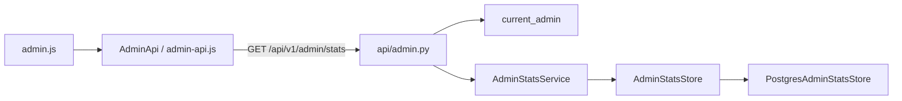

# Панель администратора

[← Глобальный каталог](./README.md)

Панель `/admin/` показывает администратору статистику пользователей из
PostgreSQL и демонстрационные показатели агента. Доступ к странице и к API
ограничен ролью `admin`; администратор создаётся командой
`make create-admin LOGIN=<login>` (см. [аутентификацию](./auth.md#создание-администратора)).

## Источники данных

| Блок панели | Источник |
| --- | --- |
| «Всего пользователей», «Активные пользователи», «Новых пользователей», «Последние пользователи» | `GET /api/v1/admin/stats` (PostgreSQL) |
| «Диалоги», «Сообщения», «Активность диалогов», «Качество ответов» | локальные demo-данные `frontend/src/admin/demo-data.js`, помечены «демо-данные» |
| Колонка «Диалоги» в списке пользователей | «—»: диалоги пока не привязаны к пользователям |

Показатели агента останутся демонстрационными, пока диалоги, сообщения и
результаты запусков агента не сохраняются в базе (таблицы `dialogs` и
`messages` запланированы в [схеме БД](./database.md)).

## HTTP-контракт

`GET /api/v1/admin/stats?period=<7|30|90>`:

```json
{
  "period": "30",
  "users_total": 6,
  "active_users": 4,
  "new_users": 2,
  "recent_users": [
    {
      "id": "<uuid>",
      "login": "krosh",
      "role": "user",
      "registered_at": "2026-10-14T09:00:00Z",
      "last_active_at": "2026-10-16T10:12:00Z",
      "status": "new"
    }
  ]
}
```

Окно — `[now − period дней, now]`:

- `users_total` — все пользователи; `new_users` — `users.created_at` в окне;
- `active_users` — различные пользователи с refresh-сессией, созданной в окне
  (вход или продление сессии);
- `recent_users` — до 5 пользователей по убыванию последней активности
  (`max(refresh_sessions.created_at)`, иначе время регистрации);
- `status` — `new` при регистрации в окне, иначе `active` при активности в
  окне, иначе `inactive`.

Ошибки в формате `{"error": ...}`: `401 unauthorized` без сессии, `403
forbidden` для роли `user`, `503 unavailable` при недоступности PostgreSQL или
Redis. Роль проверяется зависимостью `current_admin` до валидации `period`;
администратор с неверным `period` получает `422` в формате FastAPI. Ответ не
содержит хешей паролей и токенов, журнал — логинов.

## Реализация



- `smeshariki_ai.admin` — модели, контракт `AdminStatsStore` и
  `AdminStatsService` (окно по часам и статусы); не зависит от FastAPI и
  SQLAlchemy.
- `smeshariki_ai.db.PostgresAdminStatsStore` — подсчёт одним соединением по
  таблицам `users` и `refresh_sessions`; ошибки БД превращаются в
  `AdminStatsUnavailableError`. Миграции не требуются.
- Bootstrap передаёт `AdminStatsService` в `create_app(admin_stats=...)`; без
  него ручка отвечает `503`.
- Frontend: `AdminApi.stats(period)` переводит ответы в коды `unauthorized`,
  `forbidden`, `unavailable`, `invalid_response`. Панель загружает статистику
  после проверки роли и при смене периода, блокируя кнопки периода на время
  запроса; `401` ведёт на `/login/`, `403` — в `/`, остальные ошибки
  показывают сообщение без данных пользователей.

## SDD-артефакты

- [спецификация](../specs/changes/admin-user-stats/spec.md),
  [план](../specs/changes/admin-user-stats/plan.md),
  [результат проверки](../specs/changes/admin-user-stats/verification.md).
