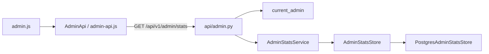

# Панель администратора

[← Глобальный каталог](./README.md)

Панель `/admin/` показывает администратору статистику пользователей, историй
и сообщений из PostgreSQL; демо-данных в панели нет
([admin-real-dialog-stats](../specs/changes/admin-real-dialog-stats/spec.md)). Доступ к странице и к API
ограничен ролью `admin`; администратор создаётся командой
`make create-admin LOGIN=<login>` (см. [аутентификацию](./auth.md#создание-администратора)).

## Источники данных

| Блок панели | Источник |
| --- | --- |
| «Всего пользователей», «Активные пользователи», «Новых пользователей», «Последние пользователи» | `GET /api/v1/admin/stats` (PostgreSQL) |
| «Качество ответов» | блок `feedback` из `GET /api/v1/admin/stats` (оценки пользователей в PostgreSQL) |
| Раздел «Жалобы», счётчик в навигации | `GET /api/v1/admin/reports`, `PATCH /api/v1/admin/reports/{id}`; счётчик — `reports_new` из `GET /api/v1/admin/stats` |
| «Диалоги», «Сообщения», «Активность диалогов» | `dialogs`, `messages`, `activity` из `GET /api/v1/admin/stats` (PostgreSQL) |
| Колонка «Диалоги» в списке пользователей | `recent_users[].dialogs` из `GET /api/v1/admin/stats` |

Блок «Качество ответов» показывает среднюю оценку из 5 с одной цифрой после
запятой, «оценено N из M ответов» и пять полос от 5 к 1 (балл числом, доля
от числа оценок, количество); без оценок — «Оценок пока нет». Мордашки
Смешариков остаются только в чате. Среднее считает frontend из `counts`.
Тексты ответов и авторы оценок в блок не выводятся
([answer-rating-faces](../specs/changes/answer-rating-faces/spec.md),
[admin-quality-numbers](../specs/changes/admin-quality-numbers/spec.md)).

Кнопка «Настройки» над «Выйти» в боковой панели (на узких экранах — рядом с
«Выйти» в правом верхнем углу) открывает то же окно смены пароля, что и в
чате ([Аутентификация](./auth.md#смена-пароля),
[admin-settings-password](../specs/changes/admin-settings-password/spec.md)).
Оценки историй, удалённых пользователем, удаляются вместе с ними и больше не
учитываются ([dialog-delete](../specs/changes/dialog-delete/spec.md)).

## HTTP-контракт

`GET /api/v1/admin/stats?period=<7|30|90>`:

```json
{
  "period": "30",
  "users_total": 6,
  "active_users": 4,
  "new_users": 2,
  "recent_users": [
    {
      "id": "<uuid>",
      "login": "krosh",
      "role": "user",
      "registered_at": "2026-10-14T09:00:00Z",
      "last_active_at": "2026-10-16T10:12:00Z",
      "status": "new",
      "dialogs": 3
    }
  ],
  "feedback": {
    "answers_total": 10,
    "rated_answers": 5,
    "counts": [1, 0, 1, 1, 2]
  },
  "reports_new": 1,
  "dialogs": 4,
  "messages": 26,
  "activity": [
    { "start": "2026-09-18T12:00:00Z", "dialogs": 1 },
    { "start": "2026-09-21T12:00:00Z", "dialogs": 0 }
  ]
}
```

(`activity` сокращён: для 30 дней в нём 10 отрезков.)

Окно — `[now − period дней, now]`:

- `users_total` — все пользователи; `new_users` — `users.created_at` в окне;
- `active_users` — различные пользователи с refresh-сессией, созданной в окне
  (вход или продление сессии);
- `recent_users` — до 5 пользователей по убыванию последней активности
  (`max(refresh_sessions.created_at)`, иначе время регистрации);
- `status` — `new` при регистрации в окне, иначе `active` при активности в
  окне, иначе `inactive`; панель его не показывает: в списке вместо статуса
  колонка «Регистрация» с датой `registered_at` («сегодня», «вчера», «12
  окт.»)
  ([admin-user-registered-column](../specs/changes/admin-user-registered-column/spec.md));
- `feedback.answers_total` — ответы ассистента, созданные в окне;
  `rated_answers` — сколько из них оценено; `counts[i]` — число оценок
  с баллом `i + 1` (1–5), `sum(counts) == rated_answers`;
- `reports_new` — число жалоб в статусе `new` без учёта периода;
- история — диалог хотя бы с одним сообщением: пустые диалоги создаются при
  каждом открытии чата и не считаются; удалённые истории не учитываются;
- `dialogs` — истории, созданные в окне; `messages` — сообщения
  пользователя и ассистента, созданные в окне;
- `activity` — равные отрезки окна от старого к новому (7 дней — 7 по 1
  дню, 30 — 10 по 3 дня, 90 — 9 по 10 дней): `start` — начало отрезка,
  `dialogs` — истории, созданные в нём; сумма равна `dialogs`;
- `recent_users[].dialogs` — истории пользователя за всё время.

График «Активность диалогов» подписывает столбцы датой начала отрезка; если
историй за период нет, поверх нулевых столбцов написано «Историй за период
нет».

Ошибки в формате `{"error": ...}`: `401 unauthorized` без сессии, `403
forbidden` для роли `user`, `503 unavailable` при недоступности PostgreSQL или
Redis. Роль проверяется зависимостью `current_admin` до валидации `period`;
администратор с неверным `period` получает `422` в формате FastAPI. Ответ не
содержит хешей паролей и токенов, журнал — логинов.

## Жалобы на ответы

Раздел `#reports` показывает жалобы пользователей на ответы ассистента
([message-report](../specs/changes/message-report/spec.md)). Это единственное
место панели, где администратор видит тексты: причину, комментарий, запрос и
ответ (копии, сохранённые при подаче), дату и пометку «история удалена». Кто
пожаловался, не передаётся. Фильтр «Новые / Рассмотренные / Отклонённые / Все»,
у новой жалобы — «Рассмотрено» и «Отклонить», у закрытой — «Вернуть в
новые»; после действия список перезагружается, а счётчик в навигации
меняется на единицу. Тексты выводятся только через `textContent`.
Пользователь узнаёт о закрытии жалобы из нейтральной плашки Кроша в чате;
«Рассмотрено» и «Отклонить» для него выглядят одинаково
([report-feedback-to-user](../specs/changes/report-feedback-to-user/spec.md)).

`GET /api/v1/admin/reports?status=<new|resolved|dismissed|all>` (по умолчанию
`new`) — до 50 жалоб от новых к старым:

```json
{
  "reports": [
    {
      "id": 1,
      "reason": "rude",
      "comment": "Обидно",
      "request_text": "Расскажи про Нюшу",
      "answer_text": "…",
      "status": "new",
      "created_at": "2026-10-18T16:15:00Z",
      "resolved_at": null,
      "dialog_deleted": false
    }
  ]
}
```

`PATCH /api/v1/admin/reports/{id}` с `{"status": "resolved"|"dismissed"|"new"}`
отвечает `204`; закрытие записывает `resolved_at` и администратора, `new`
обнуляет их. Неизвестный `id` — `404 {"error":"not_found"}`. Права и ошибки
как у статистики: `401`/`403`/`503` проверяются до валидации, неверные
`status`, тело или `id` вне диапазона 1…2⁶³−1 дают `422` в формате FastAPI. Журнал содержит
`admin.report.status_changed` с `report_id` и `status`, без текстов.

## Реализация



- `smeshariki_ai.admin` — модели, контракт `AdminStatsStore` и
  `AdminStatsService` (окно по часам и статусы); не зависит от FastAPI и
  SQLAlchemy.
- `smeshariki_ai.db.PostgresAdminStatsStore` — подсчёт одним соединением по
  таблицам `users`, `refresh_sessions`, `dialogs`, `messages` и
  `message_feedback`; отрезок истории —
  `floor((created_at − since) / bucket)`. Ошибки БД превращаются в
  `AdminStatsUnavailableError`. Миграции не требуются.
- Bootstrap передаёт `AdminStatsService` в `create_app(admin_stats=...)`; без
  него ручка отвечает `503`.
- Жалобы: контракт `ReportStore` и `AdminReportsService` в
  `smeshariki_ai.admin`, `PostgresReportStore` в `db/reports.py`; bootstrap
  передаёт сервис в `create_app(admin_reports=...)`, без него ручки жалоб
  отвечают `503`. Frontend: `AdminApi.listReports(filter)`,
  `AdminApi.setReportStatus(id, status)` и `mountReports` в `admin.js`.
- Frontend: `AdminApi.stats(period)` переводит ответы в коды `unauthorized`,
  `forbidden`, `unavailable`, `invalid_response`. Панель загружает статистику
  после проверки роли и при смене периода, блокируя кнопки периода на время
  запроса; `401` ведёт на `/login/`, `403` — в `/`, остальные ошибки
  показывают сообщение без данных пользователей.

## SDD-артефакты

- жалобы: [спецификация](../specs/changes/message-report/spec.md),
  [план](../specs/changes/message-report/plan.md),
  [результат проверки](../specs/changes/message-report/verification.md);
- [спецификация](../specs/changes/admin-user-stats/spec.md),
  [план](../specs/changes/admin-user-stats/plan.md),
  [результат проверки](../specs/changes/admin-user-stats/verification.md).
