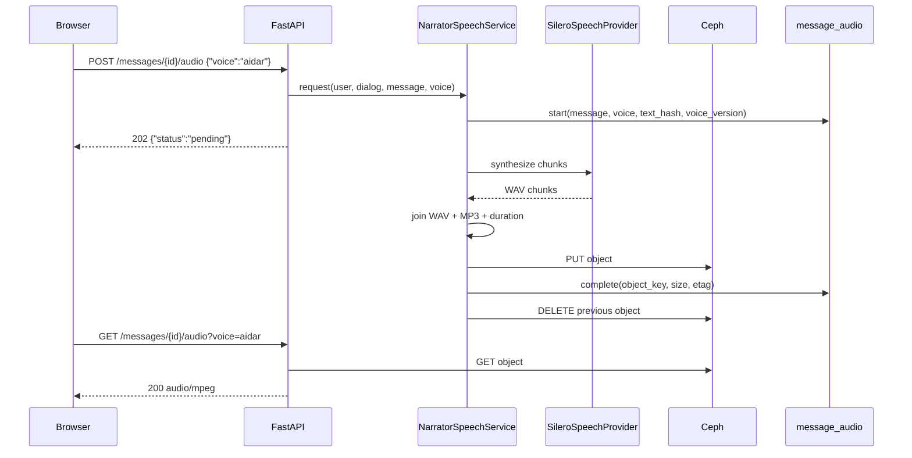

# Озвучка сказок

[← Глобальный каталог](./README.md)

Озвучка — локальная post-processing-функция backend. Она не участвует в
agent loop и не меняет текст истории. Пользователь выбирает голос в чате,
нажимает «Озвучить» у завершённого ответа, backend синтезирует MP3 и кладёт
его в Ceph. Метаданные генерации остаются в PostgreSQL.

## Границы

- Синтез выполняется локально на CPU моделью Silero TTS v5 (`v5_ru`).
- Доступны встроенные голоса `aidar`, `baya`, `kseniya`, `xenia`, `eugene`.
- Выбор голоса хранится только во frontend в `localStorage`.
- Внешние TTS-сервисы не используются; модель не скачивается во время
  выполнения запроса.
- Озвучивается только сохранённый ответ ассистента в диалоге пользователя.
- MP3 хранится в приватном Ceph bucket; прямой публичный URL не выдаётся.
- Готовая запись отдаётся авторизованному владельцу диалога.

## Где находится реализация

- [`speech/service.py`](../backend/src/smeshariki_ai/speech/service.py) —
  `NarratorSpeechService`;
- [`speech/silero.py`](../backend/src/smeshariki_ai/speech/silero.py) —
  CPU-адаптер Silero v5;
- [`speech/objects.py`](../backend/src/smeshariki_ai/speech/objects.py) —
  контракт `AudioObjectStore`;
- [`speech/ceph.py`](../backend/src/smeshariki_ai/speech/ceph.py) — S3-клиент
  Ceph RGW;
- [`speech/encoder.py`](../backend/src/smeshariki_ai/speech/encoder.py) —
  склейка WAV и MP3-кодирование через `ffmpeg`;
- [`speech/normalize.py`](../backend/src/smeshariki_ai/speech/normalize.py) —
  нормализация и нарезка текста;
- [`speech/store.py`](../backend/src/smeshariki_ai/speech/store.py) и
  [`db/audio.py`](../backend/src/smeshariki_ai/db/audio.py) — контракт и
  PostgreSQL-хранилище метаданных;
- [`api/app.py`](../backend/src/smeshariki_ai/api/app.py) — HTTP-ручки;
- [`docker/fetch-silero.sh`](../docker/fetch-silero.sh) — загрузка модели;
- [`frontend/src/script.js`](../frontend/src/script.js) — выбор голоса,
  компактный плеер, polling и скачивание.

## Поток



Каждый `POST` запускает новую генерацию, даже если готовая запись уже есть.
Старый MP3 остаётся доступным до успешного завершения новой генерации. Если
новая генерация завершилась ошибкой, старый объект и метаданные не меняются.

Синтез идёт в отдельном потоке; одновременных генераций не больше
`SPEECH_MAX_CONCURRENCY` (по умолчанию одна). Задачи отслеживаются и
отменяются при shutdown.

## Контракт API

| Запрос | Ответ |
| --- | --- |
| `POST /api/v1/dialogs/{dialog_id}/messages/{message_id}/audio` с `{"voice":"aidar"}` | `202 {"status":"pending"}`; каждый запрос запускает новую генерацию |
| `GET /api/v1/dialogs/{dialog_id}/messages/{message_id}/audio?voice=aidar` | `202`, пока объекта нет; `200 audio/mpeg`, если есть готовый объект; `404` для чужого/неизвестного/пользовательского сообщения; `503` при ошибке Ceph или отключённой озвучке |
| `GET .../audio?voice=aidar&download=1` | тот же MP3 с `Content-Disposition: attachment; filename="smeshariki-<message_id>-aidar.mp3"` |

Без `voice` используется `SPEECH_VOICE`. Неизвестный голос даёт `422`.
`GET /api/v1/dialogs/{dialog_id}/messages` возвращает `audio_voices` — список
голосов, для которых в Ceph есть готовая запись.

## Хранение

MP3 хранится в Ceph по ключу:

```text
smeshariki-audio/{dialog_id}/{message_id}/{voice_id}/{generation_id}.mp3
```

`message_audio` (миграции `0013`, `0014`) хранит:

- `message_id`, `voice_id` — составной ключ;
- `status` — `pending`, `ready` или `failed`;
- `text_hash` — SHA-256 исходного текста;
- `voice_version` — модель, голос, скорость и версия нормализации;
- `object_key`, `size_bytes`, `etag`;
- `mime_type`, `duration_ms`, `error_code`;
- `created_at`, `updated_at`.

`audio_data` оставлен nullable только для ленивого переноса старых записей в
Ceph; новые MP3 в PostgreSQL не пишутся. Удаление диалога каскадно удаляет
метаданные; объекты Ceph очищаются сервисом озвучки.

## Конфигурация

| Переменная | Значение по умолчанию | Назначение |
| --- | --- | --- |
| `SPEECH_ENABLED` | `true` | Включает локальную озвучку |
| `SPEECH_VOICE` | `baya` | Голос, если клиент не передал `voice` |
| `SPEECH_SPEED` | `1.0` | Скорость речи, `0.5…2.0` |
| `SPEECH_MAX_CONCURRENCY` | `1` | Одновременных CPU-синтезов |
| `SPEECH_MAX_TEXT_CHARS` | `20000` | Максимальная длина ответа |
| `SPEECH_MODEL_PATH` | `/models/silero/v5_ru.pt` | Путь к модели |
| `CEPH_S3_ENDPOINT` | `http://ceph-rgw:7480` | S3 endpoint Ceph RGW |
| `CEPH_S3_BUCKET` | `smeshariki-audio` | Приватный bucket |
| `CEPH_S3_ACCESS_KEY` | `smeshariki` | Access key |
| `CEPH_S3_SECRET_KEY` | — | Secret key, только через env |
| `CEPH_S3_REGION` | `us-east-1` | Регион S3 |
| `CEPH_S3_PREFIX` | `smeshariki-audio` | Префикс ключей |

Модель не коммитится в Git. `docker/fetch-silero.sh` скачивает её по
официальному URL, проверяет SHA-256 и кладёт в
`docker/models/silero/v5_ru.pt`; Compose монтирует этот каталог read-only.

## Выбор голоса во frontend

- Выбор хранится в `localStorage` под ключом `smeshariki.voice`.
- Значение по умолчанию — `aidar`.
- Контрол показывает название голоса и стрелку вниз; отдельной подписи
  «Голос» нет.
- В меню пять голосов, текущий отмечен галочкой.
- Выбор действует на все сообщения и диалоги в браузере и не меняет
  `SPEECH_VOICE` на backend.

## Ограничения

- Качество и скорость зависят от CPU и размера текста.
- Образ `s3gw` в Compose собран под `linux/amd64`; на Apple Silicon нужна
  эмуляция Docker.
- Модель Silero v5 распространяется по некоммерческой лицензии.
- Плеер не запускается автоматически.
- Ошибки синтеза и Ceph не раскрывают текст, аудио, ключи и исключения.

## Связанные SDD-артефакты

- [Предыдущая спецификация](../specs/changes/silero-narrator-tts/spec.md)
- [Текущая спецификация](../specs/changes/voice-selection-ceph/spec.md)
- [План](../specs/changes/voice-selection-ceph/plan.md)
- [Результат проверки](../specs/changes/voice-selection-ceph/verification.md)
