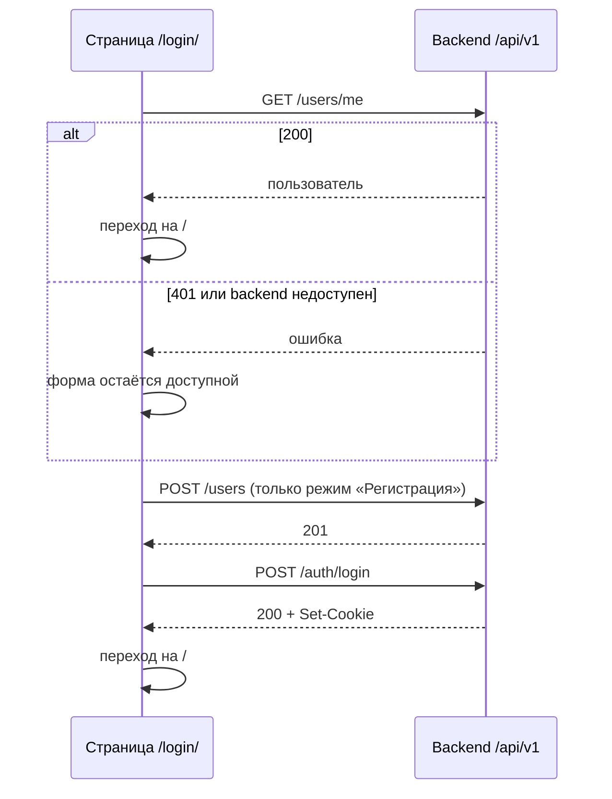

# Аутентификация

Страница описывает HTTP-контракт аутентификации пользователей и его
использование frontend-страницей `/login/`. Frontend-часть реализована;
backend-реализация контракта (хранение пользователей, сессии, защита
существующих ручек) выполняется отдельным изменением и до его завершения
эндпоинты ниже недоступны.

## Границы ответственности

- **Frontend** ([`auth-api.js`](../frontend/src/auth-api.js),
  [`login/`](../frontend/src/login/)) отправляет запросы контракта на том же
  origin, проверяет поля до отправки и после успешного входа переходит в чат.
  Он не хранит пароль, идентификатор сессии или токены в JavaScript-хранилищах.
- **Backend** регистрирует пользователей, хранит хеши паролей, создаёт и
  удаляет серверные сессии и выставляет сессионную cookie. Роль и другие
  системные поля вычисляются только на backend.

Сессия передаётся cookie, а не заголовком `Authorization`: браузер
автоматически прикладывает её и к `fetch`, и к `EventSource`, который не
поддерживает собственные заголовки.

## HTTP-контракт

Базовый префикс — `/api/v1`, тела запросов и ответов — JSON.

| Запрос | Успешный ответ | Ошибки |
| --- | --- | --- |
| `POST /api/v1/users` с `{"login":"<login>","password":"<password>"}` — регистрация | `201 Created`, `{"id":"<uuid>","login":"<login>","role":"user"}` | `409 Conflict` — логин занят; `422 Unprocessable Entity` — нарушены правила полей или переданы лишние поля |
| `POST /api/v1/auth/login` с `{"login":"<login>","password":"<password>"}` — аутентификация | `200 OK`, объект пользователя, `Set-Cookie` с идентификатором сессии | `401 Unauthorized` — неверная пара логин/пароль, одинаково для неизвестного логина и неверного пароля; `422` — некорректные поля |
| `POST /api/v1/auth/logout` без тела — деавторизация | `204 No Content`, сессия удалена, cookie сброшена | Нет: без действительной сессии ответ тоже `204` |
| `GET /api/v1/users/me` — текущий пользователь | `200 OK`, `{"id":"<uuid>","login":"<login>","role":"user"\|"admin"}` | `401 Unauthorized` — сессии нет или она недействительна |

Правила полей:

- `login` — 3–32 символа: латинские буквы, цифры, `_`, `.` и `-`; уникален
  без учёта регистра;
- `password` — 8–128 символов;
- допускаются только `login` и `password`; `id`, `role`, даты и другие
  системные поля клиент передать не может (`422`);
- регистрация всегда создаёт пользователя с ролью `user`.

Сессионная cookie выставляется с `HttpOnly`, `SameSite=Lax` и `Path=/`;
`Secure` включается вместе с HTTPS. Ответы и журналы не содержат пароль, хеш
пароля и идентификатор сессии.

## Поведение страницы `/login/`

`AuthApi` переводит ответы в стабильные коды ошибок: `login_taken` (`409`),
`invalid_credentials` (`401` при входе), `unauthorized` (`401` у `/users/me`),
`invalid_fields` (`422`), `invalid_response` (некорректное тело успешного
ответа) и `unavailable` (сетевой сбой или любой другой статус). Страница
показывает по ним понятный текст, сохраняет введённый логин и очищает пароль.

## Что пока не реализовано

Backend-реализация контракта, ограничение доступа к чату для гостей, кнопка
выхода в чате и проверка роли для административной панели выполняются
отдельными изменениями.

## SDD-артефакты

- [спецификация](../specs/changes/auth-frontend-contract/spec.md);
- [план](../specs/changes/auth-frontend-contract/plan.md);
- [результат проверки](../specs/changes/auth-frontend-contract/verification.md).
