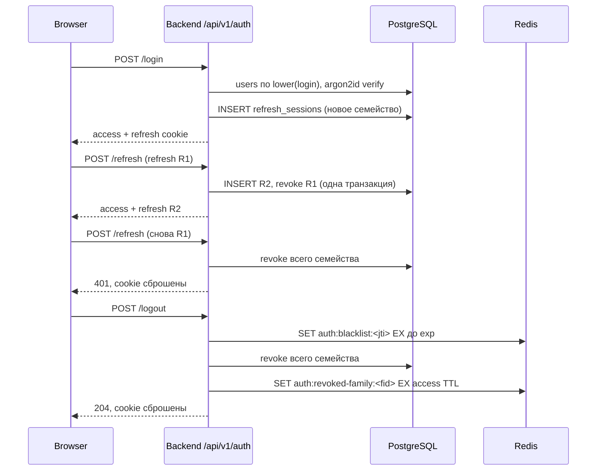
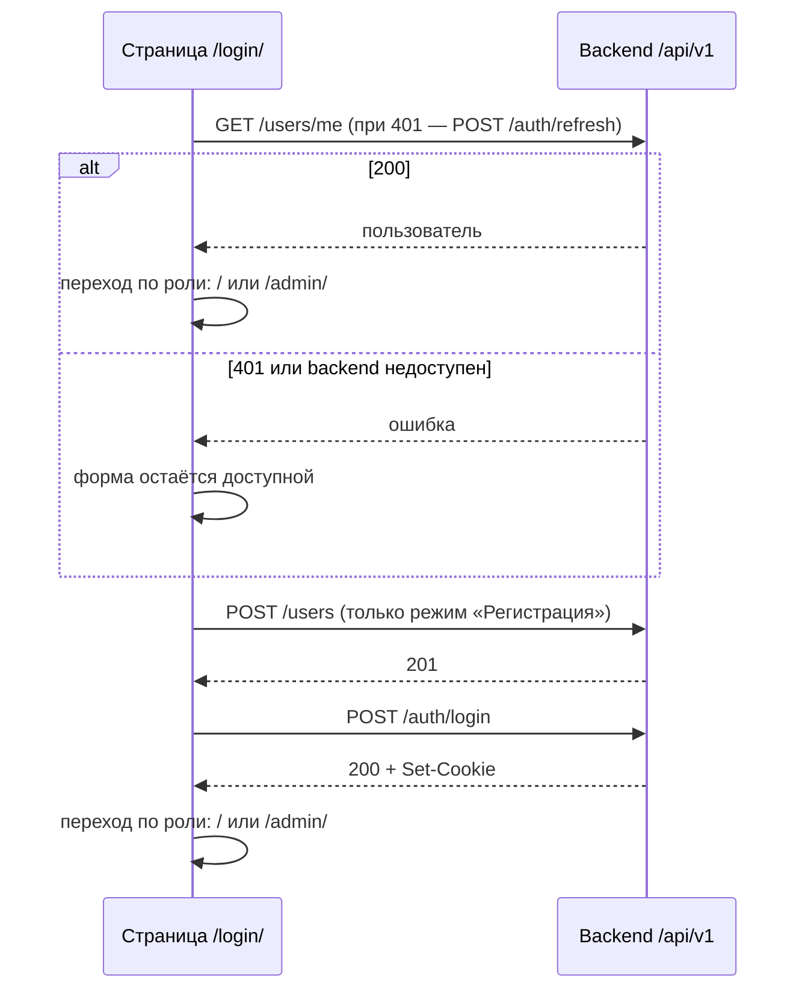

# Аутентификация

[← Глобальный каталог](./README.md)

Страница описывает HTTP-контракт аутентификации пользователей, его
backend-реализацию на JWT и refresh-токенах и использование frontend-страницей
`/login/`. Схема хранения пользователей — на странице [База данных](./database.md).

## Границы ответственности

- **Frontend** ([`auth-api.js`](../frontend/src/auth-api.js),
  [`login/`](../frontend/src/login/)) отправляет запросы контракта на том же
  origin, проверяет поля до отправки и после успешного входа переходит в чат.
  Он не хранит пароль и токены в JavaScript-хранилищах и не читает cookie.
- **Backend** ([`smeshariki_ai.auth`](../backend/src/smeshariki_ai/auth/),
  [`api/auth.py`](../backend/src/smeshariki_ai/api/auth.py)) регистрирует
  пользователей, хранит хеши паролей, выпускает и отзывает токены и
  выставляет cookie. Роль и другие системные поля вычисляются только на
  backend.

Токены передаются только `HttpOnly` cookie, а не заголовком `Authorization`:
браузер автоматически прикладывает их и к `fetch`, и к `EventSource`, который
не поддерживает собственные заголовки. Токены не возвращаются в теле ответа.

## Защита от межсайтовых запросов

Так как cookie отправляются браузером автоматически, `SameSite=Lax` дополняют
две проверки (login CSRF через HTML-форму `enctype="text/plain"`):

- **`Sec-Fetch-Site`.** Middleware `ForbiddenOriginMiddleware`
  ([`api/security.py`](../backend/src/smeshariki_ai/api/security.py)) для
  `POST`/`PUT`/`PATCH`/`DELETE` к `/api/*` отвечает `403`
  `{"error":"forbidden_origin"}` до аутентификации и разбора тела, если
  заголовок равен `cross-site` или `same-site`. Запросы без заголовка и со
  значениями `same-origin` или `none` проходят; `GET`, включая SSE, не
  затрагиваются. `Origin` с `Host` не сравниваются: Vite dev proxy
  (`changeOrigin: true`) переписывает `Host`.
- **`Content-Type`.** `POST /users` и `POST /auth/login` принимают только
  `application/json` (параметры допустимы, регистр не важен), иначе `415`
  `{"error":"unsupported_media_type"}` без создания пользователя, проверки
  пароля и cookie. Так же `messages` отвечает `415` в формате FastAPI, но
  после проверки токена.

Порядок проверок у регистрации и входа: `403`, `415`, `429`
([ограничение частоты](#ограничение-частоты-попыток)), затем `422` и остальные
ответы контракта. Отказы журналируются событиями
`http.request.forbidden_origin` и `http.request.unsupported_media_type` без
значений заголовков.

## Ограничение частоты попыток

Счётчики фиксированного окна хранятся в Redis (ключи `auth:ratelimit:*`, TTL
окна; логин в ключе — SHA-256 от логина в нижнем регистре). Пороги задаются
[конфигурацией](./configuration.md) (значения по умолчанию в скобках):

| Лимит | Что считается | Порог (окно) | Когда проверяется |
| --- | --- | --- | --- |
| `login_failures` | неудачные входы пары «логин без учёта регистра + IP» | 5 (15 минут) | после валидации тела, до проверки пароля |
| `login_ip` | запросы `POST /auth/login` с IP | 30 (1 минута) | до разбора тела |
| `register_ip` | запросы `POST /users` с IP | 10 (1 час) | до разбора тела |

Превышение — `429` `{"error":"too_many_attempts"}` с `Retry-After` в секундах до
конца окна; пароль не проверяется и не хешируется, в том числе верный пароль
заблокированной пары. Успешный вход сбрасывает счётчик `login_failures` пары,
запрос с невалидным телом расходует только лимит по IP. Недоступный Redis даёт
`503` `{"error":"unavailable"}` (fail closed). Отказ журналируется событием
`auth.rate_limit.rejected` с полем `limit` без логина, пароля и IP.

**IP клиента** — `request.client.host`. Uvicorn подменяет его значением
`X-Forwarded-For` только если соединение пришло с адреса из
`FORWARDED_ALLOW_IPS` (по умолчанию `127.0.0.1`). В Compose backend доверяет
единственному адресу Caddy; Caddy заменяет входящий `X-Forwarded-For` адресом
своего клиента, поэтому подставленный заголовок не влияет на лимит. Порт
backend наружу не публикуется. Если перед Caddy появится другой прокси, его
адрес нужно явно доверить на уровне Caddy (`trusted_proxies`).

**Argon2.** Хеширование и проверка паролей выполняются не более чем в 4
операциях одновременно на процесс backend (`Argon2PasswordHasher`), остальные
ждут очереди: каждая операция занимает 64 МиБ.

## HTTP-контракт

Базовый префикс — `/api/v1`, тела запросов и ответов — JSON.

| Запрос | Успешный ответ | Ошибки |
| --- | --- | --- |
| `POST /api/v1/users` (`Content-Type: application/json`) с `{"login":"<login>","password":"<password>"}` — регистрация | `201 Created`, `{"id":"<uuid>","login":"<login>","role":"user"}`; cookie не выставляются | `403` `forbidden_origin`; `415` `unsupported_media_type`; `429` `too_many_attempts`; `409` `login_taken` — логин занят; `422` `invalid_fields` |
| `POST /api/v1/auth/login` (`Content-Type: application/json`) с `{"login":"<login>","password":"<password>"}` — вход | `200 OK`, объект пользователя, `Set-Cookie` с `access_token` и `refresh_token` | `403` `forbidden_origin`; `415` `unsupported_media_type`; `429` `too_many_attempts`; `401` `invalid_credentials` — одинаково для неизвестного логина и неверного пароля; `422` `invalid_fields` |
| `POST /api/v1/auth/refresh` без тела — обновление токенов | `200 OK`, объект пользователя, новые `access_token` и `refresh_token` | `401` `unauthorized` — refresh отсутствует, просрочен, отозван или использован повторно; обе cookie сбрасываются |
| `POST /api/v1/auth/logout` без тела — выход | `204 No Content`, `jti` в blacklist, всё семейство refresh-сессий отозвано, обе cookie сброшены | Нет: без действительных токенов ответ тоже `204` |
| `GET /api/v1/users/me` — текущий пользователь | `200 OK`, `{"id":"<uuid>","login":"<login>","role":"user"\|"admin"}` с актуальными данными из БД | `401` `unauthorized` — access-токена нет, он некорректен (в том числе без `fid`), просрочен или отозван (`jti` либо семейство) |

Тело любой ошибки этих ручек — `{"error":"<code>"}` без повторения введённых
значений. Если PostgreSQL или Redis недоступны, любая ручка отвечает `503`
`{"error":"unavailable"}` и не считает пользователя аутентифицированным (fail
closed). Ручки диалогов сохраняют прежний формат ошибок FastAPI.

Правила полей:

- `login` — 3–32 символа: латинские буквы, цифры, `_`, `.` и `-`; уникален
  без учёта регистра и хранится в исходном регистре;
- `password` — 8–128 символов, оба поля — строки;
- допускаются только `login` и `password`; лишние поля, невалидный JSON и
  пустое тело дают `422`;
- регистрация всегда создаёт пользователя с ролью `user`.

## Токены и cookie

| Cookie | Содержимое | Атрибуты | TTL по умолчанию |
| --- | --- | --- | --- |
| `access_token` | JWT HS256 с claims `sub` (id пользователя), `role`, `jti`, `sid` (refresh-сессия), `fid` (семейство refresh-сессий), `iat`, `exp`, `iss=smeshariki-ai` | `HttpOnly`, `SameSite=Lax`, `Path=/` | 15 минут, `AUTH_ACCESS_TTL_SECONDS` |
| `refresh_token` | Непрозрачная случайная строка 256 бит; в БД хранится только SHA-256 | `HttpOnly`, `SameSite=Lax`, `Path=/api/v1/auth` | 30 дней, `AUTH_REFRESH_TTL_SECONDS` |

`Secure` включается `AUTH_COOKIE_SECURE=true` вместе с HTTPS. Refresh cookie
ограничена путём `/api/v1/auth`, поэтому браузер не отправляет её в остальные
ручки.



- **Ротация.** Refresh-токен одноразовый: каждый `refresh` отзывает текущую
  сессию и создаёт следующую в том же семействе (`family_id`).
- **Повторное использование.** Предъявление уже отозванного refresh-токена —
  признак кражи: backend отзывает всё семейство, и выданный по нему токен
  тоже перестаёт работать. Семейство также помечается отозванным в Redis, и
  уже выпущенные access-токены с этим `fid` отклоняются.
- **Blacklist.** При `logout` `jti` access-токена записывается в Redis ключом
  `auth:blacklist:<jti>` с TTL до `exp`. `logout` отзывает всё семейство
  предъявленных токенов: в PostgreSQL (`revoke_family`) и в Redis ключом
  `auth:revoked-family:<fid>` с TTL не меньше времени жизни access-токена; так
  же поступает обнаружение повторного использования refresh. Проверка
  access-токена отклоняет отозванные `jti` и `fid`; подпись, `iss` и `exp`
  проверяются до обращения к Redis. Токен без `fid` (выпущен до введения
  claim) даёт `401`, и frontend восстанавливает сессию обычным `refresh`.
- **Пароли** хешируются argon2id (`argon2-cffi`) в отдельном потоке. Для
  неизвестного логина выполняется проверка фиктивного хеша, чтобы время ответа
  не выдавало существование логина.

## Внутренние контракты

```python
AuthService(*, users: UserStore, sessions: RefreshSessionStore,
            blacklist: TokenBlacklist, config: AuthConfig,
            password_hasher=None, clock=None, limiter: AttemptLimiter | None = None)
await AuthService.limit_register_ip(client_ip) -> None         # TooManyAttemptsError
await AuthService.limit_login_ip(client_ip) -> None            # TooManyAttemptsError
await AuthService.register(login, password) -> User
await AuthService.login(login, password, client_ip) -> AuthResult  # + TooManyAttemptsError
await AuthService.authenticate(access_token) -> User
await AuthService.verify_session(access_token) -> User         # без проверки exp, для SSE
await AuthService.refresh(refresh_token) -> AuthResult
await AuthService.logout(access_token | None, refresh_token | None) -> None
```

`AttemptLimiter` (async): `hit(key, limit, window) -> retry_after | None`,
`blocked(key, limit) -> retry_after | None`, `record_failure(key, window)`,
`reset(key)`; `TooManyAttemptsError` несёт `limit` и `retry_after`. HTTP-слой
вызывает `limit_*_ip` до разбора тела.

`AuthService` не зависит от FastAPI, SQLAlchemy и redis-py и не читает
environment. Production-адаптеры — `PostgresUserStore`,
`PostgresRefreshSessionStore` ([`db`](./database.md)) и `RedisTokenBlacklist` и
`RedisAttemptLimiter` ([`cache`](../backend/src/smeshariki_ai/cache/)); для тестов есть
детерминированные in-memory реализации в `auth/memory.py`. Ошибки
инфраструктуры адаптеры превращают в `AuthUnavailableError`.

`api/auth.py` предоставляет FastAPI-зависимость `current_user`: она
возвращает `User` либо отвечает `401`/`503` в формате `{"error": ...}`.
Обработчик этого формата регистрируется в `create_app` всегда; без
`auth_service` зависимость отвечает `503` (fail closed).

## Защищённые ручки

Роутер диалогов подключает `current_user` как зависимость, поэтому
`POST /api/v1/dialogs`, `POST /api/v1/dialogs/{dialog_id}/messages` и
`GET /api/v1/dialogs/{dialog_id}/events` без действительного access-токена
отвечают `401` `{"error":"unauthorized"}`, а при недоступности PostgreSQL или
Redis — `503` `{"error":"unavailable"}`. Проверка выполняется раньше валидации
UUID и тела: тело `messages` разбирается в обработчике, потому что FastAPI
отклоняет синтаксически некорректный JSON ещё до зависимостей. С действительным
токеном ручки сохраняют прежние ответы и формат ошибок FastAPI. Открытый поток
`GET .../events` при каждом heartbeat (по умолчанию 15 с) вызывает
`verify_session`: отзыв `jti` или `fid`, удалённый пользователь или
недоступность хранилищ завершают поток без дальнейших событий
(`dialog.subscription.revoked`, `outcome=revoked|unavailable`); agent loop не
отменяется. Истечение `exp` после подключения поток не закрывает. Ручки
аутентификации и `/agent_test` открыты. Диалог принадлежит создателю: чужой
диалог даёт `404` как несуществующий (см. [диалоги](./dialogs.md)).

`TokenBlacklist` кроме `add`/`contains` для `jti` содержит
`revoke_family(family_id, until)` и `family_revoked(family_id) -> bool`;
`TokenCodec.encode_access(user_id, role, session_id, family_id, now)` и
`decode_access(token, now, *, verify_expiry=True)`.

## Создание администратора

Роль `admin` нельзя получить через HTTP API. Администратор создаётся командой
backend из корня репозитория:

```sh
make create-admin LOGIN=sovunya
```

Цель применяет миграции и запускает
`python -m smeshariki_ai.create_admin --login <login>` в одноразовом
Compose-контейнере `migrate`. Пароль вводится дважды без отображения и не
принимается аргументом или environment. Логин и пароль проверяются моделью
`Credentials`, пароль хешируется `Argon2PasswordHasher` через общую функцию
`create_user` (`auth/users.py`), которую использует и `AuthService.register`.
Занятый логин, неверные поля, несовпадение паролей и недоступность базы дают
код выхода `1` без записи.

## Проверка сессии во frontend

[`auth-session.js`](../frontend/src/auth-session.js) — общий DOM-независимый
модуль для `/`, `/admin/` и `/login/`. `checkSession` вызывает
`GET /users/me`, а при `401` — один раз `POST /auth/refresh` и берёт
пользователя из его ответа. `refresh` выполняется под общей блокировкой
Web Locks `smeshariki-auth-refresh`: вкладка, дождавшаяся её, сначала повторяет
`GET /users/me` (другая вкладка могла уже обновить сессию) и вызывает `refresh`
только при `401`; одноразовый refresh-токен не предъявляется дважды, и
семейство сессий не отзывается. Без `navigator.locks` вызывается прежний
`refresh`. Итог — `user`, `anonymous` (оба `401`) или
`unavailable` (сеть, `503`, некорректный ответ): сбой backend не считается
выходом из системы.

| Страница | `anonymous` | `user` | `admin` | `unavailable` |
| --- | --- | --- | --- | --- |
| `/` | `location.replace("/login/")` без создания диалога | чат | чат | статус ошибки, повтор через 3 с |
| `/admin/` | `/login/` | `/` | панель | сообщение без demo-данных |
| `/login/` | форма | `/` | `/admin/` | форма |

После входа или регистрации `/login/` также переходит по роли. Адрес перехода
не берётся из URL. Проверка роли на `/admin/` скрывает demo-данные, но не
защищает данные; данные панели отдаёт
[административный API](./admin.md), который проверяет роль на backend.

В чате `401` у создания диалога или отправки сообщения вызывает один
`refresh` и один повтор операции; повторный отказ ведёт на `/login/`. Повтор
отправки безопасен, потому что `401` означает, что запрос не принят. При
ошибке SSE (`EventSource` не сообщает HTTP-статус) выполняется
`checkSession`: `anonymous` — переход на `/login/`; если сессия действительна,
а браузер закрыл поток, открывается новое соединение к тому же диалогу — не
более одного раза до следующего `ready`.

## Выход

В шапке чата и в нижней части боковой панели `/admin/` есть кнопка «Выйти».
Она блокируется на время `POST /api/v1/auth/logout`; после `204` чат закрывает
`EventSource` и отменяет повтор создания диалога, затем страница выполняет
`location.replace("/login/")`. При ошибке backend cookie не сбрасываются,
поэтому страница остаётся на месте, показывает «Не удалось выйти. Попробуйте
ещё раз» и снова разблокирует кнопку. В админке обработчик подключается только
после успешной проверки роли `admin`.

## Поведение страницы `/login/`



`AuthApi` переводит ответы в стабильные коды ошибок: `login_taken` (`409`),
`invalid_credentials` (`401` при входе), `unauthorized` (`401` у `/users/me`),
`invalid_fields` (`422`), `too_many_attempts` (`429` у входа и регистрации),
`invalid_response` (некорректное тело успешного
ответа) и `unavailable` (сетевой сбой, `503` или любой другой статус).
Страница показывает по ним понятный текст, сохраняет введённый логин и
очищает пароль.

## Что пока не реализовано

- смена роли существующего пользователя.

## SDD-артефакты

- backend: [спецификация](../specs/changes/backend-auth-jwt/spec.md),
  [план](../specs/changes/backend-auth-jwt/plan.md),
  [результат проверки](../specs/changes/backend-auth-jwt/verification.md);
- frontend: [спецификация](../specs/changes/auth-frontend-contract/spec.md),
  [план](../specs/changes/auth-frontend-contract/plan.md),
  [результат проверки](../specs/changes/auth-frontend-contract/verification.md).
- защита ручек, проверка сессии и создание администратора:
  [спецификация](../specs/changes/auth-route-guard/spec.md),
  [план](../specs/changes/auth-route-guard/plan.md),
  [результат проверки](../specs/changes/auth-route-guard/verification.md);
- CSRF, секрет подписи и отзыв сессии целиком:
  [спецификация](../specs/changes/auth-hardening/spec.md),
  [план](../specs/changes/auth-hardening/plan.md),
  [результат проверки](../specs/changes/auth-hardening/verification.md);
- кнопки выхода:
  [спецификация](../specs/changes/logout-button/spec.md),
  [план](../specs/changes/logout-button/plan.md),
  [результат проверки](../specs/changes/logout-button/verification.md);
- ограничение частоты входа и одновременный refresh:
  [спецификация](../specs/changes/auth-rate-limit/spec.md),
  [план](../specs/changes/auth-rate-limit/plan.md),
  [результат проверки](../specs/changes/auth-rate-limit/verification.md).
