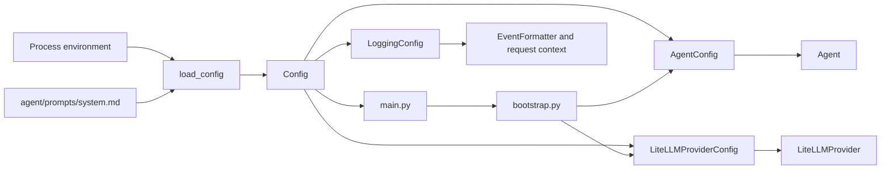

# Конфигурация backend

[← Глобальный каталог](./README.md)

Backend загружает внешнюю конфигурацию через один публичный модуль
[`smeshariki_ai.config`](../backend/src/smeshariki_ai/config.py). Его контракт
состоит из immutable-корня `Config` и функции `load_config`:

```python
class Config(BaseModel):
    agent: AgentConfig
    llm: LiteLLMProviderConfig
    logging: LoggingConfig
    auth: AuthConfig
    database: DatabaseConfig
    redis: RedisConfig
    speech: SpeechConfig
    ceph: CephS3Config
    rag: RagConfig

def load_config(environ: Mapping[str, str] | None = None) -> Config: ...
```

`Config` — общий агрегат настроек, но не глобальный singleton. Он создаётся на
внешней границе процесса, после чего bootstrap передаёт компонентам только
принадлежащие им подконфиги.

## Поток конфигурации



ASGI-entrypoint выполняет `create_application(load_config())`: один раз
собирает environment-настройки и версионируемый системный промпт, после чего
передаёт готовый корень в composition root. `bootstrap.py` не имеет
собственного loader и не подставляет defaults при отсутствии config. `Agent`
получает тот же экземпляр `config.agent`, а `LiteLLMProvider` — тот же экземпляр
`config.llm`. Логирование настраивается через `config.logging`.

Внутренние пакеты `agent`, `agent.providers`, `application`, `api` и `dialogs`
не импортируют корневой `Config` и не читают environment. Поэтому их можно
создавать и тестировать с явными зависимостями без состояния процесса.

## Источники и значения

При вызове без аргумента `load_config()` читает `os.environ`. Переданный
`Mapping[str, str]` полностью заменяет этот источник; это позволяет
детерминированно проверять загрузку без изменения process environment.

Системный промпт не является environment-настройкой. Его production-версия
хранится в
[`agent/prompts/system.md`](../backend/src/smeshariki_ai/agent/prompts/system.md),
читается через `importlib.resources` независимо от текущей рабочей директории и
передаётся в `AgentConfig.system_prompt`. Пустой, отсутствующий или нечитаемый
resource завершает старт контролируемой ошибкой. Промпт не переопределяется
через environment: единственный источник — этот resource.

| Переменная | Подконфиг и поле | Обязательность / default |
| --- | --- | --- |
| `AGENT_MAX_ITERATIONS` | `agent.max_iterations` | `4`, целое число больше нуля |
| `LLM_MODEL` | `llm.model` | Обязательная непустая строка |
| `LLM_API_KEY` | `llm.api_key` | `None`; пустое значение нормализуется в `None` |
| `LLM_BASE_URL` | `llm.base_url` | `None`; при наличии HTTP(S) URL |
| `LLM_TIMEOUT_SECONDS` | `llm.timeout_seconds` | `60`, число больше нуля |
| `LLM_NUM_RETRIES` | `llm.num_retries` | `0`, целое число не меньше нуля |
| `LLM_TEMPERATURE` | `llm.temperature` | `0.8`, число от `0` до `2` включительно |
| `LLM_THINKING` | `llm.thinking` | `false`; для DeepSeek-модели включает скрытые рассуждения, для остальных моделей `true` отклоняется |
| `LOG_LEVEL` | `logging.level` | `INFO`; `DEBUG`, `INFO`, `WARNING` или `ERROR` |
| `LOG_FORMAT` | `logging.format` | `human`; `human` или `json` |
| `AUTH_JWT_SECRET` | `auth.jwt_secret` | Обязательный секрет HS256 не короче 32 байт; значение с префиксом `replace-with-` отклоняется. В `docker/.env.example` пустой, ошибка не раскрывает значение |
| `AUTH_ACCESS_TTL_SECONDS` | `auth.access_ttl_seconds` | `900`, целое число больше нуля |
| `AUTH_REFRESH_TTL_SECONDS` | `auth.refresh_ttl_seconds` | `2592000` (30 дней), целое число больше нуля |
| `AUTH_COOKIE_SECURE` | `auth.cookie_secure` | `false`; включать вместе с HTTPS |
| `AUTH_LOGIN_MAX_FAILURES` | `auth.rate_limit.login_failures` | `5`, целое число больше нуля: неудачных входов пары «логин + IP» за окно |
| `AUTH_LOGIN_FAILURE_WINDOW_SECONDS` | `auth.rate_limit.login_failure_window_seconds` | `900`, целое число больше нуля |
| `AUTH_LOGIN_MAX_PER_IP` | `auth.rate_limit.login_per_ip` | `30`, целое число больше нуля: запросов `POST /auth/login` с IP за окно |
| `AUTH_LOGIN_PER_IP_WINDOW_SECONDS` | `auth.rate_limit.login_per_ip_window_seconds` | `60`, целое число больше нуля |
| `AUTH_REGISTER_MAX_PER_IP` | `auth.rate_limit.register_per_ip` | `10`, целое число больше нуля: запросов `POST /users` с IP за окно |
| `AUTH_REGISTER_PER_IP_WINDOW_SECONDS` | `auth.rate_limit.register_per_ip_window_seconds` | `3600`, целое число больше нуля |
| `DATABASE_URL` | `database.url` | Обязательный URL `postgresql+asyncpg://...` |
| `REDIS_URL` | `redis.url` | Обязательный URL `redis://` или `rediss://` |
| `SPEECH_ENABLED` | `speech.enabled` | `true`; `false` отключает локальную озвучку без загрузки модели |
| `SPEECH_VOICE` | `speech.voice` | `baya`; встроенный голос Silero v5 (`aidar`, `baya`, `kseniya`, `xenia`, `eugene`) |
| `SPEECH_SPEED` | `speech.speed` | `1.0`, число от `0.5` до `2.0` |
| `SPEECH_MAX_CONCURRENCY` | `speech.max_concurrency` | `1`, целое больше нуля |
| `SPEECH_MAX_TEXT_CHARS` | `speech.max_text_chars` | `20000`, целое от 1 до 100000 |
| `SPEECH_MODEL_PATH` | `speech.model_path` | `/models/silero/v5_ru.pt` |
| `CEPH_S3_ENDPOINT` | `ceph.endpoint` | `http://ceph-rgw:7480` |
| `CEPH_S3_BUCKET` | `ceph.bucket` | `smeshariki-audio` |
| `CEPH_S3_ACCESS_KEY` | `ceph.access_key` | `smeshariki` |
| `CEPH_S3_SECRET_KEY` | `ceph.secret_key` | SecretStr; задаётся только через env |
| `CEPH_S3_REGION` | `ceph.region` | `us-east-1` |
| `CEPH_S3_PREFIX` | `ceph.prefix` | `smeshariki-audio` |
| `RAG_QUERY_EXPANSION_ENABLED` | `rag.query_expansion_enabled` | `false` |
| `RAG_QUERY_EXPANSION_MODE` | `rag.query_expansion_mode` | `replace` или `append`, по умолчанию `replace` |
| `RAG_LORE_RETRIEVAL_K` | `rag.lore_retrieval_k` | `10`, целое больше нуля |
| `RAG_LORE_MAX_PASSAGES` | `rag.lore_max_passages` | `5`, целое больше нуля |
| `RAG_LORE_MAX_CHARS` | `rag.lore_max_chars` | `4800`, целое больше нуля |
| `RAG_LORE_MIN_SCORE` | `rag.lore_min_score` | `2.0`, число от 0 |
| `RAG_LORE_RERANK_ENABLED` | `rag.lore_rerank_enabled` | `false` |
| `RAG_HYBRID_ENABLED` | `rag.hybrid_enabled` | `false` |
| `RAG_HYBRID_BM25_WEIGHT` | `rag.hybrid_bm25_weight` | `0.7`, число от 0 до 1 |

Переменная `FORWARDED_ALLOW_IPS` не входит в `Config`: её читает Uvicorn
(см. [доверие к `X-Forwarded-For`](./auth.md#ограничение-частоты-попыток)).

Docker Compose загружает локальный `docker/.env` и передаёт значения процессу
backend. Python-код не читает `.env` как файл и не использует
`pydantic-settings` или dotenv-библиотеку. Полный контейнерный контракт описан
в [руководстве Docker](../docker/README.md).

## Владение и валидация

- `AgentConfig` принадлежит пакету [`agent`](./agent.md) и определяет только
  настройки runtime агента. Текст production-промпта принадлежит тому же
  пакету, но загружается внешним config loader до создания runtime.
- `LiteLLMProviderConfig` принадлежит `agent.providers` и определяет только
  настройки адаптера LiteLLM, включая температуру и режим thinking.
- `LoggingConfig` принадлежит модулю `observability`; формат и поля описаны
  на [странице логирования](./logging.md).
- `AuthConfig` (с вложенной `RateLimitConfig`) принадлежит пакету
  [`auth`](./auth.md), `DatabaseConfig` —
  [`db`](./database.md), `RedisConfig` — `cache`. Bootstrap передаёт
  `AuthService` только `config.auth`, engine — только `config.database`,
  Redis-клиенту — только `config.redis`.
- Корневой `Config` агрегирует эти модели, но не дублирует их поля.
- Все модели запрещают неизвестные поля и изменение после создания.
- API key, JWT-секрет, `DATABASE_URL` и `REDIS_URL` хранятся как `SecretStr` и
  не раскрываются в строковом представлении конфигурации и ошибках валидации.
- Невалидная или неполная конфигурация завершает старт до создания
  FastAPI-приложения; production fallback на fake-провайдер отсутствует.

При добавлении нового настраиваемого компонента его модель остаётся в модуле
владельца. Корневой `Config` получает новый типизированный подконфиг,
`load_config` собирает его из согласованного внешнего источника, а bootstrap
передаёт компоненту только этот подконфиг. Новые источники, форматы файлов и
reload во время работы требуют отдельного SDD-изменения.

Команда миграций `python -m smeshariki_ai.db.migrate` также получает
`DATABASE_URL` через `load_config`, поэтому ей нужен полный environment
backend.

## Связанные SDD-артефакты

- [Спецификация](../specs/changes/backend-config/spec.md)
- [План](../specs/changes/backend-config/plan.md)
- [Результат проверки](../specs/changes/backend-config/verification.md)
- [Спецификация resource системного промпта](../specs/changes/agent-system-prompt-resource/spec.md)
- [План resource системного промпта](../specs/changes/agent-system-prompt-resource/plan.md)
- [Результат проверки resource системного промпта](../specs/changes/agent-system-prompt-resource/verification.md)
