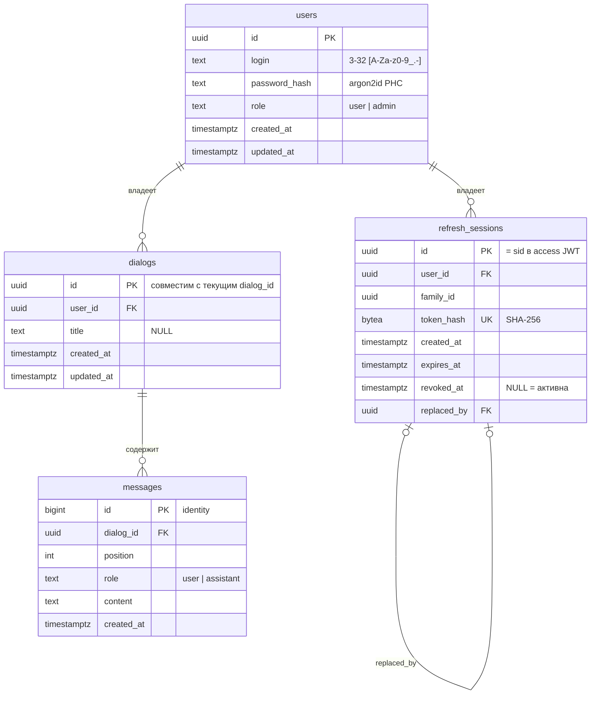

# База данных

[← Глобальный каталог](./README.md)

Backend хранит постоянные данные в PostgreSQL 17. База — инфраструктурная
зависимость backend: она работает в отдельном Compose-контейнере `postgres`, но
подключение, схема и миграции принадлежат пакету `smeshariki_ai.db`.

Схема сразу спроектирована с учётом постоянной истории диалогов: таблицы
аутентификации создаёт миграция `0001`, `dialogs` и `messages` — миграция
`0002`.

| Таблица | Назначение | Состояние |
| --- | --- | --- |
| `users` | Учётные записи и роли | Реализовано, миграция `0001` |
| `refresh_sessions` | Refresh-токены и их ротация | Реализовано, миграция `0001` |
| `dialogs` | Диалоги пользователя | Реализовано, миграция `0002` |
| `messages` | Сообщения диалога | Реализовано, миграция `0002` |

## Где находится реализация

- [`db/tables.py`](../backend/src/smeshariki_ai/db/tables.py) — описание
  таблиц в SQLAlchemy Core;
- [`db/stores.py`](../backend/src/smeshariki_ai/db/stores.py) —
  `PostgresUserStore` и `PostgresRefreshSessionStore`;
- [`db/history.py`](../backend/src/smeshariki_ai/db/history.py) —
  `PostgresHistoryStore`;
- [`db/engine.py`](../backend/src/smeshariki_ai/db/engine.py) — ленивый async
  engine (`asyncpg`);
- [`db/migrations/`](../backend/src/smeshariki_ai/db/migrations/) — Alembic
  environment и версии миграций;
- [`db/migrate.py`](../backend/src/smeshariki_ai/db/migrate.py) — команда
  применения миграций.

## Схема



### `users`

| Столбец | Тип | Ограничения |
| --- | --- | --- |
| `id` | `uuid` | PK; UUIDv4 генерирует приложение |
| `login` | `text` | `NOT NULL`, `CHECK login ~ '^[A-Za-z0-9_.-]{3,32}$'` |
| `password_hash` | `text` | `NOT NULL`, строка argon2id в формате PHC |
| `role` | `text` | `NOT NULL DEFAULT 'user'`, `CHECK role IN ('user','admin')` |
| `created_at`, `updated_at` | `timestamptz` | `NOT NULL DEFAULT now()` |

Индекс `users_login_lower_key` — `UNIQUE (lower(login))`: логин хранится в
исходном регистре, а уникальность и поиск выполняются без учёта регистра.

### `refresh_sessions`

| Столбец | Тип | Ограничения |
| --- | --- | --- |
| `id` | `uuid` | PK; передаётся в access JWT как `sid` |
| `user_id` | `uuid` | `NOT NULL`, FK `users(id) ON DELETE CASCADE`, индекс |
| `family_id` | `uuid` | `NOT NULL`, индекс; общий для цепочки ротаций одного входа |
| `token_hash` | `bytea` | `NOT NULL UNIQUE`; SHA-256 от refresh-токена |
| `created_at`, `expires_at` | `timestamptz` | `NOT NULL` |
| `revoked_at` | `timestamptz` | `NULL` — сессия активна |
| `replaced_by` | `uuid` | FK `refresh_sessions(id) ON DELETE SET NULL` |

Ротация выполняется одной транзакцией: вставка новой сессии и условный
`UPDATE ... WHERE revoked_at IS NULL` старой. Если старая уже отозвана
параллельным запросом, транзакция откатывается и сервис считает это повторным
использованием токена. Сам refresh-токен в базе не хранится.

### `dialogs`

| Столбец | Тип | Ограничения |
| --- | --- | --- |
| `id` | `uuid` | PK; тот же UUID, что сейчас возвращает `POST /api/v1/dialogs` |
| `user_id` | `uuid` | `NOT NULL`, FK `users(id) ON DELETE CASCADE` |
| `title` | `text` | `NULL` |
| `created_at`, `updated_at` | `timestamptz` | `NOT NULL DEFAULT now()` |

Индекс `dialogs_user_id_updated_at_idx` на `(user_id, updated_at DESC)` —
список диалогов пользователя от новых к старым. Строка `dialogs` появляется
только вместе с первыми сообщениями, после первого успешного ответа агента:
черновики в базу не записываются. `title` остаётся `NULL`-able, но при
сохранении всегда заполняется (правило — в [диалогах](./dialogs.md#жизненный-цикл-диалога)).

### `messages`

| Столбец | Тип | Ограничения |
| --- | --- | --- |
| `id` | `bigint` | PK, `GENERATED ALWAYS AS IDENTITY` |
| `dialog_id` | `uuid` | `NOT NULL`, FK `dialogs(id) ON DELETE CASCADE` |
| `position` | `int` | `NOT NULL`, `UNIQUE (dialog_id, position)` |
| `role` | `text` | `NOT NULL`, `CHECK role IN ('user','assistant')` |
| `content` | `text` | `NOT NULL` |
| `created_at` | `timestamptz` | `NOT NULL DEFAULT now()` |

`position` задаёт порядок и делает атомарное добавление пары «пользователь —
ассистент» проверяемым на конфликт. Как и в текущем `HistoryStore`, tool calls
и tool results не хранятся.

## Решения

- `role` — `text` с `CHECK`, а не PostgreSQL enum: новая роль добавляется
  миграцией ограничения без `ALTER TYPE`.
- UUID генерирует приложение, поэтому идентификаторы известны до вставки и
  совпадают с уже опубликованным форматом API.
- Удаление пользователя каскадно удаляет его refresh-сессии, диалоги и
  сообщения; удаление диалога каскадно удаляет сообщения.
- Ошибки подключения и SQL адаптеры аутентификации превращают в
  `AuthUnavailableError`, адаптер истории — в `HistoryUnavailableError`;
  engine создаётся с `hide_parameters=True`, чтобы хеши и тексты сообщений не
  попадали в текст исключений.

## PostgresHistoryStore

`PostgresHistoryStore(engine)` реализует контракт `HistoryStore` из
[диалогов](./dialogs.md#внутренние-контракты) на том же engine, что и
аутентификация. Время (`created_at`, `updated_at`) передаёт `AgentService`, а не
`now()` базы.

- `create` — одна транзакция: `INSERT dialogs` и `INSERT messages` с позициями
  0 и 1.
- `append` — одна транзакция: `SELECT ... FOR UPDATE` строки диалога
  (блокировка сериализует параллельные добавления), следующая
  `position = coalesce(max(position), -1) + 1`, вставка сообщений и
  `UPDATE dialogs SET updated_at`.
- `list` — keyset-условие `(updated_at, id) < (:updated_at, :id)` с
  `ORDER BY updated_at DESC, id DESC`.
- `delete` — `DELETE ... RETURNING id`; сообщения удаляет каскад.

## Миграции

Миграции — Alembic-скрипты в пакете backend, источник истины для схемы.
`tables.py` повторяет их для запросов и должен меняться вместе с ними.

```sh
# В Compose: одноразовый сервис migrate выполняет перед стартом backend
python -m smeshariki_ai.db.migrate
# Вручную из корня репозитория (поднимает postgres при необходимости)
make migrate
```

Команда берёт `DATABASE_URL` через `load_config`, поэтому ей нужен тот же
environment, что и backend; Compose передаёт его общим YAML-якорем. Отдельный
`alembic.ini` не используется: `script_location` и engine задаются в
`migrate.py`. Новая версия добавляется файлом в `db/migrations/versions/`
со следующим номером ревизии.

## SDD-артефакты

- [спецификация](../specs/changes/backend-auth-jwt/spec.md);
- [план](../specs/changes/backend-auth-jwt/plan.md),
  [результат проверки](../specs/changes/backend-auth-jwt/verification.md);
- постоянная история диалогов: [спецификация](../specs/changes/dialog-history/spec.md),
  [план](../specs/changes/dialog-history/plan.md).
