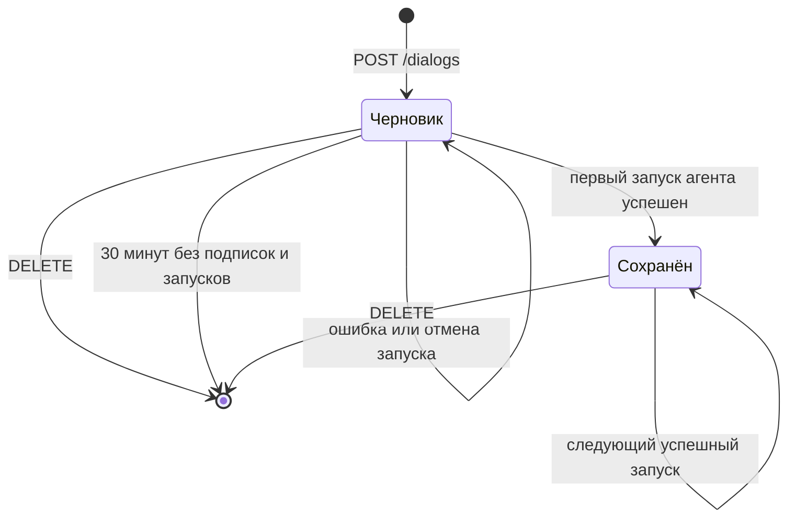
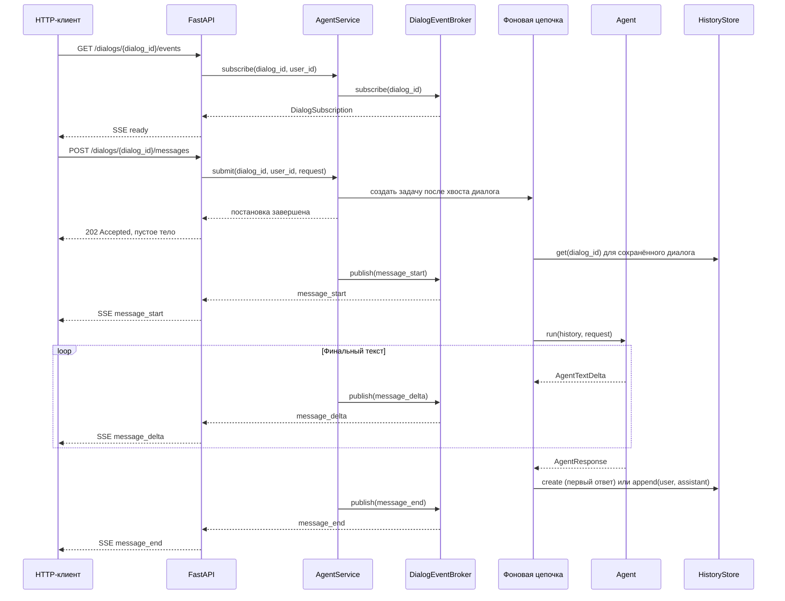
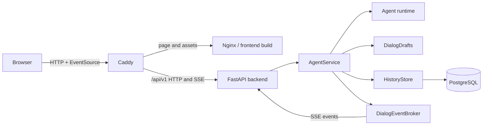

# Диалоги и HTTP API

[← Глобальный каталог](./README.md)

Диалоговый слой связывает HTTP API с независимым runtime агента. Прикладная
координация находится в `application`, контракт хранения истории и реестр
черновиков — в `dialogs`, PostgreSQL-реализация хранения — в `db`, а
FastAPI-маршруты только валидируют HTTP-ввод и преобразуют ошибки.

## Где находится реализация

- [`application/agent_service.py`](../backend/src/smeshariki_ai/application/agent_service.py)
  — очередь запусков и `AgentService`;
- [`application/event_broker.py`](../backend/src/smeshariki_ai/application/event_broker.py)
  — контракт `DialogEventBroker` и process-local реализация
  `InMemoryDialogEventBroker`;
- [`application/events.py`](../backend/src/smeshariki_ai/application/events.py)
  — типы событий и потребительский контракт подписки;
- [`dialogs/history.py`](../backend/src/smeshariki_ai/dialogs/history.py) —
  контракт `HistoryStore` и in-memory реализация;
- [`dialogs/drafts.py`](../backend/src/smeshariki_ai/dialogs/drafts.py) —
  process-local реестр черновиков `DialogDrafts`;
- [`dialogs/models.py`](../backend/src/smeshariki_ai/dialogs/models.py),
  [`dialogs/title.py`](../backend/src/smeshariki_ai/dialogs/title.py),
  [`dialogs/errors.py`](../backend/src/smeshariki_ai/dialogs/errors.py) —
  модели списка и курсора, правило заголовка, ошибки;
- [`db/history.py`](../backend/src/smeshariki_ai/db/history.py) —
  `PostgresHistoryStore`;
- [`api/cursor.py`](../backend/src/smeshariki_ai/api/cursor.py) — кодирование
  курсора списка;
- [`api/app.py`](../backend/src/smeshariki_ai/api/app.py) — HTTP-маршруты и
  shutdown lifecycle;
- [`api/schemas.py`](../backend/src/smeshariki_ai/api/schemas.py) — схемы HTTP-
  запросов и ответов;
- [`api/agent_test.html`](../backend/src/smeshariki_ai/api/agent_test.html) —
  самодостаточный тестовый интерфейс;
- [`frontend/src/agent-api.js`](../frontend/src/agent-api.js) — браузерный
  HTTP/SSE-клиент dialog API;
- [`frontend/src/script.js`](../frontend/src/script.js) — состояния формы,
  порядок сообщений и отображение потокового ответа;
- [`frontend/vite.config.js`](../frontend/vite.config.js) — локальный same-
  origin dev proxy пути `/api`;
- [`docker/Caddyfile`](../docker/Caddyfile) — основной same-origin маршрут
  `/api` к backend и остальных путей к Nginx;
- [`bootstrap.py`](../backend/src/smeshariki_ai/bootstrap.py) — сборка готовых
  зависимостей приложения.

## Жизненный цикл диалога

Диалог попадает в PostgreSQL только после первого успешного ответа агента. До
этого он остаётся черновиком: клиент знает `dialog_id`, а backend держит в
памяти процесса владельца и счётчики активности.



- Черновик создаёт `DialogDrafts`; PostgreSQL не используется. Рестарт backend
  теряет черновики, сохранённые диалоги его переживают.
- Первый успешный запуск одной транзакцией вставляет строку `dialogs` с
  заголовком и пару сообщений; `message_end` публикуется после фиксации. При
  ошибке агента, отмене или сбое хранилища в базе ничего не остаётся,
  подписчики получают `message_error`, а следующий запрос снова считается
  первым.
- Черновик без подписок `events` и без активных или ожидающих запусков
  удаляется через `DRAFT_TTL` (30 минут). Проверка ленивая: срок
  проверяется при обращении к черновику, а `create` удаляет все истёкшие
  черновики. Короткое переподключение `EventSource` черновик не теряет.
- Заголовок — первый пользовательский запрос: пробелы по краям удаляются,
  последовательности пробельных символов схлопываются в один пробел, текст
  длиннее 60 символов обрезается до 60 с добавлением `…`. Заголовок задаётся
  при сохранении и дальше не меняется (`make_title`).
- После рестарта в сохранённый диалог можно писать: агент получает сохранённую
  историю как контекст.

## Внутренние контракты

```python
AgentService(
    agent: AgentRunner,
    history_store: HistoryStore,
    event_broker: DialogEventBroker,
    *,
    drafts: DialogDrafts | None = None,
    clock: Callable[[], datetime] | None = None,
)
await AgentService.start_dialog(user_id: UUID) -> UUID
await AgentService.submit(
    dialog_id: UUID,
    user_id: UUID,
    request: UserRequest,
) -> None
await AgentService.subscribe(dialog_id: UUID, user_id: UUID) -> DialogSubscription
await AgentService.unsubscribe(subscription: DialogSubscription) -> None
await AgentService.list_dialogs(
    user_id: UUID,
    limit: int,
    after: DialogCursor | None = None,
) -> DialogPage            # items, next_cursor
await AgentService.get_dialog(dialog_id: UUID, user_id: UUID) -> DialogTranscript
await AgentService.delete_dialog(dialog_id: UUID, user_id: UUID) -> None
await AgentService.shutdown() -> None

await DialogEventBroker.subscribe(dialog_id: UUID) -> DialogSubscription
await DialogEventBroker.unsubscribe(subscription: DialogSubscription) -> None
await DialogEventBroker.publish(dialog_id: UUID, event: DialogEvent) -> None
await DialogEventBroker.close_dialog(dialog_id: UUID) -> None
await DialogEventBroker.shutdown() -> None
```

`start_dialog` создаёт черновик без обращения к `HistoryStore` и возвращает
UUIDv4. Владелец ищется сначала среди черновиков, потом в `HistoryStore`.
Возврат из `submit` означает только то, что фоновая задача создана в текущем
процессе; метод не ждёт ответа агента. `get_dialog` для черновика возвращает
`title=None` и пустой список сообщений. `list_dialogs` запрашивает у хранилища
`limit + 1` элементов: лишний элемент означает, что следующая страница есть, и
курсором становится последний возвращённый.

`delete_dialog` проверяет владельца и без гонок выполняет шаги: помечает диалог
удаляемым (`submit` и `subscribe` отвечают `DialogNotFoundError`), отменяет и
дожидается всех задач диалога (отменённые запуски публикуют `message_error`),
удаляет черновик либо строку в базе и вызывает `DialogEventBroker.close_dialog`.
Поэтому первое сохранение черновика не может завершиться после удаления.
Сервис хранит множество задач каждого диалога, а не только хвост цепочки.

Для одного `dialog_id` сервис хранит хвост цепочки `asyncio.Task`: следующий
запуск ожидает предыдущий и только затем читает обновлённую историю. Разные
диалоги имеют независимые цепочки и могут выполняться параллельно. Очередь не
ограничена по длине и не сохраняется после перезапуска.

`AgentService` проверяет существование диалога, его владельца и состояние
lifecycle, после чего
делегирует открытие, закрытие и доставку событий внедрённому
`DialogEventBroker`. Сервис не хранит подписчиков и не знает об устройстве их
очередей.

Production composition root создаёт один `InMemoryDialogEventBroker` на
экземпляр приложения. Он ведёт независимые наборы подписчиков по `dialog_id` и
публикует им `message_start`, `message_delta`, `message_end` или
`message_error`. Очередь каждого подписчика ограничена 64 событиями:
переполненная или отключённая подписка удаляется и не создаёт backpressure для
агента. События не сохраняются для replay; подключившийся клиент видит только
будущие события. `close_dialog` закрывает все подписки одного диалога после
доставки уже поставленных в очередь событий; повторный вызов и вызов после
`shutdown` безопасны. Брокер не зависит от FastAPI, агента и `HistoryStore`.

```python
await HistoryStore.create(
    dialog_id: UUID, owner_id: UUID, title: str | None,
    messages: Sequence[Message], now: datetime,
) -> None                                          # диалог + первые сообщения
await HistoryStore.owner(dialog_id: UUID) -> UUID
await HistoryStore.get(dialog_id: UUID) -> tuple[Message, ...]   # контекст агента
await HistoryStore.read(dialog_id: UUID) -> DialogTranscript     # title + сообщения с created_at
await HistoryStore.append(
    dialog_id: UUID, messages: Sequence[Message], now: datetime,
) -> None
await HistoryStore.list(
    owner_id: UUID, limit: int, after: DialogCursor | None,
) -> tuple[DialogSummary, ...]
await HistoryStore.delete(dialog_id: UUID) -> None
```

`HistoryStore` хранит только сохранённые диалоги; черновиков в нём нет.
`owner`, `get`, `read`, `append` и `delete` бросают `DialogNotFoundError` для
неизвестного диалога. `create` и `append` атомарны; время передаёт
`AgentService` из внедрённых часов. Сообщения получают последовательные
`position`. При ошибке агента история не меняется; tool calls и tool results в
историю диалога не попадают. `list` сортирует по `(updated_at, dialog_id)` по
убыванию и принимает keyset-курсор `DialogCursor(updated_at, dialog_id)`.
`DialogDrafts` (`create`, `owner`, `attach`/`detach`, `run_started`/
`run_finished`, `discard`) принимает внедряемые часы и `ttl`.

`InMemoryHistoryStore` выполняет тот же контракт для тестов без PostgreSQL;
`PostgresHistoryStore` описан в [базе данных](./database.md#postgreshistorystore).
Ошибки подключения и SQL превращаются в `HistoryUnavailableError`
(наследник `DialogError`) без текста запроса и параметров.

## Поток сообщения



## HTTP-контракты

Базовый префикс API — `/api/v1`. Все ручки диалогов требуют
действительный access-токен в cookie: без него они отвечают `401`
`{"error":"unauthorized"}`, при недоступности хранилищ аутентификации — `503`
`{"error":"unavailable"}`, причём раньше `404` и `422`. Подробности — в
[аутентификации](./auth.md#защищённые-ручки).

| Запрос | Успешный ответ | Ошибки |
| --- | --- | --- |
| `POST /api/v1/dialogs` без тела | `201 Created`, `Location: /api/v1/dialogs/<uuid>`, JSON `{"dialog_id":"<uuid>"}` | `503 Service Unavailable`, если сервис больше не принимает запросы |
| `POST /api/v1/dialogs/{dialog_id}/messages` с JSON `{"request":"<непустой текст>"}` | Немедленный `202 Accepted` с пустым телом после создания фоновой задачи | `415 Unsupported Media Type` (`{"detail":"Unsupported media type."}`), если `Content-Type` не `application/json`; `404 Not Found` для неизвестного или чужого диалога; `422 Unprocessable Entity` для некорректного UUID, пустого текста или лишних полей; `503 Service Unavailable`, если задачу нельзя принять или сохранённый диалог нельзя найти из-за недоступной базы |
| `GET /api/v1/dialogs/{dialog_id}/events` | `200 OK`, `text/event-stream`, начальное `ready`, heartbeat и будущие `message_*` events; на каждом heartbeat сессия перепроверяется, при отзыве поток закрывается | `404 Not Found` для неизвестного или чужого диалога; `422 Unprocessable Entity` для некорректного UUID; `503 Service Unavailable` после остановки сервиса |
| `GET /api/v1/dialogs?limit=<n>&cursor=<c>` | `200 OK`, JSON `{"items":[{"dialog_id","title","created_at","updated_at"}],"next_cursor":"<строка>"\|null}` | `422` для `limit` вне 1–50 (по умолчанию 20) и для `cursor`, который не декодируется; `503` `{"detail":"Dialog storage is unavailable."}` |
| `GET /api/v1/dialogs/{dialog_id}/messages` | `200 OK`, JSON `{"dialog_id","title","messages":[{"role","content","created_at"}]}` в порядке `position`; для черновика `"title":null` и `"messages":[]` | `404 Not Found` для неизвестного или чужого диалога; `422` для некорректного UUID; `503` как выше |
| `DELETE /api/v1/dialogs/{dialog_id}` | `204 No Content`, пустое тело | `403` для `Sec-Fetch-Site: cross-site\|same-site`; `404 Not Found` для неизвестного или чужого диалога; `422` для некорректного UUID; `503` |
| `GET /agent_test` | `200 OK`, один самодостаточный HTML с тестовым чатом | Стандартная ошибка FastAPI при недоступности приложения |

`415` у `messages` возвращается после проверки токена, поэтому гость
по-прежнему получает `401`. Поток событий перепроверяет access-токен из
подключения на каждом heartbeat (`AuthService.verify_session`): после выхода,
отзыва семейства, удаления пользователя или недоступности хранилищ он
завершается без дальнейших событий, а agent loop продолжает работу;
истечение `exp` поток не закрывает. Небезопасные запросы (`POST`, `DELETE`) с `Sec-Fetch-Site:
cross-site|same-site` отклоняются `403` до этих ручек — см.
[аутентификацию](./auth.md#защита-от-межсайтовых-запросов).

`dialog_id` всегда передаётся в URL и не является средством авторизации.
Диалог принадлежит пользователю, создавшему его через `POST /dialogs`
(`user.id` из `current_user`). Для чужого диалога или черновика, включая запрос
администратора, `messages` (GET и POST), `events` и `DELETE` отвечают так же,
как для несуществующего: `404` `{"detail":"Dialog not found."}`; запрос не
ставится в очередь, поток не открывается, диалог не меняется. Cookie для выбора диалога не создаются и не
читаются.

**Список и курсор.** В `items` попадают только сохранённые диалоги текущего
пользователя от новых к старым: порядок `updated_at` по убыванию, при равенстве —
`dialog_id` по убыванию. `next_cursor` — непрозрачная строка (base64url без
`=` от JSON `{"u": updated_at, "d": dialog_id}`, `api/cursor.py`) последнего
элемента страницы; `null` означает последнюю страницу. Пагинация keyset по
`(updated_at, dialog_id)`, `offset` не используется. Сообщения диалога
отдаются целиком, без пагинации.

**Удаление.** `DELETE` удаляет сохранённый диалог вместе с сообщениями либо
черновик из памяти. Активные и ожидающие запуски диалога отменяются, ничего не
сохраняется, подписчики `events` получают `message_error`, после чего поток
закрывается. Запуски других диалогов не затрагиваются.

**Недоступная база.** `HistoryUnavailableError` превращается в `503`
`{"detail":"Dialog storage is unavailable."}` обработчиком приложения. Создание
черновика и работа с ним до сохранения от базы не зависят; сбой в фоновом
запуске даёт подписчикам `message_error` и не меняет историю.

SSE events содержат JSON: `ready` передаёт `dialog_id`, `message_delta` —
непустой `delta`, `message_error` — безопасные `code` и `message`, а
`message_start` и `message_end` используют пустой объект. Tool calls, tool
results и история через поток не выдаются. `Last-Event-ID` не поддерживается:
после переподключения replay отсутствует. CORS middleware не реализован.

`/agent_test` открыт без входа, но его запросы к API требуют сессию из
`/login/` на том же origin. Страница создаёт новый диалог, открывает `EventSource`, отправляет сообщения
в существующую POST-ручку и постепенно дополняет ответ. Страница состоит из
одного HTML с встроенными CSS и vanilla JavaScript, не загружает внешние ресурсы
и вставляет запросы и ответы в DOM как текст.

## Frontend-интеграция

В основном Compose запуске браузер получает frontend от Nginx через Caddy и
обращается к относительным адресам `/api/v1/...` на том же origin. Caddy
передаёт API и SSE в backend, сохраняя префикс `/api`; остальные запросы
направляет в Nginx. Backend и Nginx не публикуют порты на хосте.
Отдельный Vite dev server также проксирует `/api` в backend: default target —
`http://127.0.0.1:8000`, переопределение — `BACKEND_URL`. Ни один из сценариев
не требует CORS или изменения FastAPI-контракта.
`AgentApi` вызывает браузерный `fetch` с глобальным контекстом `Window`:
сохранённая функция не должна получать `AgentApi` как `this`, иначе запрос
может завершиться до отправки в сеть.



При загрузке страницы frontend создаёт новый диалог, открывает один
`EventSource` и блокирует форму до `ready`. При ошибке создания диалога
frontend оставляет форму заблокированной и повторяет запрос через три секунды;
после успешного создания повтор прекращается. После успешного `202 Accepted`
пользовательское сообщение добавляется в чат, а события `message_delta`
дописываются в одну реплику ассистента. События, пришедшие во время POST,
буферизуются, чтобы ответ агента не оказался выше сообщения пользователя.
Одновременно допускается только один незавершённый запрос.

Пользовательский текст, delta и сообщения ошибок добавляются через
`textContent`. `dialog_id` не сохраняется в cookie или `localStorage`; полная
перезагрузка создаёт новый диалог. Ошибка EventSource блокирует форму, пока
браузер пытается переподключиться, но потерянные события не восстанавливаются,
так как backend не поддерживает replay.

## Наблюдаемость и lifecycle

Сервис журналирует создание диалога, отказ в доступе к чужому диалогу
(`dialog.access.denied` с `dialog_id`, `user_id`, `outcome="foreign"`;
в HTTP-ответе он неотличим от отсутствующего диалога), принятие запроса, начало и завершение
фонового запуска, сохранение истории, отмену и тип ошибки с привязкой к
`dialog_id`. Сохранение черновика журналируется как `dialog.persisted`,
удаление — как `dialog.deleted` (`dialog_id`, `user_id`, `draft`), истечение
черновика — как `dialog.draft.expired`, а ошибка хранилища на HTTP-пути — как
`dialog.storage.unavailable` с `error_type`. Вместе с событиями runtime это позволяет увидеть каждую итерацию и
статус инструмента. Текст запроса, заголовки, курсоры, история, ответы, tool payload, секреты и
текст исключения не журналируются.

При штатном shutdown сервис прекращает принимать новые запросы, отменяет все
отслеживаемые фоновые задачи и ожидает их завершения, после чего вызывает
`DialogEventBroker.shutdown()`. Брокер закрывает подписки и разблокирует
ожидающих потребителей. Повторные unsubscribe и shutdown безопасны. Очередь запусков, брокер событий и
черновики находятся только в памяти процесса и после перезапуска теряются;
сохранённые диалоги хранятся в PostgreSQL.

## Где искать подробности

- [спецификация](../specs/changes/agent-dialog-api/spec.md);
- [план](../specs/changes/agent-dialog-api/plan.md);
- [результат проверки](../specs/changes/agent-dialog-api/verification.md);
- [спецификация streaming и SSE](../specs/changes/agent-sse-test-ui/spec.md);
- [план streaming и SSE](../specs/changes/agent-sse-test-ui/plan.md);
- [результат проверки streaming и SSE](../specs/changes/agent-sse-test-ui/verification.md);
- [спецификация брокера событий](../specs/changes/dialog-event-broker/spec.md);
- [план брокера событий](../specs/changes/dialog-event-broker/plan.md);
- [результат проверки брокера событий](../specs/changes/dialog-event-broker/verification.md);
- [спецификация единого Compose запуска](../specs/changes/compose-caddy-nginx-stack/spec.md);
- [план единого Compose запуска](../specs/changes/compose-caddy-nginx-stack/plan.md);
- [результат проверки единого Compose запуска](../specs/changes/compose-caddy-nginx-stack/verification.md);
- [спецификация frontend-интеграции](../specs/changes/frontend-agent-integration/spec.md);
- [план frontend-интеграции](../specs/changes/frontend-agent-integration/plan.md);
- [результат проверки frontend-интеграции](../specs/changes/frontend-agent-integration/verification.md);
- [усиление аутентификации: спецификация](../specs/changes/auth-hardening/spec.md),
  [план](../specs/changes/auth-hardening/plan.md),
  [результат проверки](../specs/changes/auth-hardening/verification.md);
- [владение диалогами: спецификация](../specs/changes/dialog-ownership/spec.md),
  [план](../specs/changes/dialog-ownership/plan.md),
  [результат проверки](../specs/changes/dialog-ownership/verification.md);
- [постоянная история диалогов: спецификация](../specs/changes/dialog-history/spec.md),
  [план](../specs/changes/dialog-history/plan.md);
- [запуск и тестовые HTTP-запросы](../docker/README.md).
