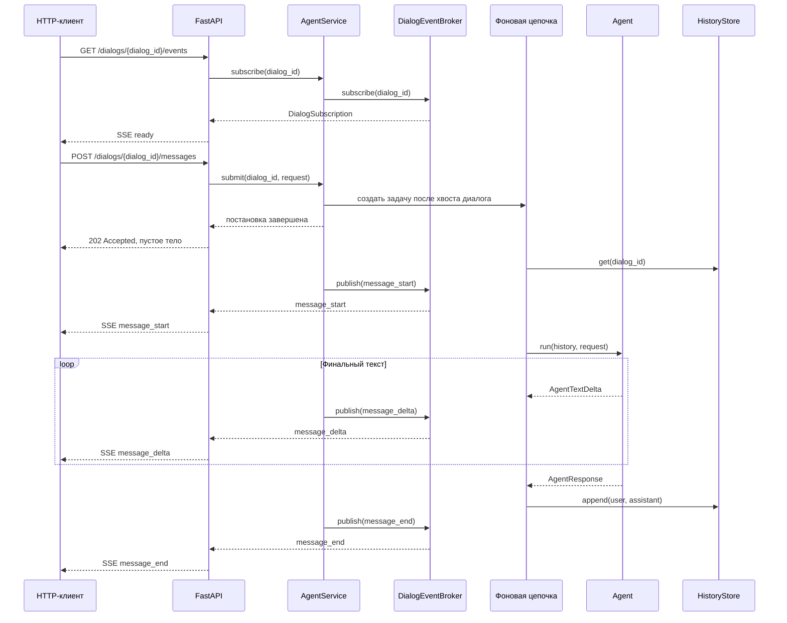
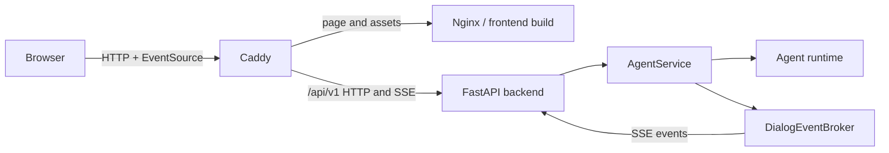

# Диалоги и HTTP API

[← Глобальный каталог](./README.md)

Диалоговый слой связывает HTTP API с независимым runtime агента. Прикладная
координация находится в `application`, хранение истории — в `dialogs`, а
FastAPI-маршруты только валидируют HTTP-ввод и преобразуют ошибки.

## Где находится реализация

- [`application/agent_service.py`](../backend/src/smeshariki_ai/application/agent_service.py)
  — очередь запусков и `AgentService`;
- [`application/event_broker.py`](../backend/src/smeshariki_ai/application/event_broker.py)
  — контракт `DialogEventBroker` и process-local реализация
  `InMemoryDialogEventBroker`;
- [`application/events.py`](../backend/src/smeshariki_ai/application/events.py)
  — типы событий и потребительский контракт подписки;
- [`dialogs/history.py`](../backend/src/smeshariki_ai/dialogs/history.py) —
  контракт истории и in-memory реализация для тестов;
- [`dialogs/models.py`](../backend/src/smeshariki_ai/dialogs/models.py) —
  сводка диалога, сохранённое сообщение и правило названия;
- [`db/history.py`](../backend/src/smeshariki_ai/db/history.py) —
  production-реализация `PostgresHistoryStore`;
- [`api/app.py`](../backend/src/smeshariki_ai/api/app.py) — HTTP-маршруты и
  shutdown lifecycle;
- [`api/schemas.py`](../backend/src/smeshariki_ai/api/schemas.py) — схемы HTTP-
  запросов и ответов;
- [`api/agent_test.html`](../backend/src/smeshariki_ai/api/agent_test.html) —
  самодостаточный тестовый интерфейс;
- [`frontend/src/agent-api.js`](../frontend/src/agent-api.js) — браузерный
  HTTP/SSE-клиент dialog API;
- [`frontend/src/script.js`](../frontend/src/script.js) — состояния формы,
  порядок сообщений и отображение потокового ответа;
- [`frontend/vite.config.js`](../frontend/vite.config.js) — локальный same-
  origin dev proxy пути `/api`;
- [`docker/Caddyfile`](../docker/Caddyfile) — основной same-origin маршрут
  `/api` к backend и остальных путей к Nginx;
- [`bootstrap.py`](../backend/src/smeshariki_ai/bootstrap.py) — сборка готовых
  зависимостей приложения.

## Внутренние контракты

```python
AgentService(
    agent: AgentRunner,
    history_store: HistoryStore,
    event_broker: DialogEventBroker,
)
await AgentService.start_dialog(user_id: UUID) -> UUID
await AgentService.list_dialogs(user_id: UUID) -> tuple[DialogSummary, ...]
await AgentService.transcript(user_id: UUID, dialog_id: UUID) -> DialogTranscript
await AgentService.submit(
    user_id: UUID, dialog_id: UUID, request: UserRequest
) -> None
await AgentService.subscribe(user_id: UUID, dialog_id: UUID) -> DialogSubscription
await AgentService.unsubscribe(subscription: DialogSubscription) -> None
await AgentService.shutdown() -> None

await DialogEventBroker.subscribe(dialog_id: UUID) -> DialogSubscription
await DialogEventBroker.unsubscribe(subscription: DialogSubscription) -> None
await DialogEventBroker.publish(dialog_id: UUID, event: DialogEvent) -> None
await DialogEventBroker.shutdown() -> None
```

`start_dialog` создаёт пустой диалог, принадлежащий пользователю, и возвращает
UUIDv4. Все операции конкретного диалога получают `user_id` и передают его
хранилищу: чужой и несуществующий диалог одинаково дают
`DialogNotFoundError`. `list_dialogs` возвращает не более 50 диалогов. Возврат из `submit`
означает только то, что фоновая задача создана в текущем процессе; метод не ждёт
ответа агента.

Для одного `dialog_id` сервис хранит хвост цепочки `asyncio.Task`: следующий
запуск ожидает предыдущий и только затем читает обновлённую историю. Разные
диалоги имеют независимые цепочки и могут выполняться параллельно. Очередь не
ограничена по длине и не сохраняется после перезапуска.

`AgentService` проверяет существование диалога и состояние lifecycle, после чего
делегирует открытие, закрытие и доставку событий внедрённому
`DialogEventBroker`. Сервис не хранит подписчиков и не знает об устройстве их
очередей.

Production composition root создаёт один `InMemoryDialogEventBroker` на
экземпляр приложения. Он ведёт независимые наборы подписчиков по `dialog_id` и
публикует им `message_start`, `message_delta`, `message_end` или
`message_error`. Очередь каждого подписчика ограничена 64 событиями:
переполненная или отключённая подписка удаляется и не создаёт backpressure для
агента. События не сохраняются для replay; подключившийся клиент видит только
будущие события. Брокер не зависит от FastAPI, агента и `HistoryStore`.

```python
await HistoryStore.create(owner_id: UUID) -> UUID
await HistoryStore.get(owner_id: UUID, dialog_id: UUID) -> tuple[Message, ...]
await HistoryStore.append(
    dialog_id: UUID,
    messages: Sequence[Message],
) -> None
await HistoryStore.list_dialogs(
    owner_id: UUID, *, limit: int
) -> tuple[DialogSummary, ...]
await HistoryStore.transcript(owner_id: UUID, dialog_id: UUID) -> DialogTranscript
```

`get` возвращает неизменяемый снимок. `append` атомарно добавляет группу
сообщений и обновляет `updated_at`; первое сообщение пользователя задаёт
название диалога: пробельные последовательности заменяются одним пробелом,
длинный текст обрезается до 60 символов с `…`, позже название не меняется.
`list_dialogs` возвращает только диалоги с сообщениями, от недавно
обновлённых к старым. Сбой хранилища — `DialogStoreUnavailableError`.

Production bootstrap использует `PostgresHistoryStore` на общем с
аутентификацией engine (схема — в [базе данных](./database.md)); история
переживает рестарт backend. `InMemoryHistoryStore` поддерживает тот же
контракт и используется в тестах. После успешного запуска сервис сохраняет одной операцией только
пользовательское и финальное сообщения ассистента. При ошибке агента история не
меняется; tool calls и tool results в историю диалога не попадают.

## Поток сообщения



## HTTP-контракты

Базовый префикс API — `/api/v1`. Все ручки диалогов требуют
действительный access-токен в cookie: без него они отвечают `401`
`{"error":"unauthorized"}`, при недоступности хранилищ аутентификации — `503`
`{"error":"unavailable"}`, причём раньше `404` и `422`. Подробности — в
[аутентификации](./auth.md#защищённые-ручки).

| Запрос | Успешный ответ | Ошибки |
| --- | --- | --- |
| `POST /api/v1/dialogs` без тела | `201 Created`, `Location: /api/v1/dialogs/<uuid>`, JSON `{"dialog_id":"<uuid>"}`; владелец — текущий пользователь | `503 Service Unavailable`, если сервис больше не принимает запросы или хранилище недоступно |
| `POST /api/v1/dialogs/{dialog_id}/messages` с JSON `{"request":"<непустой текст>"}` и необязательным `"reading_minutes": 2\|5\|10` (длина истории в минутах чтения; в историю не сохраняется) | Немедленный `202 Accepted` с пустым телом после создания фоновой задачи | `404 Not Found` для неизвестного или чужого диалога; `422 Unprocessable Entity` для некорректного UUID, пустого текста, лишних полей или `reading_minutes` вне 2/5/10 (включая явный `null`); `503 Service Unavailable`, если задачу нельзя принять |
| `GET /api/v1/dialogs` | `200 OK`, JSON `{"dialogs":[{"dialog_id","title","created_at","updated_at"}]}`: до 50 непустых диалогов пользователя от недавно обновлённых | `503 Service Unavailable` при сбое хранилища |
| `GET /api/v1/dialogs/{dialog_id}/messages` | `200 OK`, JSON `{"dialog_id","title","messages":[{"id","role","content","created_at","feedback"}]}` в порядке сообщений (`id` — число, `feedback` — целый балл 1–5 или `null`); у нового диалога `title` равен `null`, `messages` пуст | `404 Not Found` для неизвестного или чужого диалога; `422` для некорректного UUID; `503` при сбое хранилища |
| `PUT /api/v1/dialogs/{dialog_id}/messages/{message_id}/feedback` с JSON `{"score": 1–5}` (строгое целое); `DELETE` по тому же адресу | `204 No Content`: оценка поставлена, изменена или снята (снятие отсутствующей оценки тоже `204`) | `404 {"detail":"Message not found."}` для чужого или несуществующего диалога, несуществующего сообщения, сообщения другого диалога и сообщения пользователя; `422` для некорректного `message_id` или тела; `503` при сбое хранилища |
| `GET /api/v1/dialogs/{dialog_id}/events` | `200 OK`, `text/event-stream`, начальное `ready`, heartbeat и будущие `message_*` events | `404 Not Found` для неизвестного или чужого диалога; `422 Unprocessable Entity` для некорректного UUID; `503 Service Unavailable` после остановки сервиса или при сбое хранилища |
| `GET /agent_test` | `200 OK`, один самодостаточный HTML с тестовым чатом | Стандартная ошибка FastAPI при недоступности приложения |

`dialog_id` всегда передаётся в URL и не является средством авторизации:
диалог принадлежит создавшему его пользователю, и для чужого диалога все
ручки отвечают `404 {"detail":"Dialog not found."}`, не раскрывая его
существование; роль `admin` доступа к чужим диалогам не даёт. При сбое
PostgreSQL ручки диалогов отвечают `503 {"detail":"Agent service is
unavailable."}`. Время в ответах — ISO 8601 в UTC. Cookie для выбора диалога
не создаются и не читаются.

SSE events содержат JSON: `ready` передаёт `dialog_id`, `message_delta` —
непустой `delta`, `message_error` — безопасные `code` и `message`, а
`message_start` использует пустой объект, а `message_end` — `{"message_id": <id>}`
сохранённого ответа ассистента, чтобы его можно было сразу оценить. Tool calls, tool
results и история через поток не выдаются. `Last-Event-ID` не поддерживается:
после переподключения replay отсутствует. CORS middleware не реализован.

`/agent_test` открыт без входа, но его запросы к API требуют сессию из
`/login/` на том же origin. Страница создаёт новый диалог, открывает `EventSource`, отправляет сообщения
в существующую POST-ручку и постепенно дополняет ответ. Страница состоит из
одного HTML с встроенными CSS и vanilla JavaScript, не загружает внешние ресурсы
и вставляет запросы и ответы в DOM как текст.

## Frontend-интеграция

В основном Compose запуске браузер получает frontend от Nginx через Caddy и
обращается к относительным адресам `/api/v1/...` на том же origin. Caddy
передаёт API и SSE в backend, сохраняя префикс `/api`; остальные запросы
направляет в Nginx. Backend и Nginx не публикуют порты на хосте.
Отдельный Vite dev server также проксирует `/api` в backend: default target —
`http://127.0.0.1:8000`, переопределение — `BACKEND_URL`. Ни один из сценариев
не требует CORS или изменения FastAPI-контракта.
`AgentApi` вызывает браузерный `fetch` с глобальным контекстом `Window`:
сохранённая функция не должна получать `AgentApi` как `this`, иначе запрос
может завершиться до отправки в сеть.



При загрузке страницы frontend создаёт новый диалог, открывает один
`EventSource`, блокирует форму до `ready` и загружает список историй
`GET /api/v1/dialogs` для боковой панели. Выбор истории загружает
`GET /api/v1/dialogs/{dialog_id}/messages` и переключает `EventSource` на
выбранный диалог только после успешной загрузки; после `message_end` список
перезагружается. При ошибке создания диалога
frontend оставляет форму заблокированной и повторяет запрос через три секунды;
после успешного создания повтор прекращается. После успешного `202 Accepted`
пользовательское сообщение добавляется в чат, а события `message_delta`
дописываются в одну реплику ассистента. События, пришедшие во время POST,
буферизуются, чтобы ответ агента не оказался выше сообщения пользователя.
Одновременно допускается только один незавершённый запрос.

Пользовательский текст, delta, названия историй и сообщения ошибок
добавляются через `textContent`. `dialog_id` не сохраняется в cookie,
`localStorage` или URL; полная
перезагрузка создаёт новый диалог. Ошибка EventSource блокирует форму, пока
браузер пытается переподключиться, но потерянные события не восстанавливаются,
так как backend не поддерживает replay.

## Наблюдаемость и lifecycle

Сервис журналирует создание диалога, принятие запроса, начало и завершение
фонового запуска, сохранение истории, отмену и тип ошибки с привязкой к
`dialog_id`. Вместе с событиями runtime это позволяет увидеть каждую итерацию и
статус инструмента. Текст запроса, история, ответы, tool payload, секреты и текст
исключения не журналируются.

При штатном shutdown сервис прекращает принимать новые запросы, отменяет все
отслеживаемые фоновые задачи и ожидает их завершения, после чего вызывает
`DialogEventBroker.shutdown()`. Брокер закрывает подписки и разблокирует
ожидающих потребителей. Повторные unsubscribe и shutdown безопасны. История
диалогов хранится в PostgreSQL, а очереди запусков и SSE-события находятся
только в памяти процесса и после перезапуска теряются.

## Где искать подробности

- [спецификация](../specs/changes/agent-dialog-api/spec.md);
- [план](../specs/changes/agent-dialog-api/plan.md);
- [результат проверки](../specs/changes/agent-dialog-api/verification.md);
- [спецификация streaming и SSE](../specs/changes/agent-sse-test-ui/spec.md);
- [план streaming и SSE](../specs/changes/agent-sse-test-ui/plan.md);
- [результат проверки streaming и SSE](../specs/changes/agent-sse-test-ui/verification.md);
- [спецификация брокера событий](../specs/changes/dialog-event-broker/spec.md);
- [план брокера событий](../specs/changes/dialog-event-broker/plan.md);
- [результат проверки брокера событий](../specs/changes/dialog-event-broker/verification.md);
- [спецификация единого Compose запуска](../specs/changes/compose-caddy-nginx-stack/spec.md);
- [план единого Compose запуска](../specs/changes/compose-caddy-nginx-stack/plan.md);
- [результат проверки единого Compose запуска](../specs/changes/compose-caddy-nginx-stack/verification.md);
- [спецификация frontend-интеграции](../specs/changes/frontend-agent-integration/spec.md);
- [план frontend-интеграции](../specs/changes/frontend-agent-integration/plan.md);
- [результат проверки frontend-интеграции](../specs/changes/frontend-agent-integration/verification.md);
- [спецификация постоянной истории](../specs/changes/user-dialog-history/spec.md);
- [план постоянной истории](../specs/changes/user-dialog-history/plan.md);
- [результат проверки постоянной истории](../specs/changes/user-dialog-history/verification.md);
- [запуск и тестовые HTTP-запросы](../docker/README.md).
