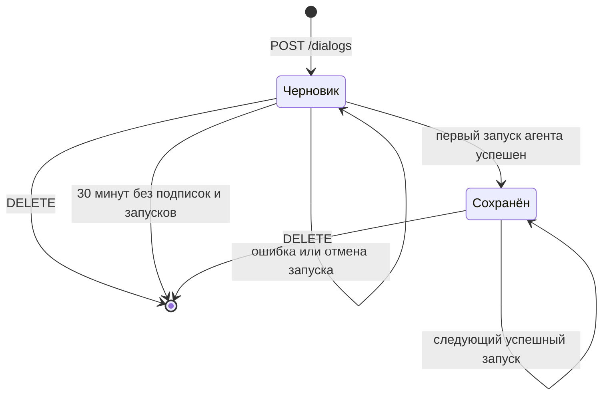
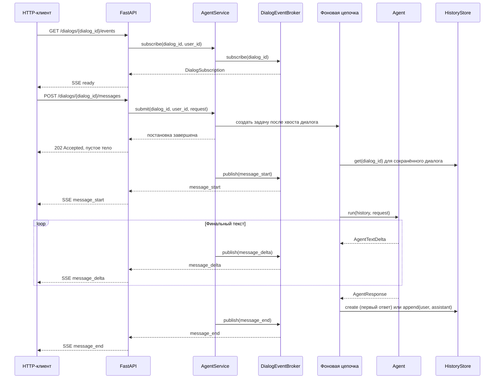
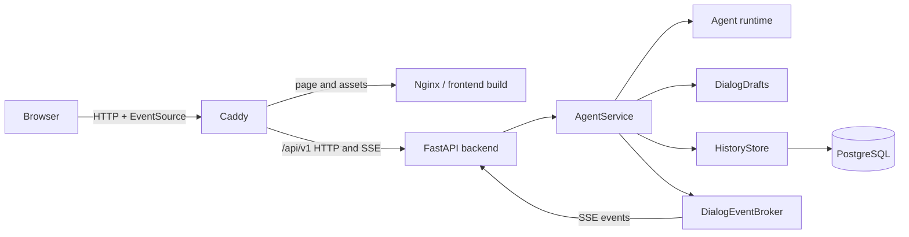

# Диалоги и HTTP API

[← Глобальный каталог](./README.md)

Диалоговый слой связывает HTTP API с независимым runtime агента. Прикладная
координация находится в `application`, контракт хранения истории и реестр
черновиков — в `dialogs`, PostgreSQL-реализация хранения — в `db`, а
FastAPI-маршруты только валидируют HTTP-ввод и преобразуют ошибки.

## Где находится реализация

- [`application/agent_service.py`](../backend/src/smeshariki_ai/application/agent_service.py)
  — очередь запусков и `AgentService`;
- [`application/event_broker.py`](../backend/src/smeshariki_ai/application/event_broker.py)
  — контракт `DialogEventBroker` и process-local реализация
  `InMemoryDialogEventBroker`;
- [`application/events.py`](../backend/src/smeshariki_ai/application/events.py)
  — типы событий и потребительский контракт подписки;
- [`dialogs/history.py`](../backend/src/smeshariki_ai/dialogs/history.py) —
  контракт истории и in-memory реализация для тестов;
- [`dialogs/models.py`](../backend/src/smeshariki_ai/dialogs/models.py) —
  сводка диалога, сохранённое сообщение и правило названия;
- [`db/history.py`](../backend/src/smeshariki_ai/db/history.py) —
  production-реализация `PostgresHistoryStore`;
- [`api/app.py`](../backend/src/smeshariki_ai/api/app.py) — HTTP-маршруты и
  shutdown lifecycle;
- [`api/schemas.py`](../backend/src/smeshariki_ai/api/schemas.py) — схемы HTTP-
  запросов и ответов;
- [`api/agent_test.html`](../backend/src/smeshariki_ai/api/agent_test.html) —
  самодостаточный тестовый интерфейс;
- [`frontend/src/agent-api.js`](../frontend/src/agent-api.js) — браузерный
  HTTP/SSE-клиент dialog API;
- [`frontend/src/script.js`](../frontend/src/script.js) — состояния формы,
  порядок сообщений и отображение потокового ответа;
- [`frontend/vite.config.js`](../frontend/vite.config.js) — локальный same-
  origin dev proxy пути `/api`;
- [`docker/Caddyfile`](../docker/Caddyfile) — основной same-origin маршрут
  `/api` к backend и остальных путей к Nginx;
- [`bootstrap.py`](../backend/src/smeshariki_ai/bootstrap.py) — сборка готовых
  зависимостей приложения.

## Жизненный цикл диалога

Диалог попадает в PostgreSQL только после первого успешного ответа агента. До
этого он остаётся черновиком: клиент знает `dialog_id`, а backend держит в
памяти процесса владельца и счётчики активности.



- Черновик создаёт `DialogDrafts`; PostgreSQL не используется. Рестарт backend
  теряет черновики, сохранённые диалоги его переживают.
- Первый успешный запуск одной транзакцией вставляет строку `dialogs` с
  заголовком и пару сообщений; `message_end` публикуется после фиксации. При
  ошибке агента, отмене или сбое хранилища в базе ничего не остаётся,
  подписчики получают `message_error`, а следующий запрос снова считается
  первым.
- Черновик без подписок `events` и без активных или ожидающих запусков
  удаляется через `DRAFT_TTL` (30 минут). Проверка ленивая: срок
  проверяется при обращении к черновику, а `create` удаляет все истёкшие
  черновики. Короткое переподключение `EventSource` черновик не теряет.
- Заголовок — первый пользовательский запрос: пробелы по краям удаляются,
  последовательности пробельных символов схлопываются в один пробел, текст
  длиннее 60 символов обрезается до 60 с добавлением `…`. Заголовок задаётся
  при сохранении и дальше не меняется (`make_title`).
- После рестарта в сохранённый диалог можно писать: агент получает сохранённую
  историю как контекст.

## Внутренние контракты

```python
AgentService(
    agent: AgentRunner,
    history_store: HistoryStore,
    event_broker: DialogEventBroker,
    *,
    drafts: DialogDrafts | None = None,
    clock: Callable[[], datetime] | None = None,
)
await AgentService.start_dialog(user_id: UUID) -> UUID
await AgentService.list_dialogs(user_id: UUID) -> tuple[DialogSummary, ...]
await AgentService.transcript(user_id: UUID, dialog_id: UUID) -> DialogTranscript
await AgentService.submit(
    user_id: UUID, dialog_id: UUID, request: UserRequest
) -> None
await AgentService.subscribe(user_id: UUID, dialog_id: UUID) -> DialogSubscription
await AgentService.unsubscribe(subscription: DialogSubscription) -> None
await AgentService.list_dialogs(
    user_id: UUID,
    limit: int,
    after: DialogCursor | None = None,
) -> DialogPage            # items, next_cursor
await AgentService.get_dialog(dialog_id: UUID, user_id: UUID) -> DialogTranscript
await AgentService.delete_dialog(dialog_id: UUID, user_id: UUID) -> None
await AgentService.shutdown() -> None

await DialogEventBroker.subscribe(dialog_id: UUID) -> DialogSubscription
await DialogEventBroker.unsubscribe(subscription: DialogSubscription) -> None
await DialogEventBroker.publish(dialog_id: UUID, event: DialogEvent) -> None
await DialogEventBroker.close_dialog(dialog_id: UUID) -> None
await DialogEventBroker.shutdown() -> None
```

`start_dialog` создаёт пустой диалог, принадлежащий пользователю, и возвращает
UUIDv4. Все операции конкретного диалога получают `user_id` и передают его
хранилищу: чужой и несуществующий диалог одинаково дают
`DialogNotFoundError`. `list_dialogs` возвращает не более 50 диалогов. Возврат из `submit`
означает только то, что фоновая задача создана в текущем процессе; метод не ждёт
ответа агента.

Для одного `dialog_id` сервис хранит хвост цепочки `asyncio.Task`: следующий
запуск ожидает предыдущий и только затем читает обновлённую историю. Разные
диалоги имеют независимые цепочки и могут выполняться параллельно. Очередь не
ограничена по длине и не сохраняется после перезапуска.

`AgentService` проверяет существование диалога, его владельца и состояние
lifecycle, после чего
делегирует открытие, закрытие и доставку событий внедрённому
`DialogEventBroker`. Сервис не хранит подписчиков и не знает об устройстве их
очередей.

Production composition root создаёт один `InMemoryDialogEventBroker` на
экземпляр приложения. Он ведёт независимые наборы подписчиков по `dialog_id` и
публикует им `message_start`, `message_delta`, `message_end` или
`message_error`. Очередь каждого подписчика ограничена 64 событиями:
переполненная или отключённая подписка удаляется и не создаёт backpressure для
агента. События не сохраняются для replay; подключившийся клиент видит только
будущие события. `close_dialog` закрывает все подписки одного диалога после
доставки уже поставленных в очередь событий; повторный вызов и вызов после
`shutdown` безопасны. Брокер не зависит от FastAPI, агента и `HistoryStore`.

```python
await HistoryStore.create(owner_id: UUID) -> UUID
await HistoryStore.get(owner_id: UUID, dialog_id: UUID) -> tuple[Message, ...]
await HistoryStore.append(
    dialog_id: UUID, messages: Sequence[Message], now: datetime,
) -> None
await HistoryStore.list_dialogs(
    owner_id: UUID, *, limit: int
) -> tuple[DialogSummary, ...]
await HistoryStore.transcript(owner_id: UUID, dialog_id: UUID) -> DialogTranscript
```

`get` возвращает неизменяемый снимок. `append` атомарно добавляет группу
сообщений и обновляет `updated_at`; первое сообщение пользователя задаёт
название диалога: пробельные последовательности заменяются одним пробелом,
название хранится целиком до 200 символов (длиннее — обрезается до 200 с `…`), позже не меняется. Обрезку по ширине делает страница, полный текст — в подсказке ([dialog-full-title](../specs/changes/dialog-full-title/spec.md)).
`list_dialogs` возвращает только диалоги с сообщениями, от недавно
обновлённых к старым. Сбой хранилища — `DialogStoreUnavailableError`.

Production bootstrap использует `PostgresHistoryStore` на общем с
аутентификацией engine (схема — в [базе данных](./database.md)); история
переживает рестарт backend. `InMemoryHistoryStore` поддерживает тот же
контракт и используется в тестах. После успешного запуска сервис сохраняет одной операцией только
пользовательское и финальное сообщения ассистента. При ошибке агента история не
меняется; tool calls и tool results в историю диалога не попадают.

## Поток сообщения



## HTTP-контракты

Базовый префикс API — `/api/v1`. Все ручки диалогов требуют
действительный access-токен в cookie: без него они отвечают `401`
`{"error":"unauthorized"}`, при недоступности хранилищ аутентификации — `503`
`{"error":"unavailable"}`, причём раньше `404` и `422`. Подробности — в
[аутентификации](./auth.md#защищённые-ручки).

| Запрос | Успешный ответ | Ошибки |
| --- | --- | --- |
| `POST /api/v1/dialogs` без тела | `201 Created`, `Location: /api/v1/dialogs/<uuid>`, JSON `{"dialog_id":"<uuid>"}`; владелец — текущий пользователь | `503 Service Unavailable`, если сервис больше не принимает запросы или хранилище недоступно |
| `POST /api/v1/dialogs/{dialog_id}/messages` с JSON `{"request":"<непустой текст>"}` и необязательным `"reading_minutes": 2\|5\|10` (длина истории в минутах чтения; в историю не сохраняется) | Немедленный `202 Accepted` с пустым телом после создания фоновой задачи | `404 Not Found` для неизвестного или чужого диалога; `422 Unprocessable Entity` для некорректного UUID, пустого текста, лишних полей или `reading_minutes` вне 2/5/10 (включая явный `null`); `503 Service Unavailable`, если задачу нельзя принять |
| `DELETE /api/v1/dialogs/{dialog_id}` | `204 No Content`: диалог пользователя удалён вместе с сообщениями и оценками (каскад в PostgreSQL); генерация по нему не сохраняется и завершается `message_error`; событие журнала `dialog.deleted` с `dialog_id` | `404 {"detail":"Dialog not found."}` для чужого или несуществующего диалога (чужой не удаляется); `422` для некорректного UUID; `503` при сбое хранилища |
| `GET /api/v1/dialogs` | `200 OK`, JSON `{"dialogs":[{"dialog_id","title","created_at","updated_at"}]}`: до 50 непустых диалогов пользователя от недавно обновлённых | `503 Service Unavailable` при сбое хранилища |
| `GET /api/v1/dialogs/{dialog_id}/messages` | `200 OK`, JSON `{"dialog_id","title","messages":[{"id","role","content","created_at","feedback","reported","report"}]}` в порядке сообщений (`id` — число, `feedback` — целый балл 1–5 или `null`, `report` — `null`, `"sent"` (жалоба ждёт разбора) или `"reviewed"` (разобрана, без различия «рассмотрено»/«отклонено»), `reported` — `report !== null`); у нового диалога `title` равен `null`, `messages` пуст | `404 Not Found` для неизвестного или чужого диалога; `422` для некорректного UUID; `503` при сбое хранилища |
| `PUT /api/v1/dialogs/{dialog_id}/messages/{message_id}/feedback` с JSON `{"score": 1–5}` (строгое целое); `DELETE` по тому же адресу | `204 No Content`: оценка поставлена, изменена или снята (снятие отсутствующей оценки тоже `204`) | `404 {"detail":"Message not found."}` для чужого или несуществующего диалога, несуществующего сообщения, сообщения другого диалога и сообщения пользователя; `422` для некорректного `message_id` (не целое или вне 1…2⁶³−1) или тела, в том числе `"other"` без комментария; `503` при сбое хранилища |
| `POST /api/v1/dialogs/{dialog_id}/messages/{message_id}/report` с JSON `{"reason":"scary"\|"rude"\|"wrong"\|"other"}` и `"comment"` (до 500 символов, обрезается по краям, пустой — как отсутствующий; обязателен только для `"other"`, [report-other-needs-comment](../specs/changes/report-other-needs-comment/spec.md)) | `201 Created`, `{"report_id": n}`: жалоба сохранена с копией текста ответа и запроса перед ним; событие журнала `dialog.report.created` с `dialog_id`, `message_id`, `report_id`, `reason` | `409 {"detail":"Already reported."}` — на этот ответ уже есть жалоба (первая не меняется); `404 {"detail":"Message not found."}` — как у оценки; `422` для некорректного `message_id` (не целое или вне 1…2⁶³−1) или тела; `503` при сбое хранилища |
| `GET /api/v1/reports/news` | `200 OK`, `{"news":[{"report_id","dialog_id","dialog_title"}]}`: до 20 разобранных и ещё не закрытых пользователем жалоб, от недавно разобранных; у удалённой истории `dialog_id` и `dialog_title` равны `null`. Статус, причина и тексты не возвращаются | `503` при сбое хранилища |
| `POST /api/v1/reports/news/seen` с JSON `{"report_ids":[…]}` (1–20 целых от 1 до 2⁶³−1) | `204 No Content`: новости отмечены просмотренными; чужие, неразобранные, уже просмотренные и несуществующие id пропускаются; событие журнала `dialog.report.news_seen` с `count` | `422` для некорректного тела; `503` при сбое хранилища |
| `GET /api/v1/dialogs/{dialog_id}/events` | `200 OK`, `text/event-stream`, начальное `ready`, heartbeat и будущие `message_*` events | `404 Not Found` для неизвестного или чужого диалога; `422 Unprocessable Entity` для некорректного UUID; `503 Service Unavailable` после остановки сервиса или при сбое хранилища |
| `GET /agent_test` | `200 OK`, один самодостаточный HTML с тестовым чатом | Стандартная ошибка FastAPI при недоступности приложения |

`dialog_id` всегда передаётся в URL и не является средством авторизации:
диалог принадлежит создавшему его пользователю, и для чужого диалога все
ручки отвечают `404 {"detail":"Dialog not found."}`, не раскрывая его
существование; роль `admin` доступа к чужим диалогам не даёт. При сбое
PostgreSQL ручки диалогов отвечают `503 {"detail":"Agent service is
unavailable."}`. Время в ответах — ISO 8601 в UTC. Cookie для выбора диалога
не создаются и не читаются.

Ручки с телом (`messages`, `feedback`, `report`, `reports/news/seen`) без
`Content-Type: application/json` отвечают `415 {"detail":"Unsupported media
type."}` — после проверки токена, поэтому гость по-прежнему получает `401`.
Небезопасные запросы (`POST`, `PUT`, `DELETE`) с `Sec-Fetch-Site:
cross-site|same-site` отклоняются `403` до этих ручек — см.
[аутентификацию](./auth.md). Поток событий перепроверяет access-токен
подключения на каждом heartbeat (`AuthService.verify_session`): после выхода,
отзыва семейства, удаления пользователя или недоступности хранилищ он
завершается без дальнейших событий, а agent loop продолжает работу; истечение
`exp` поток не закрывает.

Ветка `feat/user-dialog-history` заменила параллельную реализацию истории из
[dialog-history](../specs/changes/dialog-history/spec.md): черновиков и
постраничного курсора нет, список отдаёт до 50 непустых диалогов, а удаление
не отменяет идущую генерацию — её результат не сохраняется, подписчики
получают `message_error`.

SSE events содержат JSON: `ready` передаёт `dialog_id`, `message_delta` —
непустой `delta`, `message_error` — безопасные `code` и `message`, а
`message_start` использует пустой объект, а `message_end` — `{"message_id": <id>}`
сохранённого ответа ассистента, чтобы его можно было сразу оценить. Tool calls, tool
results и история через поток не выдаются. `Last-Event-ID` не поддерживается:
после переподключения replay отсутствует. CORS middleware не реализован.

`/agent_test` открыт без входа, но его запросы к API требуют сессию из
`/login/` на том же origin. Страница создаёт новый диалог, открывает `EventSource`, отправляет сообщения
в существующую POST-ручку и постепенно дополняет ответ. Страница состоит из
одного HTML с встроенными CSS и vanilla JavaScript, не загружает внешние ресурсы
и вставляет запросы и ответы в DOM как текст.

## Frontend-интеграция

В основном Compose запуске браузер получает frontend от Nginx через Caddy и
обращается к относительным адресам `/api/v1/...` на том же origin. Caddy
передаёт API и SSE в backend, сохраняя префикс `/api`; остальные запросы
направляет в Nginx. Backend и Nginx не публикуют порты на хосте.
Отдельный Vite dev server также проксирует `/api` в backend: default target —
`http://127.0.0.1:8000`, переопределение — `BACKEND_URL`. Ни один из сценариев
не требует CORS или изменения FastAPI-контракта.
`AgentApi` вызывает браузерный `fetch` с глобальным контекстом `Window`:
сохранённая функция не должна получать `AgentApi` как `this`, иначе запрос
может завершиться до отправки в сеть.



При загрузке страницы frontend создаёт новый диалог, открывает один
`EventSource`, блокирует форму до `ready` и загружает список историй
`GET /api/v1/dialogs` для боковой панели. Выбор истории загружает
`GET /api/v1/dialogs/{dialog_id}/messages` и переключает `EventSource` на
выбранный диалог только после успешной загрузки; после `message_end` список
перезагружается. При ошибке создания диалога
frontend оставляет форму заблокированной и повторяет запрос через три секунды;
после успешного создания повтор прекращается. После успешного `202 Accepted`
пользовательское сообщение добавляется в чат, а события `message_delta`
дописываются в одну реплику ассистента. События, пришедшие во время POST,
буферизуются, чтобы ответ агента не оказался выше сообщения пользователя.
Одновременно допускается только один незавершённый запрос.

Пользовательский текст, delta, названия историй и сообщения ошибок
добавляются через `textContent`. `dialog_id` не сохраняется в cookie,
`localStorage` или URL; полная
перезагрузка создаёт новый диалог. Ошибка EventSource блокирует форму, пока
браузер пытается переподключиться, но потерянные события не восстанавливаются,
так как backend не поддерживает replay.

## Наблюдаемость и lifecycle

Сервис журналирует создание диалога, отказ в доступе к чужому диалогу
(`dialog.access.denied` с `dialog_id`, `user_id`, `outcome="foreign"`;
в HTTP-ответе он неотличим от отсутствующего диалога), принятие запроса, начало и завершение
фонового запуска, сохранение истории, отмену и тип ошибки с привязкой к
`dialog_id`. Сохранение черновика журналируется как `dialog.persisted`,
удаление — как `dialog.deleted` (`dialog_id`, `user_id`, `draft`), истечение
черновика — как `dialog.draft.expired`, а ошибка хранилища на HTTP-пути — как
`dialog.storage.unavailable` с `error_type`. Вместе с событиями runtime это позволяет увидеть каждую итерацию и
статус инструмента. Текст запроса, заголовки, курсоры, история, ответы, tool payload, секреты и
текст исключения не журналируются.

При штатном shutdown сервис прекращает принимать новые запросы, отменяет все
отслеживаемые фоновые задачи и ожидает их завершения, после чего вызывает
`DialogEventBroker.shutdown()`. Брокер закрывает подписки и разблокирует
ожидающих потребителей. Повторные unsubscribe и shutdown безопасны. История
диалогов хранится в PostgreSQL, а очереди запусков и SSE-события находятся
только в памяти процесса и после перезапуска теряются.

## Где искать подробности

- [спецификация](../specs/changes/agent-dialog-api/spec.md);
- [план](../specs/changes/agent-dialog-api/plan.md);
- [результат проверки](../specs/changes/agent-dialog-api/verification.md);
- [спецификация streaming и SSE](../specs/changes/agent-sse-test-ui/spec.md);
- [план streaming и SSE](../specs/changes/agent-sse-test-ui/plan.md);
- [результат проверки streaming и SSE](../specs/changes/agent-sse-test-ui/verification.md);
- [спецификация брокера событий](../specs/changes/dialog-event-broker/spec.md);
- [план брокера событий](../specs/changes/dialog-event-broker/plan.md);
- [результат проверки брокера событий](../specs/changes/dialog-event-broker/verification.md);
- [спецификация единого Compose запуска](../specs/changes/compose-caddy-nginx-stack/spec.md);
- [план единого Compose запуска](../specs/changes/compose-caddy-nginx-stack/plan.md);
- [результат проверки единого Compose запуска](../specs/changes/compose-caddy-nginx-stack/verification.md);
- [спецификация frontend-интеграции](../specs/changes/frontend-agent-integration/spec.md);
- [план frontend-интеграции](../specs/changes/frontend-agent-integration/plan.md);
- [результат проверки frontend-интеграции](../specs/changes/frontend-agent-integration/verification.md);
- [спецификация постоянной истории](../specs/changes/user-dialog-history/spec.md);
- [план постоянной истории](../specs/changes/user-dialog-history/plan.md);
- [результат проверки постоянной истории](../specs/changes/user-dialog-history/verification.md);
- [усиление аутентификации: спецификация](../specs/changes/auth-hardening/spec.md),
  [план](../specs/changes/auth-hardening/plan.md),
  [результат проверки](../specs/changes/auth-hardening/verification.md);
- [владение диалогами: спецификация](../specs/changes/dialog-ownership/spec.md),
  [план](../specs/changes/dialog-ownership/plan.md),
  [результат проверки](../specs/changes/dialog-ownership/verification.md);
- [постоянная история диалогов: спецификация](../specs/changes/dialog-history/spec.md),
  [план](../specs/changes/dialog-history/plan.md);
- [запуск и тестовые HTTP-запросы](../docker/README.md).

## Жалобы на ответы

Пользователь может пожаловаться на ответ ассистента в своём диалоге, если тот
не подходит для детей. `HistoryStore.report` проверяет владельца так же, как
оценка, и сохраняет в жалобу копии текста ответа и ближайшего предыдущего
запроса пользователя: удаление истории обнуляет у жалобы `message_id`, но
жалоба с текстами остаётся у администратора. На один ответ — одна жалоба
(`UNIQUE(message_id)`).

Когда администратор закрывает жалобу (`resolved` или `dismissed`), она
становится новостью для пользователя: при открытии чата Крош в плашке
сообщает, что взрослые посмотрели жалобу, а под ответом флажок меняется на
«Взрослые посмотрели — спасибо!». Различие «рассмотрено»/«отклонено»
пользователю не раскрывается. «Хорошо» или «Открыть историю» отмечают
новость (`seen_at`); возврат жалобы в `new` снова делает её новостью после
следующего закрытия
([report-feedback-to-user](../specs/changes/report-feedback-to-user/spec.md)).
Разбор жалоб — в [панели администратора](./admin.md#жалобы-на-ответы),
схема — в [базе данных](./database.md#message_reports)
([message-report](../specs/changes/message-report/spec.md)).
