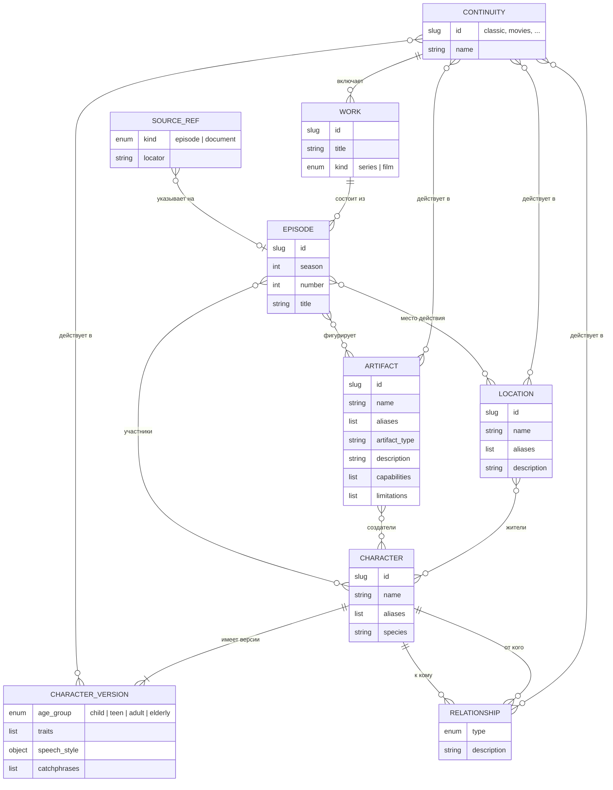

# Модель знаний

[← Глобальный каталог](./README.md) · [RAG](./rag.md)

Концептуальная ER-модель структурированных знаний о вселенной «Смешариков».
Она описывает предметную область целиком; физическая схема PostgreSQL
выводится из неё в `knowledge-postgres-store`.

## Сущности и связи



| Сущность | Смысл | Ключевые правила |
| --- | --- | --- |
| Вариант канона | Непротиворечивая версия вселенной (классика, фильмы…) | Справочник; на него ссылаются все факты |
| Произведение | Сериал или фильм | Принадлежит ровно одному варианту канона |
| Эпизод | Серия произведения | Вариант канона наследуется от произведения |
| Персонаж | Неизменная идентичность героя | На него ссылаются отношения, жители, создатели, эпизоды |
| Версия персонажа | Характер и речь героя в наборе вариантов канона | Не больше одной версии на вариант канона |
| Отношение | Направленная связь двух персонажей | Тип из закрытого словаря |
| Локация | Место действия | Жители — персонажи |
| Артефакт | Предмет или изобретение | Что умеет и чего не умеет; создатели — персонажи |
| Ссылка на источник | Необязательное подтверждение факта | Значение внутри записи, а не самостоятельная сущность |

## Идентичность

- У каждой сущности есть slug вида `^[a-z0-9]+(_[a-z0-9]+)*$`, например
  `pin` или `pin_house`. Slug уникален в пределах типа сущности и не меняется:
  на него ссылаются другие записи.
- Имена и алиасы нормализуются для сравнения и поиска так: `strip` →
  схлопнуть пробелы → `lower` → `ё` → `е`. Исходное написание сохраняется для
  вывода.
- Нормализованные имя и алиасы персонажа уникальны среди всех персонажей. У
  локаций и артефактов они уникальны среди сущностей того же типа, чьи
  варианты канона пересекаются: две разные локации с одним именем могут
  существовать в разных вариантах канона.

## Варианты канона и версии

Канон «Смешариков» содержит несколько вариантов: классический сериал,
полнометражные фильмы, спин-оффы. Почти все факты в них совпадают, но
характер и речь героя могут различаться.

- **Персонаж** — неизменная идентичность: slug, имя, алиасы, вид. На неё
  ссылаются отношения, жители, создатели и участники эпизодов.
- **Версия персонажа** — возрастная группа, характер, `speech_style` и
  коронные фразы в наборе вариантов канона. У персонажа одна или несколько
  версий; их наборы вариантов канона не пересекаются, поэтому в каждом
  варианте канона у персонажа не больше одной версии.
- **Локации, артефакты и отношения** версий не имеют: у каждой записи есть
  непустой набор вариантов канона, в которых факт верен.
- **Отношение** допустимо только в тех вариантах канона, где у обоих
  персонажей есть версия.
- **Участие в эпизоде** допустимо, только если вариант канона эпизода входит
  в варианты канона участника (для персонажа — в варианты одной из его
  версий).

Иллюстрация, а не формат файла (формат определяет `knowledge-catalog`):

```yaml
id: pin
name: Пин
species: пингвин
versions:
  - continuities: [classic]
    age_group: adult
    traits: [...]
  - continuities: [movies]
    age_group: adult
    traits: [...]
```

Если в новом варианте канона герой такой же, автор добавляет вариант в набор
существующей версии. Если он отличается, автор добавляет версию. Ссылки на
персонажа при этом не меняются.

## Реляционное представление

В YAML и доменной модели сущность — агрегат: списки и вложенные объекты
допустимы. В PostgreSQL (схема `rag`) агрегат раскладывается так:

| Часть агрегата | Представление |
| --- | --- |
| Атрибуты сущности | Колонки таблицы сущности |
| Алиасы | Отдельная таблица с уникальным индексом нормализованного значения |
| Варианты канона записи или версии | Связующая таблица |
| Связи между сущностями (жители, создатели, участники эпизодов, отношения) | Связующие таблицы с внешними ключами |
| `speech_style` | Колонки версии персонажа |
| Описательные списки без идентичности (`traits`, `catchphrases`, маркеры речи, `capabilities`, `limitations`) | `text[]` в строке сущности или версии |

Физическая схема и хранение ссылок на источники фиксируются в
`knowledge-postgres-store`.

## Источники

Ссылка на источник необязательна. Её стоит указывать для чувствительных
фактов:

- **оспоримых** — фанаты или разные материалы трактуют факт по-разному;
- **различающихся между вариантами канона** — например, черта характера,
  которая есть только в фильмах;
- **влияющих на будущие сюжеты** — способности и ограничения артефактов,
  отношения между героями.

Общеизвестные факты (имя, вид героя) источника не требуют. Ссылка указывает
на эпизод с таймкодом или на внешний документ с местом внутри него. Валидатор
проверяет только корректность указанной ссылки, например что эпизод
существует.

## Вне модели

- Правила мира и стиля сказок (конфликт без злодеев, светлый финал,
  возрастные роли как правило повествования) — ответственность system prompt
  агента.
- Повествовательные тексты (сюжеты, синопсисы, сценарии) — будущий поиск по
  лору.

## SDD-артефакты

- [спецификация](../specs/changes/rag-architecture/spec.md);
- [план](../specs/changes/rag-architecture/plan.md).
