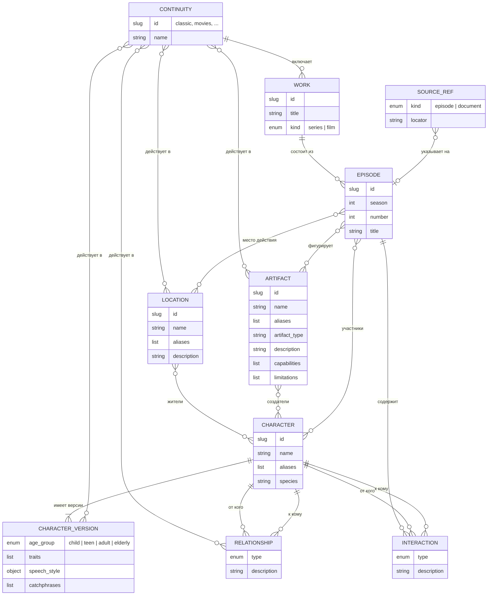

# Модель знаний

[← Глобальный каталог](./README.md) · [RAG](./rag.md)

Концептуальная ER-модель структурированных знаний о вселенной «Смешариков».
Она описывает предметную область целиком; из неё выведена
[физическая схема](#физическая-схема) PostgreSQL. Формат пакетов знаний и их
проверка реализованы в `knowledge-catalog`, хранилище и загрузка — в
`knowledge-postgres-store`.

## Сущности и связи



| Сущность | Смысл | Ключевые правила |
| --- | --- | --- |
| Вариант канона | Непротиворечивая версия вселенной (классика, фильмы…) | Справочник; на него ссылаются все факты |
| Произведение | Сериал или фильм | Принадлежит ровно одному варианту канона |
| Эпизод | Серия произведения | Вариант канона наследуется от произведения |
| Персонаж | Неизменная идентичность героя | На него ссылаются отношения, жители, создатели, эпизоды |
| Версия персонажа | Характер и речь героя в наборе вариантов канона | Не больше одной версии на вариант канона |
| Отношение | Устойчивая связь двух персонажей в вариантах канона | Тип из словаря отношений |
| Взаимодействие | Ситуативная связь двух участников эпизода: конфликт, поддержка, эмпатия | Тип из словаря взаимодействий; оба персонажа — участники эпизода |
| Локация | Место действия | Жители — персонажи |
| Артефакт | Предмет или изобретение | Что умеет и чего не умеет; создатели — персонажи |
| Ссылка на источник | Необязательное подтверждение факта | Значение внутри записи, а не самостоятельная сущность |

## Идентичность

- У каждой сущности есть slug вида `^[a-z0-9]+(_[a-z0-9]+)*$`, например
  `pin` или `pin_house`. Slug уникален в пределах типа сущности и не меняется:
  на него ссылаются другие записи.
- Имена и алиасы нормализуются для сравнения и поиска так: Unicode NFC →
  `casefold` → схлопнуть пробелы и обрезать края → `ё` → `е`. NFC нужен, чтобы
  «ё», набранная как «е» и комбинирующая диарезиса, давала тот же ключ, что и
  составная «ё». Исходное написание сохраняется для вывода.
- Нормализованные имя и алиасы персонажа уникальны среди всех персонажей. У
  локаций и артефактов они уникальны среди сущностей того же типа, чьи
  варианты канона пересекаются: две разные локации с одним именем могут
  существовать в разных вариантах канона.

## Варианты канона и версии

Канон «Смешариков» содержит несколько вариантов: классический сериал,
полнометражные фильмы, спин-оффы. Почти все факты в них совпадают, но
характер и речь героя могут различаться.

- **Персонаж** — неизменная идентичность: slug, имя, алиасы, вид. На неё
  ссылаются отношения, жители, создатели и участники эпизодов.
- **Версия персонажа** — возрастная группа, характер, `speech_style` и
  коронные фразы в наборе вариантов канона. У персонажа одна или несколько
  версий; их наборы вариантов канона не пересекаются, поэтому в каждом
  варианте канона у персонажа не больше одной версии.
- **Локации, артефакты и отношения** версий не имеют: у каждой записи есть
  непустой набор вариантов канона, в которых факт верен.
- **Отношение** допустимо только в тех вариантах канона, где у обоих
  персонажей есть версия.
- **Участие в эпизоде** допустимо, только если вариант канона эпизода входит
  в варианты канона участника (для персонажа — в варианты одной из его
  версий).

Пример персонажа с версиями — в разделе [«Формат пакета»](#формат-пакета).
Если в новом варианте канона герой такой же, автор добавляет вариант в набор
существующей версии. Если он отличается, автор добавляет версию. Ссылки на
персонажа при этом не меняются.

## Физическая схема

В YAML и доменной модели сущность — агрегат: списки и вложенные объекты
допустимы. В PostgreSQL каждый агрегат — корневая таблица и дочерние таблицы
с префиксом `rag_` в схеме `public` ([`rag/tables.py`](../backend/src/smeshariki_ai/rag/tables.py),
миграция [`0003`](../backend/src/smeshariki_ai/db/migrations/versions/0003_rag_knowledge.py)):

| Агрегат | Корень | Дочерние таблицы |
| --- | --- | --- |
| Вариант канона | `rag_continuities` | — |
| Произведение | `rag_works` | — |
| Эпизод | `rag_episodes` | `rag_episode_characters`, `rag_episode_locations`, `rag_episode_artifacts`, `rag_episode_interactions` |
| Персонаж | `rag_characters` | `rag_character_names`, `rag_character_versions`, `rag_character_version_continuities`, `rag_relationships`, `rag_relationship_continuities` |
| Локация | `rag_locations` | `rag_location_names`, `rag_location_continuities`, `rag_location_residents` |
| Артефакт | `rag_artifacts` | `rag_artifact_names`, `rag_artifact_continuities`, `rag_artifact_creators` |

| Часть агрегата | Представление |
| --- | --- |
| Атрибуты сущности | Колонки корневой таблицы; `created_at` и `updated_at` задаёт загрузка |
| Имя и алиасы | Таблица имён: позиция `0` — имя, далее алиасы, плюс нормализованное значение для индекса |
| Списки ссылок и вариантов канона | Таблицы с ключом «владелец — `position`», сохраняющим порядок |
| `speech_style` | Колонки версии персонажа |
| Описательные списки (`traits`, `catchphrases`, маркеры речи, `capabilities`, `limitations`) | `text[]` |
| Ссылки на источники | `jsonb`-массив в строке владельца |

Внешние ключи двух видов:

- **внутри агрегата** — дочерняя строка ссылается на свой корень или на
  другую дочернюю строку того же агрегата, `ON DELETE CASCADE`;
- **между агрегатами** — только на корневые таблицы, `ON DELETE RESTRICT`:
  удаление персонажа, на которого ссылаются эпизоды, локации или отношения,
  запрещено.

Поэтому загрузка заменяет дочерние строки изменённого агрегата и обновляет его
корень на месте, не затрагивая чужие агрегаты. Ограничения PostgreSQL —
вторая линия защиты после правил приложения: формат `id`, непустые строки,
словари типов, `season` и `number` ≥ 1, уникальный номер эпизода в
произведении и сезоне, уникальные имена персонажей, одна версия персонажа на
вариант канона (ключ таблицы вариантов канона версий), участник
взаимодействия — участник эпизода и вариант канона отношения — вариант канона
версии владельца (составные внешние ключи). Сложные правила проверяет только
приложение.

### Журнал

- `rag_loads` — каждая успешная загрузка: начало, конец, длительность, число
  сущностей в БД и счётчики по типам. Отменённая загрузка записей не
  оставляет.
- `rag_revisions` — журнал только на добавление: при каждом добавлении или
  изменении сущности — номер ревизии, операция, загрузка, версия формата и
  снимок агрегата в `jsonb` в формате файла пакета. Журнал не ссылается на
  таблицы сущностей, поэтому переживает их удаление; снимок можно снова
  загрузить как пакет. По версии формата снимок, записанный до изменения
  формата, распознаётся и преобразуется, а не молча перестаёт читаться.

Логическое удаление (`deleted_at`) не используется: удаление в
`knowledge-maintenance` будет физическим, а последняя версия агрегата останется
в журнале ревизий.

## Источники

Ссылка на источник необязательна. Её стоит указывать для чувствительных
фактов:

- **оспоримых** — фанаты или разные материалы трактуют факт по-разному;
- **различающихся между вариантами канона** — например, черта характера,
  которая есть только в фильмах;
- **влияющих на будущие сюжеты** — способности и ограничения артефактов,
  отношения между героями.

Общеизвестные факты (имя, вид героя) источника не требуют. Ссылка указывает
на эпизод с таймкодом или на внешний документ с местом внутри него и
прикрепляется к записи: персонажу, версии, отношению, взаимодействию, локации
или артефакту. Необязательное поле `note` уточняет, какой именно факт она
подтверждает. Валидатор проверяет только корректность указанной ссылки,
например что эпизод существует.

## Формат пакета

Пакет — каталог, который готовится вне репозитория. Внутри — подкаталоги
типов; любой может отсутствовать, а пакет может содержать любое подмножество
сущностей:

```text
<пакет>/
├── package.yaml             версия формата пакета
├── continuities/<id>.yaml   варианты канона
├── works/<id>.yaml          произведения
├── episodes/<id>.yaml       эпизоды с участниками и взаимодействиями
├── characters/<id>.yaml     персонажи с версиями и отношениями
├── locations/<id>.yaml      локации с жителями
└── artifacts/<id>.yaml      артефакты с создателями
```

- `package.yaml` обязателен и содержит только `format_version`; текущая и
  единственная поддерживаемая версия — `1`. Он делает изменение формата явным:
  пакет старого формата отвергается с понятной ошибкой, а не множеством
  ошибок схемы.
- Один файл — одна сущность целиком; имя файла без `.yaml` совпадает с `id`.
- Файлы и каталоги, имя которых начинается с точки (`.git`, `.DS_Store`),
  пропускаются; символьные ссылки отвергаются без чтения содержимого; другие
  лишние файлы и пакет без сущностей — ошибка.
- Файл — YAML-отображение в UTF-8. Скаляры разбираются по YAML 1.2 core:
  `true`/`false` — логические значения, десятичные числа — целые,
  `null` и пустое значение — отсутствие значения, остальное — строки. Поэтому
  `12:05`, `yes`, `no` и даты остаются строками. Повторяющийся ключ, теги и
  якоря — ошибка.
- Списки, не помеченные ниже как непустые, и поля, помеченные как
  необязательные, можно не указывать. Явное `null` вместо списка — ошибка.
- Отношения хранятся в файле персонажа, от которого они направлены (для
  симметричного типа — в файле любого из двух), взаимодействия и участники —
  в файле эпизода, жители — в файле локации, создатели — в файле артефакта.

Поля сущностей (полная машиночитаемая схема — команда `schema`):

| Тип | Обязательные поля | Необязательные поля |
| --- | --- | --- |
| Вариант канона | `id`, `name` | — |
| Произведение | `id`, `title`, `kind` (`series` \| `film`), `continuity` | — |
| Эпизод | `id`, `work`, `number` ≥ 1, `title` | `season` ≥ 1, `characters`, `locations`, `artifacts`, `interactions` |
| Персонаж | `id`, `name`, `species`, непустой `versions` | `aliases`, `relationships`, `sources` |
| Версия персонажа | непустой `continuities`, `age_group` (`child` \| `teen` \| `adult` \| `elderly`), непустой `traits`, `speech_style.register` | `speech_style.markers`, `speech_style.constraints`, `catchphrases`, `sources` |
| Отношение | `to`, `type`, непустой `continuities` | `description`, `sources` |
| Взаимодействие | `from`, `to`, `type`, `description` | `sources` |
| Локация | `id`, `name`, `description`, непустой `continuities` | `aliases`, `residents`, `sources` |
| Артефакт | `id`, `name`, `artifact_type`, `description`, непустой `continuities` | `aliases`, `capabilities`, `limitations`, `creators`, `sources` |
| Ссылка на источник | ровно одно из `episode` и `document` | `timecode` (`MM:SS` или `HH:MM:SS`) при `episode`, `locator` при `document`, `note` |

У фильма не больше одного эпизода: через него задаются участники и
взаимодействия фильма.

Синтетические примеры показывают формат, а не канонические данные.

```yaml
# package.yaml
format_version: 1
```

```yaml
# continuities/classic.yaml
id: classic
name: Классический сериал
```

```yaml
# works/series.yaml
id: series
title: Сериал
kind: series
continuity: classic
```

```yaml
# characters/pin.yaml
id: pin
name: Пин
aliases: [механик]
species: пингвин
versions:
  - continuities: [classic]
    age_group: adult
    traits: [изобретательный, ответственный]
    speech_style:
      register: разговорный
      markers: [акцент]
      constraints: [речь остаётся разборчивой]
    catchphrases: [пример фразы]
  - continuities: [movies]
    age_group: adult
    traits: [изобретательный, смелый]
    speech_style:
      register: разговорный
    sources:
      - document: Пример источника
        locator: раздел 2
        note: черта «смелый»
relationships:
  - to: krosh
    type: friendship
    continuities: [classic]
```

```yaml
# episodes/s01e01.yaml
id: s01e01
work: series
season: 1
number: 1
title: Пример эпизода
characters: [pin, krosh]
locations: [pin_house]
interactions:
  - from: krosh
    to: pin
    type: conflict
    description: Спор о том, кто первым возьмёт инструмент.
    sources:
      - episode: s01e01
        timecode: "04:32"
```

```yaml
# locations/pin_house.yaml
id: pin_house
name: Дом Пина
description: Дом и мастерская.
continuities: [classic]
residents: [pin]
```

```yaml
# artifacts/pin_plane.yaml
id: pin_plane
name: Самолёт Пина
artifact_type: летательный аппарат
description: Самодельный самолёт.
capabilities: [летает]
limitations: [требует ремонта]
continuities: [classic]
creators: [pin]
```

## Словари типов

Типы хранятся английскими значениями. Направленный тип читается «от `from`
(или владельца отношения) к `to`».

| Отношение | Значение | Направленность |
| --- | --- | --- |
| `friendship` | дружба | симметричное |
| `neighborhood` | соседство | симметричное |
| `affection` | симпатия | от того, кто испытывает |
| `mentor` | наставник | наставник → ученик |
| `guardian` | опекун | опекун → подопечный |

| Взаимодействие | Значение | Направленность |
| --- | --- | --- |
| `conflict` | конфликт или недопонимание | симметричное |
| `support` | поддержка | кто → кого |
| `empathy` | эмпатия | кто → к кому |

Для симметричного типа обратная пара считается тем же отношением или
взаимодействием и не может повторяться.

## Проверка пакета

```sh
python -m smeshariki_ai.rag check <пакет> [--format text|json]
python -m smeshariki_ai.rag schema
make knowledge-check DIR=<пакет>
```

Команды не требуют environment, БД и сети и не задают вопросов. Код возврата
`check`: `0` — пакет валиден, `1` — невалиден или не найден, `2` — неверные
аргументы (`make` при любой ошибке возвращает свой код `2`). Проверяется весь
пакет сразу, а ошибки выводятся в порядке «файл, поле»:

```text
characters/krosh.yaml: versions[0].age_group: обязательное поле не заполнено [missing_field]
episodes/s01e01.yaml: interactions[0].to: персонаж «krosh» не указан в characters эпизода [interaction_participant]
Сущностей: continuities: 0, works: 0, episodes: 1, characters: 1, locations: 0, artifacts: 0
Внешние ссылки (проверяются при загрузке): continuity classic, work series
Ошибок: 2
```

Сущность, которой нет в пакете, — не ошибка, а внешняя ссылка: она и
зависящие от неё правила проверяются при загрузке в БД. Ссылки на файлы,
которые сами не прошли проверку, не выводятся, чтобы одна ошибка не
порождала каскад других.

JSON-вывод (`--format json`) предназначен для агента автора:

```json
{
  "valid": false,
  "counts": {"continuities": 0, "works": 0, "episodes": 1, "characters": 1, "locations": 0, "artifacts": 0},
  "external": [{"type": "continuity", "id": "classic"}, {"type": "work", "id": "series"}],
  "issues": [
    {
      "file": "characters/krosh.yaml",
      "path": "versions[0].age_group",
      "code": "missing_field",
      "message": "обязательное поле не заполнено",
      "line": null
    }
  ]
}
```

`line` заполняется для ошибок разбора YAML. Коды ошибок стабильны:

| Группа | Коды |
| --- | --- |
| Пакет | `package_not_found`, `missing_manifest`, `unsupported_format_version`, `empty_package`, `unexpected_file`, `unexpected_directory`, `symlink_not_allowed`, `file_id_mismatch` |
| YAML | `invalid_encoding`, `yaml_syntax`, `duplicate_key`, `yaml_tag`, `yaml_anchor`, `not_a_mapping` |
| Схема | `missing_field`, `extra_field`, `invalid_type`, `empty_value`, `invalid_value`, `invalid_id`, `invalid_timecode`, `duplicate_value`, `invalid_source`, `schema_error` |
| Целостность | `unknown_reference` (только при загрузке), `overlapping_versions`, `self_reference`, `continuity_mismatch`, `duplicate_relationship`, `interaction_participant`, `duplicate_interaction`, `duplicate_name`, `duplicate_episode_number`, `film_episode_count` |
| Загрузка | `configuration_error` (не загружен конфиг backend), `database_unavailable`, `schema_not_ready` (не применены миграции), `stored_data_invalid` (данные в БД не проходят модели) |

Из двух конфликтующих сущностей ошибку получает та, чей `id` идёт позже; при
нескольких эпизодах фильма ошибку получает каждый.

## Изменение словаря типов

Типы отношений и взаимодействий — реестры в
[`rag/models.py`](../backend/src/smeshariki_ai/rag/models.py) с признаком
симметричности.

- **Добавить тип** — новое значение в реестре; существующие записи не
  меняются.
- **Разбить тип на несколько** — добавить новые типы, переклассифицировать
  записи в пакетах, затем удалить старый тип из реестра: `check` укажет каждую
  оставшуюся запись со старым типом (`invalid_value`). Порядок
  переклассификации уже загруженных записей — миграция, которая обновляет
  `CHECK` словаря и переклассифицирует строки.

## Вне модели

- Правила мира и стиля сказок (конфликт без злодеев, светлый финал,
  возрастные роли как правило повествования) — ответственность system prompt
  агента.
- Повествовательные тексты (сюжеты, синопсисы, сценарии) — будущий поиск по
  лору.

## SDD-артефакты

- архитектура: [спецификация](../specs/changes/rag-architecture/spec.md),
  [план](../specs/changes/rag-architecture/plan.md),
  [результат проверки](../specs/changes/rag-architecture/verification.md);
- формат и проверка: [спецификация](../specs/changes/knowledge-catalog/spec.md),
  [план](../specs/changes/knowledge-catalog/plan.md),
  [результат проверки](../specs/changes/knowledge-catalog/verification.md);
- хранилище и загрузка:
  [спецификация](../specs/changes/knowledge-postgres-store/spec.md),
  [план](../specs/changes/knowledge-postgres-store/plan.md),
  [результат проверки](../specs/changes/knowledge-postgres-store/verification.md);
- надёжность и рефакторинг:
  [спецификация](../specs/changes/knowledge-hardening/spec.md),
  [план](../specs/changes/knowledge-hardening/plan.md),
  [результат проверки](../specs/changes/knowledge-hardening/verification.md).
