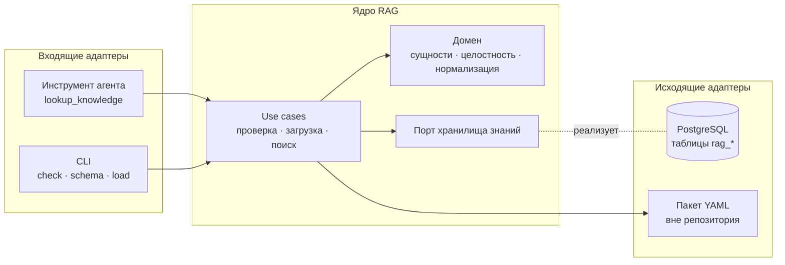
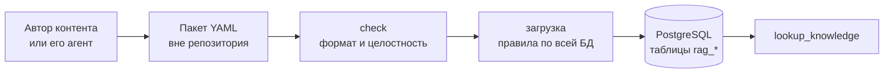
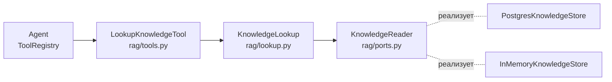

# RAG

[← Глобальный каталог](./README.md)

RAG даёт агенту канонические знания о вселенной «Смешариков». Первая очередь —
структурированные знания: сущности со строгой схемой и их точный поиск. Поиск
по неструктурированному лору (сюжеты, сценарии) — следующая очередь.

Состояние: реализованы формат и проверка пакетов, хранилище в PostgreSQL,
загрузка и инструмент агента `lookup_knowledge`.

## Назначение и границы

- RAG — модуль backend-монолита в пакете `smeshariki_ai.rag`, а не отдельный
  сервис. Публичного HTTP API нет.
- Агент получает RAG только через инструменты — наследники `agent.tools.Tool`,
  которые регистрируются в composition root (`bootstrap.py`). Инструмент
  точного поиска — `lookup_knowledge`. Когда его вызывать, модель узнаёт из
  описания инструмента; system prompt агента RAG не меняет.
- Выделение RAG в микросервис возможно в будущем. Правила изоляции ниже
  делают его дешёвым, но HTTP API заранее не создаётся.

## Слои

Правило зависимостей:

- домен зависит только от Pydantic;
- use cases зависят от домена и исходящих портов;
- входящие адаптеры вызывают только use cases;
- исходящие адаптеры реализуют порты.

Порт называется по возможности предметной области, а не по технологии, и
вводится только на границе с внешней системой, которую тесты заменяют
fake-реализацией: базой данных, позже LLM и embeddings. Пакет знаний читается
адаптером без отдельного порта: в тестах это временный каталог.

## Технологии

| Используется | Допустимое расширение (отдельным изменением) | Не используется |
| --- | --- | --- |
| PostgreSQL backend — единственное хранилище; PyYAML — разбор пакетов | Встроенный полнотекстовый поиск, `pg_trgm`, `pgvector`, embeddings через LiteLLM | Qdrant и другие отдельные хранилища, локальные файлы индексов, pickle, ML-модели в процессе backend без подтверждения бенчмарком |

## Данные

- Источник истины — PostgreSQL (таблицы `rag_*`). Знания закрыты: репозиторий
  публичный, поэтому реальные данные в него не попадают, а тесты и примеры
  документации синтетические.
- Знания поступают пакетами YAML-файлов, по одному файлу на сущность. Пакет
  может содержать любое подмножество сущностей; формат описан на странице
  [Модель знаний](./knowledge.md#формат-пакета).
- `check` проверяет пакет без БД: сущность, которой нет в пакете, выводится
  как внешняя ссылка. Загрузка читает знания из БД целиком фиксированным
  числом запросов и применяет к объединению с пакетом те же правила домена.
  Чтение только затронутой окрестности вводится, если этого потребуют метрики.
- Сложные правила целостности проверяет приложение; PostgreSQL дополнительно
  держит ключи и ограничения. Правила в SQL не дублируются.
- Загрузка выполняется в одной транзакции под advisory lock: проверка пакета,
  чтение БД, проверка правил на объединении, запись только новых и изменённых
  сущностей и журнала. При любом нарушении БД не меняется; повторная загрузка
  того же пакета ничего не пишет, кроме записи журнала загрузок.
- Каждая успешная загрузка записывается в `rag_loads`, каждое добавление и
  изменение сущности — в `rag_revisions` со снимком агрегата: так сохраняются
  история и возможность вернуть прежнюю версию. Схема описана на странице
  [Модель знаний](./knowledge.md#физическая-схема).
- Загрузка выполняется отдельной командой, а не при старте backend. Без
  загруженных знаний backend стартует, а инструмент возвращает безопасную
  ошибку «знания недоступны».

## Команды

| Команда | Назначение |
| --- | --- |
| `python -m smeshariki_ai.rag check <path> [--format text\|json]` | Проверить пакет без БД и environment. Код `0` — валиден, `1` — невалиден или не найден, `2` — неверные аргументы |
| `python -m smeshariki_ai.rag schema` | Версия формата, JSON Schema `package.yaml` и файлов каждого типа сущностей — подсказка агенту автора |
| `python -m smeshariki_ai.rag load <path> [--format text\|json]` | Проверить пакет и загрузить его в БД; конфиг БД берётся из `load_config`. Код `0` — загружено, `1` — пакет невалиден, нарушена целостность, БД недоступна или схема не готова, `2` — неверные аргументы |
| `make knowledge-check DIR=<path>` | `check` из корня репозитория через `uv`; `make` при любой ошибке возвращает собственный код `2` |
| `make knowledge-load DIR=<path> [FORMAT=json]` | Применить миграции и выполнить `load` в Compose-контейнере с окружением из `docker/.env`; пакет монтируется только для чтения. stdout содержит только отчёт `load` (с `FORMAT=json` — один JSON-документ), вывод сборки образа и миграций идёт в stderr |

Загрузка через Compose требует заполненного локального `docker/.env`. Когда
появится общая БД, загрузка перейдёт на отдельный конфиг только БД: это
изменение `config.py` и правила `AGENTS.md` по согласованию с владельцем.

## Инструмент `lookup_knowledge`

- **Аргументы:** `{"name": "<строка 1–200 символов>"}`, лишние поля
  запрещены. Неверные аргументы `ToolRegistry` превращает в
  `invalid_arguments`, хранилище не вызывается.
- **Поиск точный:** запрос нормализуется `normalize_name` и сравнивается с
  именами и алиасами персонажей, локаций и артефактов, названиями эпизодов
  (`rag_episodes.normalized_title`, миграция `0004`) и slug. Произведения и
  варианты канона не ищутся, а показываются в карточках названиями.
- **Порт чтения** `KnowledgeReader`: `find(key)` возвращает найденные
  агрегаты, произведения их эпизодов и названия всех сущностей, на которые
  они ссылаются; `has_knowledge()` — есть ли завершённая загрузка. PostgreSQL
  читает в транзакции `REPEATABLE READ READ ONLY` без advisory lock загрузки,
  поэтому поиск не ждёт загрузку и видит состояние до неё или после.
  Число запросов не зависит от числа сущностей.
- **Ответ:** `status`, `total`, `truncated`, `matches` и `message`.

| `status` | Когда | `message` |
| --- | --- | --- |
| `found` | Есть совпадения; в `matches` не больше 10 карточек, `total` — число совпадений | — |
| `not_found` | Совпадений нет, знания загружены | Не выдавать придуманные факты за канон |
| `unavailable` | Знаний нет, таблиц `rag_*` нет, БД недоступна или её данные невалидны | Не выдавать придуманные факты за канон |

- **Карточки** (`type` = `character`, `location`, `artifact`, `episode`)
  упорядочены по типу, затем по `id`. Ссылки показаны именами вместо slug,
  `sources` не входят. Персонаж — все версии с названиями вариантов канона,
  характер, `speech_style`, коронные фразы и отношения; локация — описание и
  жители; артефакт — тип, описание, возможности, ограничения и создатели;
  эпизод — произведение и его вариант канона, сезон и номер, участники,
  места, предметы и взаимодействия.
- **Журнал:** каждый вызов пишет `rag.lookup.completed` с `outcome`,
  `match_count`, длительностью, а при `unavailable` — `error_type` (ошибка
  хранилища, уровень `WARNING`) или `reason=not_loaded`. Текст запроса и
  содержимое карточек в журнал не попадают.
- **Подключение:** `build_agent_service` принимает необязательный
  `knowledge_reader` и регистрирует `lookup_knowledge` рядом с `get_context`.
  `create_application` передаёт `PostgresKnowledgeStore` на общем engine;
  без него (явный `auth_service`, вызов по умолчанию) используется пустой
  `InMemoryKnowledgeStore`, и инструмент отвечает `unavailable`. Модули RAG
  импортируются напрямую: пакет `rag` ничего не реэкспортирует, чтобы CLI не
  загружал агент и LiteLLM.

## Изоляция

- Таблицы RAG имеют префикс `rag_` в схеме `public`, описаны собственным
  `MetaData` в пакете `rag` и не ссылаются на таблицы других модулей: нет
  внешних ключей и `JOIN`. Отдельная схема не используется: тесты других
  модулей пересоздают схему `public` и миграции с нуля.
- Адаптер PostgreSQL находится в пакете `rag`; пакет `db/` других модулей не
  меняется. Миграции RAG — отдельные файлы в общей цепочке Alembic,
  затрагивающие только таблицы `rag_*`.
- Из других модулей RAG импортирует только `agent.tools.Tool` (в
  `rag/tools.py`), `log_event` и `utc_now` из `observability` и общие
  `DatabaseConfig` и `create_engine`.
- Инструмент получает use case `KnowledgeLookup` в конструкторе, аргументы и
  результаты — Pydantic-модели. Отдельный абстрактный интерфейс use case
  появится вместе со второй реализацией: при выделении RAG в сервис
  инструмент получит HTTP-клиент без изменения агента и домена.

## Точки интеграции

В общих файлах RAG только добавляет строки. Изменение существующего чужого
кода или текста решается отдельно с владельцем.

| Файл | Что добавляет RAG | Владелец |
| --- | --- | --- |
| `backend/src/smeshariki_ai/rag/` | Весь код модуля | RAG |
| `docs/rag.md`, `docs/knowledge.md` | Документация модуля | RAG |
| `backend/pyproject.toml`, `backend/uv.lock` | Зависимость PyYAML | Общий |
| `Makefile` | Цели команд знаний | Общий |
| `backend/src/smeshariki_ai/db/migrations/versions/` | Новые файлы миграций таблиц `rag_*` | Общий |
| `backend/src/smeshariki_ai/bootstrap.py` | Регистрация инструмента; список инструментов задан одной строкой, поэтому её изменение требует решения владельца агента | Агент |
| `backend/src/smeshariki_ai/config.py` | Подконфиг RAG, если понадобится; добавление поля в `Config` требует решения владельца | Backend |
| `docker/compose.yaml` | Не меняется: загрузка запускается в существующем сервисе `migrate` | Общий |
| `docs/README.md`, `AGENTS.md` | Строки каталога и разделы о реализованном RAG | Общий |

## Дальнейшие изменения

1. `knowledge-maintenance` — выгрузка сущностей из БД в пакет и удаление с
   проверкой ссылок и архивом в журнале ревизий.
2. Нечёткий поиск имён (`pg_trgm`) и подсказки при `not_found`.
3. Поиск по лору — отдельная серия после оценки потребности.

## SDD-артефакты

- архитектура: [спецификация](../specs/changes/rag-architecture/spec.md),
  [план](../specs/changes/rag-architecture/plan.md),
  [результат проверки](../specs/changes/rag-architecture/verification.md);
- формат и проверка знаний:
  [спецификация](../specs/changes/knowledge-catalog/spec.md),
  [план](../specs/changes/knowledge-catalog/plan.md),
  [результат проверки](../specs/changes/knowledge-catalog/verification.md);
- хранилище и загрузка:
  [спецификация](../specs/changes/knowledge-postgres-store/spec.md),
  [план](../specs/changes/knowledge-postgres-store/plan.md),
  [результат проверки](../specs/changes/knowledge-postgres-store/verification.md);
- инструмент `lookup_knowledge`:
  [спецификация](../specs/changes/knowledge-lookup-tool/spec.md),
  [план](../specs/changes/knowledge-lookup-tool/plan.md),
  [результат проверки](../specs/changes/knowledge-lookup-tool/verification.md);
- надёжность и рефакторинг:
  [спецификация](../specs/changes/knowledge-hardening/spec.md),
  [план](../specs/changes/knowledge-hardening/plan.md),
  [результат проверки](../specs/changes/knowledge-hardening/verification.md).
