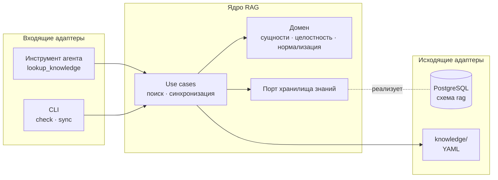
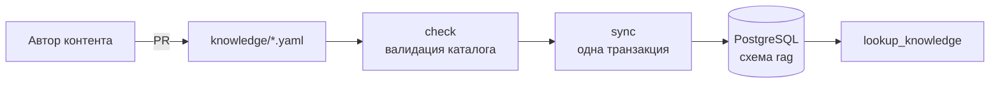

# RAG

[← Глобальный каталог](./README.md)

RAG даёт агенту канонические знания о вселенной «Смешариков». Первая очередь —
структурированные знания: сущности со строгой схемой и их точный поиск. Поиск
по неструктурированному лору (сюжеты, сценарии) — следующая очередь.

Состояние: архитектура согласована, код ещё не реализован.

## Назначение и границы

- RAG — модуль backend-монолита в пакете `smeshariki_ai.rag`, а не отдельный
  сервис. Публичного HTTP API нет.
- Агент получает RAG только через инструменты — наследники `agent.tools.Tool`,
  которые регистрируются в composition root (`bootstrap.py`). Инструмент
  точного поиска — `lookup_knowledge`. Когда его вызывать, модель узнаёт из
  описания инструмента; system prompt агента RAG не меняет.
- Выделение RAG в микросервис возможно в будущем. Правила изоляции ниже
  делают его дешёвым, но HTTP API заранее не создаётся.

## Слои

Правило зависимостей:

- домен зависит только от Pydantic;
- use cases зависят от домена и исходящих портов;
- входящие адаптеры вызывают только use cases;
- исходящие адаптеры реализуют порты.

Порт называется по возможности предметной области, а не по технологии, и
вводится только на границе с внешней системой, которую тесты заменяют
fake-реализацией: базой данных, позже LLM и embeddings. Файлы каталога
читаются адаптером без отдельного порта: в тестах это временный каталог.

## Технологии

| Используется | Допустимое расширение (отдельным изменением) | Не используется |
| --- | --- | --- |
| PostgreSQL backend — единственное хранилище | Встроенный полнотекстовый поиск, `pg_trgm`, `pgvector`, embeddings через LiteLLM | Qdrant и другие отдельные хранилища, локальные файлы индексов, pickle, ML-модели в процессе backend без подтверждения бенчмарком |

## Данные

- Источник истины — YAML-файлы в `knowledge/` в корне репозитория, по одному
  файлу на сущность. Каталог содержит только данные; формат и правила
  проверки определяет backend.
- PostgreSQL — проекция только для чтения во время работы backend.
  Единственный писатель — команда синхронизации. Данные не кладутся в
  Alembic-миграции.
- Синхронизация выполняется отдельным шагом после миграций, а не при старте
  backend. Без загруженных знаний backend стартует, а инструмент возвращает
  безопасную ошибку «знания недоступны».

Модель данных описана на странице [Модель знаний](./knowledge.md).

## Изоляция

- Таблицы RAG находятся в схеме PostgreSQL `rag`, описаны собственным
  `MetaData` в пакете `rag` и не ссылаются на таблицы других модулей: нет
  внешних ключей и `JOIN`.
- Адаптер PostgreSQL находится в пакете `rag`; пакет `db/` других модулей не
  меняется. Миграции RAG — отдельные файлы в общей цепочке Alembic,
  затрагивающие только схему `rag`.
- Из других модулей RAG импортирует только `agent.tools.Tool` и общие
  `DatabaseConfig` и `create_engine`.
- Инструмент зависит от интерфейса use case, аргументы и результаты —
  Pydantic-модели. При выделении RAG в сервис инструмент заменяется
  HTTP-клиентом без изменения агента и домена.

## Точки интеграции

| Файл | Что меняет RAG | Владелец | Согласование |
| --- | --- | --- | --- |
| `backend/src/smeshariki_ai/rag/` | Весь код модуля | RAG | Нет |
| `knowledge/` | Данные | Автор контента | Ревью PR |
| `docs/rag.md`, `docs/knowledge.md` | Документация модуля | RAG | Нет |
| `backend/src/smeshariki_ai/db/migrations/versions/` | Только новые файлы миграций схемы `rag` | Общий | Уведомить |
| `backend/src/smeshariki_ai/bootstrap.py` | Регистрация инструмента вместо `get_context` | Агент | Да |
| `backend/src/smeshariki_ai/config.py` | Подконфиг RAG, если понадобится | Backend | Да |
| `docker/compose.yaml`, `docker/Dockerfile` | Одноразовый сервис синхронизации, копирование `knowledge/` | Общий | Да |
| `Makefile` | Команды проверки и синхронизации знаний | Общий | Да |
| `docs/README.md` | Строки каталога | Общий | Только для замены чужого текста |
| `AGENTS.md` | Правила RAG | Общий | Да |

## Дальнейшие изменения

1. `knowledge-catalog` — доменные модели всех сущностей, правила целостности,
   чтение и проверка `knowledge/`, команда `check`.
2. `knowledge-postgres-store` — физическая схема `rag` по ER-модели,
   миграция, синхронизация, адаптер чтения.
3. `knowledge-lookup-tool` — use case поиска и инструмент `lookup_knowledge`
   в composition root.
4. Поиск по лору — отдельная серия после оценки потребности.

## SDD-артефакты

- [спецификация](../specs/changes/rag-architecture/spec.md);
- [план](../specs/changes/rag-architecture/plan.md).
