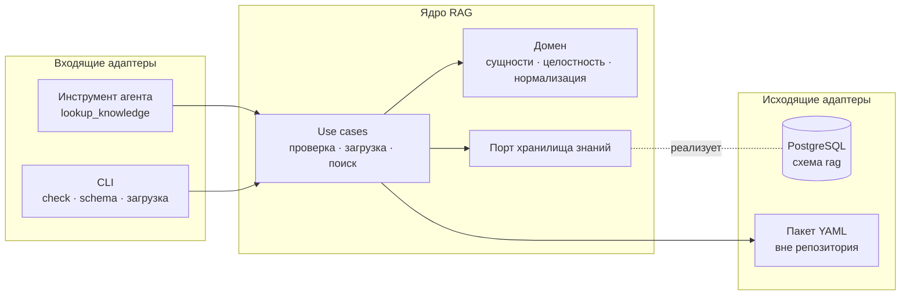
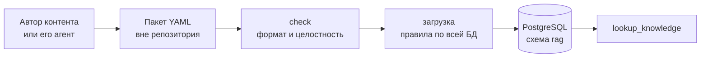

# RAG

[← Глобальный каталог](./README.md)

RAG даёт агенту канонические знания о вселенной «Смешариков». Первая очередь —
структурированные знания: сущности со строгой схемой и их точный поиск. Поиск
по неструктурированному лору (сюжеты, сценарии) — следующая очередь.

Состояние: реализованы формат и проверка пакетов знаний; загрузки в БД и
инструмента агента пока нет.

## Назначение и границы

- RAG — модуль backend-монолита в пакете `smeshariki_ai.rag`, а не отдельный
  сервис. Публичного HTTP API нет.
- Агент получает RAG только через инструменты — наследники `agent.tools.Tool`,
  которые регистрируются в composition root (`bootstrap.py`). Инструмент
  точного поиска — `lookup_knowledge`. Когда его вызывать, модель узнаёт из
  описания инструмента; system prompt агента RAG не меняет.
- Выделение RAG в микросервис возможно в будущем. Правила изоляции ниже
  делают его дешёвым, но HTTP API заранее не создаётся.

## Слои

Правило зависимостей:

- домен зависит только от Pydantic;
- use cases зависят от домена и исходящих портов;
- входящие адаптеры вызывают только use cases;
- исходящие адаптеры реализуют порты.

Порт называется по возможности предметной области, а не по технологии, и
вводится только на границе с внешней системой, которую тесты заменяют
fake-реализацией: базой данных, позже LLM и embeddings. Пакет знаний читается
адаптером без отдельного порта: в тестах это временный каталог.

## Технологии

| Используется | Допустимое расширение (отдельным изменением) | Не используется |
| --- | --- | --- |
| PostgreSQL backend — единственное хранилище; PyYAML — разбор пакетов | Встроенный полнотекстовый поиск, `pg_trgm`, `pgvector`, embeddings через LiteLLM | Qdrant и другие отдельные хранилища, локальные файлы индексов, pickle, ML-модели в процессе backend без подтверждения бенчмарком |

## Данные

- Источник истины — PostgreSQL (схема `rag`). Знания закрыты: репозиторий
  публичный, поэтому реальные данные в него не попадают, а тесты и примеры
  документации синтетические.
- Знания поступают пакетами YAML-файлов, по одному файлу на сущность. Пакет
  может содержать любое подмножество сущностей; формат описан на странице
  [Модель знаний](./knowledge.md#формат-пакета).
- `check` проверяет пакет без БД: сущность, которой нет в пакете, выводится
  как внешняя ссылка. Загрузка читает знания из БД целиком фиксированным
  числом запросов и применяет к объединению с пакетом те же правила домена.
  Чтение только затронутой окрестности вводится, если этого потребуют метрики.
- Сложные правила целостности проверяет приложение; PostgreSQL дополнительно
  держит ключи и ограничения. Правила в SQL не дублируются.
- Загрузка выполняется отдельной командой, а не при старте backend. Без
  загруженных знаний backend стартует, а инструмент возвращает безопасную
  ошибку «знания недоступны».

## Команды

| Команда | Назначение |
| --- | --- |
| `python -m smeshariki_ai.rag check <path> [--format text\|json]` | Проверить пакет без БД и environment. Код `0` — валиден, `1` — невалиден или не найден, `2` — неверные аргументы |
| `python -m smeshariki_ai.rag schema` | JSON Schema файлов каждого типа сущностей — подсказка агенту автора |
| `make knowledge-check DIR=<path>` | `check` из корня репозитория через `uv`; `make` при любой ошибке возвращает собственный код `2` |

## Изоляция

- Таблицы RAG находятся в схеме PostgreSQL `rag`, описаны собственным
  `MetaData` в пакете `rag` и не ссылаются на таблицы других модулей: нет
  внешних ключей и `JOIN`.
- Адаптер PostgreSQL находится в пакете `rag`; пакет `db/` других модулей не
  меняется. Миграции RAG — отдельные файлы в общей цепочке Alembic,
  затрагивающие только схему `rag`.
- Из других модулей RAG импортирует только `agent.tools.Tool` и общие
  `DatabaseConfig` и `create_engine`.
- Инструмент зависит от интерфейса use case, аргументы и результаты —
  Pydantic-модели. При выделении RAG в сервис инструмент заменяется
  HTTP-клиентом без изменения агента и домена.

## Точки интеграции

В общих файлах RAG только добавляет строки. Изменение существующего чужого
кода или текста решается отдельно с владельцем.

| Файл | Что добавляет RAG | Владелец |
| --- | --- | --- |
| `backend/src/smeshariki_ai/rag/` | Весь код модуля | RAG |
| `docs/rag.md`, `docs/knowledge.md` | Документация модуля | RAG |
| `backend/pyproject.toml`, `backend/uv.lock` | Зависимость PyYAML | Общий |
| `Makefile` | Цели команд знаний | Общий |
| `backend/src/smeshariki_ai/db/migrations/versions/` | Новые файлы миграций схемы `rag` | Общий |
| `backend/src/smeshariki_ai/bootstrap.py` | Регистрация инструмента; список инструментов задан одной строкой, поэтому её изменение требует решения владельца агента | Агент |
| `backend/src/smeshariki_ai/config.py` | Подконфиг RAG, если понадобится; добавление поля в `Config` требует решения владельца | Backend |
| `docker/compose.yaml` | Одноразовый сервис загрузки, если понадобится | Общий |
| `docs/README.md`, `AGENTS.md` | Строки каталога и разделы о реализованном RAG | Общий |

## Дальнейшие изменения

1. `knowledge-postgres-store` — физическая схема `rag` по ER-модели,
   миграция, загрузка пакета, адаптер чтения.
2. `knowledge-lookup-tool` — use case поиска и инструмент `lookup_knowledge`
   в composition root.
3. Поиск по лору — отдельная серия после оценки потребности.

## SDD-артефакты

- архитектура: [спецификация](../specs/changes/rag-architecture/spec.md),
  [план](../specs/changes/rag-architecture/plan.md),
  [результат проверки](../specs/changes/rag-architecture/verification.md);
- формат и проверка знаний:
  [спецификация](../specs/changes/knowledge-catalog/spec.md),
  [план](../specs/changes/knowledge-catalog/plan.md),
  [результат проверки](../specs/changes/knowledge-catalog/verification.md).
