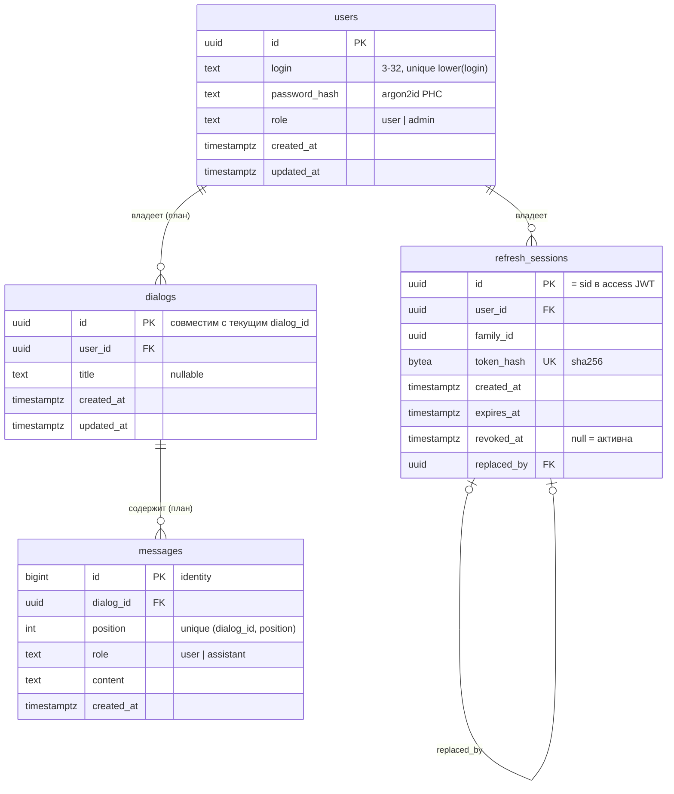

# Аутентификация в backend: JWT, refresh-токены и пользователи в PostgreSQL

## Цель

Реализовать в Python backend серверную часть
[контракта аутентификации](../../../docs/auth.md), которой уже пользуется
страница `/login/`. Backend регистрирует пользователей, выдаёт короткоживущий
access JWT и долгоживущий refresh-токен, отзывает access-токены через blacklist
в Redis и хранит пользователей в PostgreSQL. Схема базы данных проектируется
сразу с учётом будущего постоянного хранения истории диалогов и описывается на
отдельной странице `docs/database.md`.

Аутентификация становится ещё одним модулем модульного монолита
`smeshariki_ai`; отдельный сервис не создаётся. PostgreSQL и Redis — новые
инфраструктурные контейнеры, orchestration и обращение к ним остаются
ответственностью backend.

Существующий frontend-контракт не меняется: оба токена передаются только
`HttpOnly` cookie, поэтому `fetch` и `EventSource` продолжают работать без
заголовка `Authorization`, а `auth-api.js` и `/login/` не требуют правок.

## Контракт API

Префикс `/api/v1`, тела — JSON. Маршрутизация Caddy не меняется: весь `/api`
уже идёт в backend.

| Запрос | Успешный ответ | Ошибки |
| --- | --- | --- |
| `POST /api/v1/users` `{"login","password"}` | `201`, `{"id","login","role":"user"}`; cookie не выставляются | `409` логин занят; `422` поля |
| `POST /api/v1/auth/login` `{"login","password"}` | `200`, объект пользователя, `Set-Cookie` access и refresh | `401` неверная пара; `422` поля |
| `POST /api/v1/auth/refresh` без тела — **новый** | `200`, объект пользователя, новые access и refresh cookie | `401` refresh отсутствует, просрочен, отозван или переиспользован; cookie сбрасываются |
| `POST /api/v1/auth/logout` без тела | `204`, access в blacklist, refresh-сессия отозвана, cookie сброшены | Нет: без токенов тоже `204` |
| `GET /api/v1/users/me` | `200`, `{"id","login","role":"user"\|"admin"}` | `401` access отсутствует, некорректен, просрочен или в blacklist |

Тело ошибки — `{"error":"<code>"}` с кодами `login_taken`,
`invalid_fields`, `invalid_credentials`, `unauthorized`, `unavailable`.
Невалидный JSON, лишние поля и нарушение правил полей дают `422`
(`invalid_fields`), при этом тело не повторяет введённые значения. Правила
полей — из `docs/auth.md`: `login` 3–32 символа `[A-Za-z0-9_.-]`, уникален без
учёта регистра; `password` 8–128 символов. Ручки аутентификации подключаются
отдельным `APIRouter`; формат ошибок существующих ручек диалогов не меняется.

Если PostgreSQL или Redis недоступны, ручки аутентификации отвечают `503`
`{"error":"unavailable"}` и не пропускают запрос (fail closed): `/users/me` не
возвращает `200`, если blacklist нельзя проверить.

### Токены и cookie

| Cookie | Содержимое | Атрибуты | TTL по умолчанию |
| --- | --- | --- | --- |
| `access_token` | JWT HS256: `sub` (user id), `role`, `jti`, `sid` (refresh-сессия), `iat`, `exp`, `iss` | `HttpOnly`, `SameSite=Lax`, `Path=/` | 15 минут |
| `refresh_token` | Непрозрачная случайная строка 256 бит; в БД хранится только SHA-256 | `HttpOnly`, `SameSite=Lax`, `Path=/api/v1/auth` | 30 дней |

`Secure` включается настройкой `AUTH_COOKIE_SECURE`. Refresh-токен
одноразовый: каждый `refresh` отзывает текущую сессию и создаёт следующую в
том же семействе. Повторное предъявление уже отозванного refresh-токена
считается кражей и отзывает всё семейство.

Blacklist: при `logout` `jti` access-токена записывается в Redis ключом
`auth:blacklist:<jti>` с TTL, равным остатку жизни токена; после истечения
токена ключ исчезает сам. Подпись, `iss` и `exp` проверяются до обращения к
Redis.

## Схема базы данных

PostgreSQL 17. Миграции — Alembic в пакете backend, применяются командой
backend одноразовым Compose-сервисом `migrate` до старта `backend`. Будущие
таблицы диалогов проектируются сейчас, а создаются миграцией отдельного
изменения о постоянной истории (см. «Границы»).

Решения схемы:

- UUID генерирует приложение; `users.id` и `dialogs.id` остаются UUID, как и в
  текущем API.
- `role` — `text` с `CHECK`, а не PostgreSQL enum: добавление роли не требует
  `ALTER TYPE`.
- Удаление пользователя каскадно удаляет его refresh-сессии, диалоги и
  сообщения (`ON DELETE CASCADE`).
- `messages.position` сохраняет порядок внутри диалога и поддерживает текущее
  правило атомарного добавления пары «пользователь — ассистент»; tool calls и
  tool results, как и сейчас, не хранятся.
- Индексы: `users (lower(login))` unique, `refresh_sessions (user_id)`,
  `refresh_sessions (family_id)`, `dialogs (user_id, updated_at DESC)`.

## Требования

- REQ-001: Пакет `smeshariki_ai.auth` содержит доменный `AuthService` и
  контракты `UserStore`, `RefreshSessionStore`, `TokenBlacklist`. Сервис не
  зависит от FastAPI, SQLAlchemy и redis-py и не читает environment.
- REQ-002: Регистрация создаёт пользователя с ролью `user` и хешем argon2id и
  отвечает по контракту, включая `409` для логина, отличающегося только
  регистром.
- REQ-003: Вход проверяет пароль, создаёт refresh-сессию и выставляет обе
  cookie; неизвестный логин и неверный пароль неотличимы по статусу и телу.
- REQ-004: `GET /users/me` принимает только действительный access JWT не из
  blacklist и возвращает актуальные `login` и `role` из БД.
- REQ-005: `refresh` ротирует refresh-токен, выдаёт новый access и при
  повторном использовании отозванного токена отзывает всё семейство.
- REQ-006: `logout` идемпотентен, заносит `jti` в Redis с TTL до `exp`,
  отзывает refresh-сессию и сбрасывает обе cookie.
- REQ-007: Недоступность PostgreSQL или Redis даёт `503` и никогда не даёт
  успешную аутентификацию.
- REQ-008: `load_config` дополнительно загружает подконфиги `auth`,
  `database` и `redis` из `AUTH_JWT_SECRET` (обязателен, не короче 32 байт),
  `AUTH_ACCESS_TTL_SECONDS`, `AUTH_REFRESH_TTL_SECONDS`, `AUTH_COOKIE_SECURE`,
  `DATABASE_URL`, `REDIS_URL`. Компоненты получают только свой подконфиг.
  `docker/.env.example` содержит только плейсхолдеры.
- REQ-009: Bootstrap создаёт async engine и Redis-клиент, передаёт адаптеры в
  `AuthService` и закрывает подключения в lifespan. Существующие ручки диалогов
  работают как раньше и аутентификации не требуют.
- REQ-010: Журнал содержит события регистрации, входа, refresh, logout и
  обнаружения повторного refresh с `user_id` и исходом, но не содержит логинов,
  паролей, хешей, токенов, `jti`, cookie и тел запросов.
- REQ-011: Alembic-миграция создаёт `users` и `refresh_sessions` по схеме выше;
  `docs/database.md` описывает всю схему, включая запланированные `dialogs` и
  `messages`.
- REQ-012: Compose запускает `postgres` и `redis` с healthcheck и volume для
  PostgreSQL, сервис `migrate` применяет миграции, `backend` стартует после их
  успешного завершения.

## Сценарии

### Регистрация и вход

- Given пустая база
- When `POST /users` с `Krosh`/`password123`, затем `POST /auth/login` с
  `krosh`/`password123`
- Then `201` с ролью `user`, затем `200` с тем же `id` и cookie
  `access_token` и `refresh_token`; `/users/me` возвращает `200`

### Logout отзывает access-токен

- Given пользователь вошёл и сохранил копию `access_token`
- When `POST /auth/logout`, затем `GET /users/me` с сохранённой копией
- Then `204`, затем `401`

### Ротация и повторное использование refresh

- Given пользователь вошёл и получил refresh `R1`
- When `refresh` с `R1` → `R2`; затем снова `refresh` с `R1`
- Then первый `200`; второй `401`, и `R2` тоже больше не принимается

### Redis недоступен

- Given действительный access-токен, Redis остановлен
- When `GET /users/me`
- Then `503` `{"error":"unavailable"}`

### Лишнее поле

- When `POST /users` с `{"login":"krosh","password":"password123","role":"admin"}`
- Then `422` `{"error":"invalid_fields"}`, пользователь не создан

## Технологии и структура

- Новые зависимости backend: `sqlalchemy[asyncio]` и `asyncpg` (доступ к
  PostgreSQL), `alembic` (миграции), `redis` (`redis.asyncio`), `pyjwt`,
  `argon2-cffi`. Управление — через `uv`, lock-файл обновляется.
- Структура:
  - `smeshariki_ai/auth/` — `service.py` (`AuthService`), `models.py`
    (доменные типы и ошибки), `stores.py` (контракты), `tokens.py` (JWT и
    refresh), `passwords.py` (argon2id), `config.py` (`AuthConfig`),
    `memory.py` (детерминированные in-memory реализации для тестов);
  - `smeshariki_ai/db/` — `DatabaseConfig`, engine, таблицы SQLAlchemy Core,
    адаптеры `UserStore`/`RefreshSessionStore`, Alembic-окружение и миграции;
  - `smeshariki_ai/auth/redis_blacklist.py` или `smeshariki_ai/cache/` —
    `RedisConfig` и `TokenBlacklist` на Redis;
  - `smeshariki_ai/api/auth.py` — `APIRouter` ручек аутентификации, cookie и
    формат ошибок; зависимость `current_user` для будущей защиты ручек.
- Docker: сервисы `postgres:17-alpine`, `redis:7-alpine`, `migrate` (тот же
  образ backend, команда `alembic upgrade head`) в `docker/compose.yaml`.
- Документация: `docs/database.md` (новая), `docs/auth.md`,
  `docs/configuration.md`, `docs/logging.md`, `docs/README.md`,
  `docker/README.md`, `AGENTS.md` (технологии: PostgreSQL, Redis).

## Команды

- Запуск: `make run`
- Тесты: `make test`
- Линт: `make lint`

## Тестирование

- Модульные тесты `AuthService` с in-memory хранилищами и фиксированными
  часами: регистрация и нормализация логина, вход и неотличимость ошибок,
  проверка access (подпись, `exp`, blacklist), ротация и reuse detection,
  logout, fail closed при ошибке хранилища (REQ-001…REQ-007).
- HTTP-тесты через `httpx.ASGITransport` с in-memory зависимостями: статусы,
  тела ошибок, `422` на лишние поля и невалидный JSON, атрибуты cookie,
  отсутствие секретов в журнале (REQ-003, REQ-006, REQ-010).
- Тесты `load_config` для новых переменных и ошибок валидации (REQ-008).
- Интеграционные тесты адаптеров PostgreSQL (после `alembic upgrade head`) и
  Redis запускаются, если заданы `TEST_DATABASE_URL` и `TEST_REDIS_URL`, иначе
  помечаются skip.
- Ручная проверка Compose: сценарии выше через `curl` и страница `/login/`
  (REQ-009, REQ-011, REQ-012).

## Границы

- Всегда: хранить только хеши паролей и refresh-токенов; сравнивать секреты за
  постоянное время; fail closed при сбое Redis/PostgreSQL.
- Сначала спросить: изменение frontend-контракта, добавление ручек сверх
  `refresh`, перевод существующих ручек на обязательную аутентификацию.
- Никогда: класть токены в тело ответа или JavaScript-хранилища; логировать
  секреты; коммитить `docker/.env`.
- Вне изменения: создание таблиц `dialogs`/`messages` и перевод истории на
  PostgreSQL; закрытие чата для гостей и привязка диалогов к пользователю;
  автоматический `refresh` во frontend; создание администратора; rate limiting.

## Критерии приёмки

- [ ] `make run` поднимает `caddy`, `frontend`, `backend`, `postgres`, `redis`;
  миграция применяется автоматически.
- [ ] Все сценарии выше воспроизводятся через `curl` на `http://127.0.0.1:8080`.
- [ ] `/login/` регистрирует, входит и перенаправляет на `/` без правок
  frontend.
- [ ] В журнале нет логинов, паролей, токенов и cookie.
- [ ] `docs/database.md` описывает все четыре таблицы, связи, индексы и
  решения; остальные страницы `docs/` и `AGENTS.md` обновлены.
- [ ] `make test` и `make lint` проходят успешно.

## Решения по открытым вопросам

1. Ручка `POST /api/v1/auth/refresh` и тело ошибки `{"error":"<code>"}`
   принимаются. Всё, что не описано явно в текущем `docs/auth.md` (refresh,
   формат ошибок, `503`, JWT-cookie вместо серверной сессии, blacklist,
   ротация refresh), дописывается туда в рамках этого изменения.
2. Автоматический refresh во frontend выполняется отдельным изменением.
3. `dialogs`/`messages` только документируются в `docs/database.md`; миграция
   создаётся изменением о постоянной истории.

## Открытые вопросы

- Нет.
