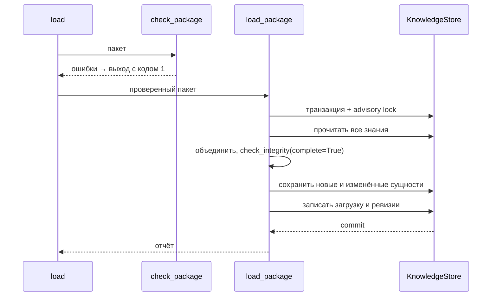

# Хранилище структурированных знаний в PostgreSQL

## Цель

Сделать PostgreSQL рабочим источником истины структурированных знаний:
физическая схема по ER-модели из [`docs/knowledge.md`](../../../docs/knowledge.md),
миграция, порт хранилища с PostgreSQL- и in-memory реализациями и загрузка
проверенного пакета командой, понятной автору и его агенту. Изменение
пересматривает размещение таблиц из [`rag-architecture`](../rag-architecture/spec.md).

## Допущения

- Формат пакета, модели и правила целостности — изменение
  [`knowledge-catalog`](../knowledge-catalog/spec.md); здесь они
  переиспользуются без изменений.
- Выгрузка из БД в пакет и удаление сущностей — следующее изменение
  `knowledge-maintenance`; до него сущность можно только добавить или
  заменить. Поиск для агента — изменение `knowledge-lookup-tool`.
- Загрузка читает знания из БД целиком фиксированным числом запросов и
  применяет к объединению с пакетом правила домена. Чтение только затронутой
  окрестности вводится, если отчёт загрузки покажет больше ~10 000 сущностей
  или время больше ~5 секунд.
- В БД пишет только загрузка. Сложные правила проверяет приложение;
  PostgreSQL держит ключи и простые ограничения, правила в SQL не дублируются.
- Загрузка выполняется в Compose-контейнере с окружением из `docker/.env`, как
  `make create-admin`: `load_config` требует весь конфиг backend. Известное
  ограничение: при появлении общей БД загрузка обязательно переходит на
  отдельный конфиг только БД — это изменение `config.py` и правила
  `AGENTS.md` по согласованию с владельцем.
- Логическое удаление (`deleted_at`) не используется: оно требует фильтра в
  каждом запросе и ослабляет внешние ключи. Удаление в `knowledge-maintenance`
  будет физическим, с последней версией агрегата в `rag_revisions`;
  восстановление — загрузка снимка ревизии. Журнал удалений может потребовать
  обобщить `rag_loads` до журнала операций — решается там.
- Разделение ролей PostgreSQL (миграции, чтение backend, запись загрузки,
  запрет `UPDATE`/`DELETE` журнала) откладывается до перехода на общую БД;
  сейчас Compose использует одного пользователя.
- Денормализованная карточка сущности для инструмента агента решается в
  `knowledge-lookup-tool` по реальным запросам.
- Изменение словаря типов отношений или взаимодействий требует миграции,
  обновляющей `CHECK` и переклассифицирующей строки.
- Номер миграции — `0003`. Если до PR в `main` появится другая `0003`,
  миграция перенумеровывается.

## Требования

### Пересмотр решений `rag-architecture`

- REQ-001: Таблицы RAG находятся в схеме `public` с префиксом имени `rag_`.
  Отдельная схема `rag` не используется: тесты других модулей пересоздают
  схему `public` и миграции с нуля. Заменяет REQ-012 `rag-architecture` в
  части схемы; правило отсутствия внешних ключей и `JOIN` с таблицами других
  модулей сохраняется.

### Физическая схема

- REQ-002: Схема состоит из таблиц раздела «Физическая схема». Корневые
  таблицы имеют первичный ключ `id`; дочерние — составной ключ из
  идентификатора владельца и `position`, сохраняющей порядок элементов.
- REQ-003: Внешние ключи внутри агрегата (`ON DELETE CASCADE`) связывают
  дочерние строки с владельцем; внешние ключи между агрегатами (`ON DELETE
  RESTRICT`) указывают на варианты канона, произведения, персонажей, локации и
  артефакты.
- REQ-004: Ограничения PostgreSQL: формат `id` корневых сущностей; непустые
  строки; значения словарей (`kind`, `age_group`, типы отношений и
  взаимодействий); `season` и `number` ≥ 1; уникальность номера эпизода в
  произведении и сезоне (`NULLS NOT DISTINCT`); различие двух персонажей
  отношения и взаимодействия; непустой `traits`; `sources` — JSON-массив.
- REQ-005: Имена и алиасы хранятся в таблицах имён (позиция `0` — имя, далее
  алиасы) с нормализованным значением. У персонажей нормализованное значение
  уникально; у локаций и артефактов оно проиндексировано, а уникальность в
  пересекающихся вариантах канона проверяет приложение.
- REQ-006: Первичный ключ таблицы вариантов канона версий —
  «персонаж — вариант канона», поэтому у персонажа не больше одной версии в
  варианте канона.
- REQ-007: Описательные списки хранятся как `text[]`, `speech_style` — колонки
  версии, ссылки на источники — `jsonb` в строке владельца.
- REQ-008: Миграция `0003` создаёт таблицы, `downgrade` удаляет их. Схема после
  миграции совпадает с описанием таблиц в коде.

### История и технические атрибуты

- REQ-009: Корневые таблицы имеют обязательные `created_at` (по умолчанию
  текущее время) и `updated_at`; при изменении сущности `updated_at` задаёт
  загрузка, без триггеров. Технические атрибуты не входят в доменные модели.
- REQ-010: `rag_loads` хранит каждую успешную загрузку: время начала и
  окончания, длительность, число сущностей в БД после загрузки и отчёт по
  типам. Отменённая загрузка записей не оставляет.
- REQ-011: `rag_revisions` — журнал только на добавление: при каждом
  добавлении или изменении сущности загрузка в той же транзакции записывает
  тип, `id`, порядковый номер ревизии сущности, операцию, загрузку, время и
  снимок агрегата в `jsonb` в формате файла пакета. Номер ревизии уникален в
  пределах сущности; ссылок на таблицы сущностей у журнала нет, поэтому он
  переживает их удаление. Неизменные сущности ревизий не порождают.

### Порт и адаптеры

- REQ-012: Порт `KnowledgeStore` открывает транзакцию знаний с операциями
  «прочитать все знания» и «сохранить сущности целиком». Порт и
  результаты — доменные модели, без типов SQLAlchemy.
- REQ-013: `InMemoryKnowledgeStore` реализует порт для тестов и проходит тот же
  контрактный набор тестов, что и PostgreSQL-адаптер.
- REQ-014: `PostgresKnowledgeStore` читает все знания фиксированным числом
  запросов (по одному на таблицу) и сохраняет сущности пакетными запросами;
  число запросов не зависит от числа сущностей.
- REQ-015: Сохранение сущности заменяет её агрегат целиком: корневая строка
  обновляется на месте, дочерние строки заменяются. Строки, на которые
  ссылаются другие агрегаты, не удаляются. Прочитанные после сохранения
  сущности равны сохранённым, включая порядок списков.
- REQ-016: Ошибки БД и сети преобразуются в `KnowledgeStoreUnavailableError`
  без текста SQL, параметров и URL; отсутствующие таблицы — в
  `KnowledgeSchemaNotReadyError`.

### Загрузка

- REQ-017: Загрузка сначала выполняет проверку `check`; при любой ошибке
  пакета БД не открывается и ничего не пишется.
- REQ-018: Загрузка выполняется в одной транзакции под advisory lock, поэтому
  параллельные загрузки выполняются по очереди.
- REQ-019: Сущность пакета заменяет сущность БД с тем же типом и `id`; прочие
  сущности БД сохраняются.
- REQ-020: Правила целостности применяются к объединению БД и пакета как к
  полному набору. При нарушении транзакция откатывается; ошибка содержит файл
  пакета, если сущность из пакета, иначе адрес `db:<тип>/<id>`.
- REQ-021: Сущность, равная уже сохранённой, не записывается. Повторная
  загрузка того же пакета ничего не меняет в БД.
- REQ-022: Отчёт загрузки содержит идентификатор загрузки из `rag_loads`, по
  каждому типу число добавленных, изменённых и неизменных сущностей, общее
  число сущностей в БД после загрузки и длительность в миллисекундах.

### Команды

- REQ-023: `python -m smeshariki_ai.rag load <path> [--format text|json]` не
  задаёт вопросов, берёт конфиг БД из `load_config` и печатает ошибки проверки
  в формате `check` либо отчёт загрузки. Код `0` — загружено, `1` — пакет
  невалиден, нарушена целостность, БД недоступна или схема не готова, `2` —
  неверные аргументы. `check` и `schema` по-прежнему не читают environment.
- REQ-024: `make knowledge-load DIR=<path> [FORMAT=json]` применяет миграции и
  запускает `load` в Compose-контейнере, монтируя пакет только для чтения. Без
  `DIR` или с несуществующим каталогом цель печатает подсказку.

### Тесты и документация

- REQ-025: Интеграционные тесты PostgreSQL используют `TEST_DATABASE_URL`,
  пропускаются без неё и пересоздают схему `public` так же, как тесты других
  модулей.
- REQ-026: `docs/knowledge.md` описывает физическую схему, журнал и ревизии,
  `docs/rag.md` — хранилище, загрузку и команду, `docs/database.md` получает
  строку о таблицах `rag_*` со ссылкой. Собственный текст о схеме `rag` в
  `docs/` и `AGENTS.md` заменяется префиксом `rag_`; раздел «Реализованный
  каталог знаний» в `AGENTS.md` дополняется хранилищем и загрузкой.

## Физическая схема

| Агрегат | Таблицы |
| --- | --- |
| Вариант канона | `rag_continuities` |
| Произведение | `rag_works` |
| Эпизод | `rag_episodes`, `rag_episode_characters`, `rag_episode_locations`, `rag_episode_artifacts`, `rag_episode_interactions` |
| Персонаж | `rag_characters`, `rag_character_names`, `rag_character_versions`, `rag_character_version_continuities`, `rag_relationships`, `rag_relationship_continuities` |
| Локация | `rag_locations`, `rag_location_names`, `rag_location_continuities`, `rag_location_residents` |
| Артефакт | `rag_artifacts`, `rag_artifact_names`, `rag_artifact_continuities`, `rag_artifact_creators` |
| Журнал | `rag_loads`, `rag_revisions` |

## Загрузка

## Сценарии

### Первая загрузка

- Given пустые таблицы знаний и валидный пакет
- When выполняется `make knowledge-load DIR=<path>`
- Then все сущности пакета добавлены, отчёт показывает их как добавленные

### Повторная загрузка

- Given пакет уже загружен
- When он загружается ещё раз
- Then отчёт показывает все сущности неизменными, строки БД не меняются

### Частичный пакет

- Given в БД есть персонаж `krosh`, пакет содержит только эпизод с ним
- When пакет загружается
- Then эпизод добавлен, ссылка на `krosh` проверена по БД

### Нарушение по данным БД

- Given в БД есть эпизод фильма с участием `pin`, пакет убирает у `pin`
  версию в варианте канона фильма
- When пакет загружается
- Then загрузка отменяется с ошибкой `continuity_mismatch` по адресу
  `db:episodes/<id>`, БД не меняется

### Невалидный пакет

- Given в пакете ошибка формата
- When выполняется `load`
- Then выводятся ошибки как у `check`, к БД нет обращений, код `1`

## Технологии и структура

- SQLAlchemy Core (async) с asyncpg, Alembic, PostgreSQL 17 — без новых
  зависимостей.
- Код в `backend/src/smeshariki_ai/rag/`: `ports.py` (порт и ошибки),
  `memory.py` (in-memory хранилище), `postgres.py` (таблицы и адаптер),
  `services.py` (use case загрузки), `cli.py` (команда `load`).
- Миграция — новый файл `db/migrations/versions/0003_rag_knowledge.py`;
  `env.py` и пакет `db/` не меняются.
- Тесты: `tests/unit/rag/` (use case на in-memory хранилище, контракт),
  `tests/integration/rag/` (PostgreSQL-адаптер, контракт, миграция).
- Общие файлы, только добавления: `Makefile`, `docs/database.md`; в `AGENTS.md`
  и `docs/` заменяется собственный текст о схеме `rag`.

## Команды

- Загрузка: `make knowledge-load DIR=<path>`.
- Тесты: `make test`, `make lint`; PostgreSQL-тесты —
  `TEST_DATABASE_URL=… uv run --project backend --locked pytest backend/tests/integration/rag`.

## Тестирование

| Требования | Проверка |
| --- | --- |
| REQ-002–REQ-008 | Интеграционные тесты: ограничения отвергают недопустимые строки; сравнение схемы после `upgrade` с описанием таблиц; `downgrade` и повторный `upgrade` |
| REQ-009–REQ-011 | Unit-тесты use case: журнал и ревизии создаются только для добавленных и изменённых сущностей, нумерация ревизий, снимок проходит проверку моделью; интеграционные тесты: `updated_at` меняется только у изменённых, откат не оставляет записей журнала |
| REQ-012–REQ-015 | Контрактный набор на in-memory и PostgreSQL: сохранение и чтение без потерь, замена агрегата, сохранность ссылающихся строк; подсчёт запросов адаптера при разном числе сущностей |
| REQ-016 | Интеграционные тесты недоступной БД и схемы без миграции |
| REQ-017–REQ-022 | Unit-тесты use case на in-memory хранилище: невалидный пакет, слияние, нарушение по данным БД с откатом, идемпотентность, отчёт; интеграционный тест параллельных загрузок |
| REQ-023 | Unit-тесты `cli.main` с подменённым хранилищем: коды, текстовый и JSON-вывод |
| REQ-001, REQ-024–REQ-026 | Ревью документации и diff общих файлов; ручной `make knowledge-load` |

## Границы

- Всегда: писать в БД только после полной проверки; держать все записи
  загрузки в одной транзакции; в общих файлах только добавлять, кроме
  собственного текста.
- Сначала спросить: новые зависимости или расширения PostgreSQL; изменение
  моделей и правил `knowledge-catalog`; изменение чужих модулей, `env.py` и
  `config.py`.
- Никогда: внешние ключи и `JOIN` с таблицами других модулей; дублировать
  правила целостности в SQL; реальные данные в репозитории; запрашивать
  секреты интерактивно.

## Критерии приёмки

- [ ] Миграция `0003` создаёт и удаляет таблицы `rag_*`, схема совпадает с
  кодом.
- [ ] Загрузка добавляет, заменяет и пропускает неизменные сущности в одной
  транзакции и откатывается при любом нарушении.
- [ ] Число запросов чтения и записи не зависит от числа сущностей.
- [ ] Каждая успешная загрузка записана в `rag_loads`, каждое добавление и
  изменение сущности — в `rag_revisions` со снимком агрегата.
- [ ] In-memory и PostgreSQL-хранилища проходят один контрактный набор.
- [ ] `make knowledge-load`, `make lint` и `make test` проходят; PostgreSQL-тесты
  проходят с `TEST_DATABASE_URL`, тесты других модулей с той же БД тоже.

## Открытые вопросы

- Нет.
