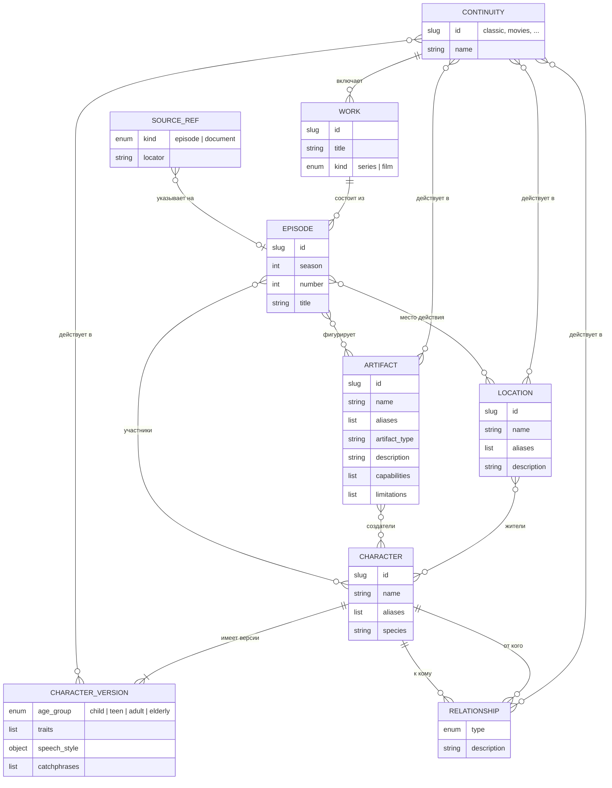

# Архитектура RAG и модель предметной области

## Цель

Зафиксировать до написания кода, что такое RAG в `smeshariki-ai`: границы
модуля, гексагональные слои, единственное хранилище, источник истины данных,
правила изоляции и концептуальную ER-модель структурированных знаний о
вселенной «Смешариков». Последующие изменения `knowledge-*` реализуют эту
архитектуру и не пересматривают её без нового изменения.

Изменение только документационное: код, каталог `knowledge/`, таблицы и
зависимости не создаются.

## Допущения

- Первая очередь RAG — структурированные знания (сущности со строгой схемой) и
  их точный поиск агентом. Поиск по неструктурированному лору (сюжеты,
  сценарии) — следующая очередь; здесь фиксируются только её границы.
- Реальные данные вручную готовит выделенный автор контента, переписывая
  сценарии или используя опубликованные материалы авторов. Автор не является
  разработчиком.
- System prompt принадлежит модулю агента. RAG его не меняет; модель узнаёт,
  когда вызывать инструмент, из описания инструмента.
- Сейчас RAG — модуль монолита. Выделение в микросервис с HTTP API возможно в
  будущем, но не входит ни в одно запланированное изменение.
- Ветка `feat-rag-mvp` — только справочный архив: решения из неё переносятся
  сюда явно, код и спеки не сливаются.

## Требования

### Границы и слои

- REQ-001: `docs/rag.md` описывает RAG как часть backend-монолита в пакете
  `smeshariki_ai.rag`, без отдельного сервиса и публичного HTTP API. Агент
  получает RAG только через наследников `agent.tools.Tool`, которые
  регистрируются в composition root. Инструмент точного поиска называется
  `lookup_knowledge`.
- REQ-002: `docs/rag.md` фиксирует гексагональные слои и правило зависимостей:
  домен (модели, правила целостности, нормализация) не зависит ни от чего,
  кроме Pydantic; use cases зависят от домена и исходящих портов; входящие
  адаптеры (инструменты агента, CLI) вызывают только use cases; исходящие
  адаптеры (PostgreSQL, файлы каталога) реализуют порты.
- REQ-003: Порты называются по возможностям предметной области, а не по
  технологиям. Порт вводится только на границе с внешней системой, которую
  тесты заменяют fake-реализацией (БД, LLM/embeddings). Чтение файлов
  каталога — адаптер без отдельного порта.

### Технологии и данные

- REQ-004: Единственное хранилище RAG — PostgreSQL backend. Допустимый путь
  расширения: встроенный полнотекстовый поиск, `pg_trgm`, `pgvector` и
  embeddings через уже используемый LiteLLM. Каждое расширение подключается
  отдельным изменением с обоснованием.
- REQ-005: Явно не используются: Qdrant и другие отдельные хранилища,
  локальные файлы индексов, pickle, ML-модели в процессе backend без
  подтверждения бенчмарком.
- REQ-006: Источник истины структурированных знаний — YAML-файлы в каталоге
  `knowledge/` в корне репозитория, по одному файлу на сущность. PostgreSQL —
  проекция только для чтения во время работы backend. Единственный писатель —
  команда синхронизации backend. Данные не кладутся в Alembic-миграции.
- REQ-007: Каталог `knowledge/` содержит только данные. Формат, схему и
  правила валидации определяет backend; каталог зависит от backend, а не
  наоборот.
- REQ-008: Синхронизация выполняется отдельным шагом после миграций, а не при
  старте backend. Backend стартует без загруженных знаний; инструмент в этом
  случае возвращает безопасную ошибку «знания недоступны».

### Изоляция модуля

- REQ-009: Таблицы RAG находятся в отдельной схеме PostgreSQL `rag`, описаны
  собственным `MetaData` в пакете `rag` и не имеют внешних ключей, `JOIN` и
  других зависимостей от таблиц других модулей.
- REQ-010: Адаптер PostgreSQL RAG находится в пакете `rag`; пакет `db/`
  других модулей не меняется. Миграции RAG — отдельные файлы в общей цепочке
  Alembic, затрагивающие только схему `rag`.
- REQ-011: Из других модулей код RAG импортирует только `agent.tools.Tool`
  (в адаптере инструментов) и общие `DatabaseConfig` и `create_engine`.
- REQ-012: Инструмент агента зависит от интерфейса use case, а не от его
  реализации, а аргументы и результаты use cases — Pydantic-модели без
  ORM-объектов и типов адаптеров. Так при выделении RAG в сервис инструмент
  заменяется HTTP-клиентом без изменения агента и домена.

### Модель предметной области

- REQ-013: `docs/knowledge.md` содержит концептуальную ER-модель из раздела
  «Модель предметной области»: сущности, ключевые атрибуты, связи,
  кардинальности и Mermaid ER-диаграмму.
- REQ-014: Правила идентичности: каждая сущность имеет неизменяемый slug
  `^[a-z0-9]+(_[a-z0-9]+)*$`, уникальный в пределах типа. Имена и алиасы
  нормализуются как `strip → схлопнуть пробелы → lower → ё→е`. Нормализованные
  имя и алиасы персонажа уникальны среди персонажей; у локаций и артефактов —
  среди сущностей того же типа с пересекающимися вариантами канона.
- REQ-015: Вариант канона — самостоятельная сущность. Персонаж — неизменная
  идентичность (slug, имя, алиасы, вид) и одна или несколько версий с
  атрибутами, которые могут различаться между вариантами канона. Каждая версия
  действует в непустом множестве вариантов канона; множества версий одного
  персонажа не пересекаются.
- REQ-016: Локации, артефакты и отношения не имеют версий и действуют в
  непустом множестве вариантов канона. Отношение связывает идентичности
  персонажей и допустимо только в вариантах канона, где у обоих персонажей
  есть версия. Жители и создатели — идентичности персонажей.
- REQ-017: Участие персонажа, локации или артефакта в эпизоде допустимо,
  только если вариант канона эпизода входит в варианты канона участника (для
  персонажа — одной из его версий). Все ссылки между сущностями проверяются до
  записи в БД.
- REQ-018: Ссылка на источник необязательна. Её указывают для чувствительных
  фактов: оспоримых, различающихся между вариантами канона или способных
  повлиять на будущие сюжеты. `docs/knowledge.md` содержит критерии для автора
  контента. Валидатор проверяет только корректность указанной ссылки.
- REQ-019: В структурированную модель не входят правила мира и стиля сказок
  (ответственность system prompt агента) и повествовательные тексты (будущий
  поиск по лору).

### Согласованность и интеграция

- REQ-020: Версия персонажа покрывает поля, на которые уже опирается system
  prompt агента: возрастная группа `child | teen | adult | elderly`, характер и
  `speech_style`. Различие вариантов канона выражается данными, а не правилами
  RAG.
- REQ-021: `docs/rag.md` содержит таблицу точек интеграции: файлы, которые RAG
  создаёт сам, и общие файлы, которые он затрагивает минимально
  (`bootstrap.py`, `docker/compose.yaml`, `docker/Dockerfile`, `Makefile`,
  добавление файлов в каталог версий миграций, `docs/README.md`, `AGENTS.md`).
  Каждое изменение общего файла согласуется с его владельцем.
- REQ-022: `docs/rag.md` содержит цепочку следующих изменений с одной строкой
  ответственности на каждое.
- REQ-023: `docs/README.md` получает только дополнения: строки каталога со
  ссылками на `rag.md` и `knowledge.md`. Чужой текст не переписывается.
- REQ-024: Правки `AGENTS.md` из раздела «Согласованность с документацией»
  вносятся только после одобрения владельцем (Nisakoo). До одобрения изменение
  не переходит в `verify`.

## Модель предметной области



| Сущность | Смысл | Ключевые правила |
| --- | --- | --- |
| Вариант канона | Непротиворечивая версия вселенной (классика, фильмы…) | Справочник; на него ссылаются все факты |
| Произведение | Сериал или фильм | Принадлежит ровно одному варианту канона |
| Эпизод | Серия произведения | Вариант канона наследуется от произведения |
| Персонаж | Неизменная идентичность героя | На него ссылаются отношения, жители, создатели, эпизоды |
| Версия персонажа | Характер и речь героя в наборе вариантов канона | Не больше одной версии на вариант канона |
| Отношение | Направленная связь двух персонажей | Тип из закрытого словаря |
| Локация | Место действия | Жители — персонажи |
| Артефакт | Предмет или изобретение | Что умеет и чего не умеет; создатели — персонажи |
| Ссылка на источник | Необязательное подтверждение факта | Значение внутри записи, а не самостоятельная сущность |

В YAML и доменной модели сущность — агрегат: списки и вложенные объекты
допустимы. В реляционной схеме алиасы, варианты канона и связи между
сущностями — отдельные таблицы с ключами и ограничениями, описательные списки
без собственной идентичности (`traits`, `catchphrases`, маркеры речи,
`capabilities`, `limitations`) — `text[]`, `speech_style` раскладывается на
колонки версии. Физическая схема и хранение ссылок на источники уточняются в
`knowledge-postgres-store`.

## Согласованность с документацией

| Документ | Что написано | Оценка | Действие |
| --- | --- | --- | --- |
| `AGENTS.md`, части проекта | RAG — внутренний инструмент backend | Согласны | Добавить `knowledge/` в список частей |
| `AGENTS.md`, правила 3–4 | RAG через интерфейс инструмента; зависимости в контейнерах, orchestration в backend | Согласны | Нет |
| `AGENTS.md`, согл. арх. 5 | Один инструмент `search_knowledge` | Расходится по имени и числу инструментов | Заменить на `lookup_knowledge` и ссылку на `docs/rag.md` |
| `AGENTS.md`, согл. арх. 6, 9 | Индексация отдельно от поиска, запуск командой; fakes для LLM и embeddings | Согласны | Нет |
| `AGENTS.md`, согл. арх. 7 | Отдельное векторное хранилище | Противоречит REQ-004 | Заменить на PostgreSQL backend с путём к `pgvector` |
| `AGENTS.md`, runtime агента 9 | `search_knowledge` — отдельным изменением | Расходится по имени | Заменить на инструменты RAG из `docs/rag.md` |
| `AGENTS.md`, технологии | Qdrant для RAG | Противоречит REQ-004, REQ-005 | Удалить строку |
| `docs/README.md` | Не реализовано: «RAG и инструмент `search_knowledge`» | Расходится по имени | Заменить имя вместе с правкой `AGENTS.md` |
| `README.md`, `backend/README.md`, `docker/README.md` | RAG внутри backend, пока не реализован | Согласны | Обновятся по факту реализации |
| `agent/prompts/system.md` | Профиль с `speech_style`, возрастные роли, противоречивые версии канона, контекст как данные | Согласны; это неявный контракт с RAG | Учтён в REQ-015, REQ-020 |
| Тесты агента | `search_knowledge` как имя тестового инструмента | Не контракт | Нет |

## Технологии и структура

Создаются `docs/rag.md` и `docs/knowledge.md`; дополняется `docs/README.md`;
`AGENTS.md` правится по REQ-024. Предлагаемая раскладка пакета (уточняется в
планах следующих изменений):

```text
backend/src/smeshariki_ai/rag/
    models.py   # домен: сущности, каталог, правила целостности
    ports.py    # исходящие порты (ABC)
    services.py # use cases: синхронизация, lookup
    catalog.py  # адаптер чтения knowledge/
    postgres.py # адаптер PostgreSQL и таблицы схемы rag
    tools.py    # входящий адаптер: инструменты агента
    cli.py      # входящий адаптер: команды
```

## Команды

- `make run`, `make test` и `make lint` не меняются: Python-код не изменяется.

## Тестирование

| Требования | Проверка |
| --- | --- |
| REQ-001–REQ-022 | Ревью `docs/rag.md` и `docs/knowledge.md` по этой спецификации |
| REQ-023 | Ревью diff `docs/README.md`: только добавленные строки |
| REQ-024 | Одобрение правок `AGENTS.md` владельцем, ревью diff |

Автотесты не добавляются: изменение не затрагивает поведение кода.

## Границы

- Всегда: ссылаться на эту спецификацию из `docs/rag.md`; держать в `docs`
  архитектуру и краткие контракты, без копирования требований.
- Сначала спросить: любые правки чужих документов сверх перечисленных; смена
  хранилища или добавление технологии; изменение правил идентичности и
  изоляции.
- Никогда: менять код, system prompt и пакет `db/` других модулей; создавать
  `knowledge/` или таблицы в этом изменении.

## Критерии приёмки

- [ ] `docs/rag.md` описывает границы, слои, технологии, источник истины,
  правила изоляции, точки интеграции и цепочку изменений.
- [ ] `docs/knowledge.md` содержит ER-модель, правила идентичности, версий
  персонажей, вариантов канона и критерии указания источников.
- [ ] `docs/README.md` дополнен ссылками без переписывания чужого текста.
- [ ] Правки `AGENTS.md` одобрены владельцем и внесены.
- [ ] `make test` неприменим: изменение документационное.

## Дальнейшие изменения

1. `knowledge-catalog` — доменные модели всех сущностей, правила целостности,
   чтение и проверка `knowledge/`, команда `check`.
2. `knowledge-postgres-store` — физическая схема `rag` из ER-модели, миграция,
   синхронизация, адаптер чтения.
3. `knowledge-lookup-tool` — use case поиска и инструмент `lookup_knowledge` в
   composition root.
4. Поиск по лору — отдельная серия после оценки потребности.

## Открытые вопросы

- Нет. Одобрение правок `AGENTS.md` владельцем отслеживается REQ-024.
